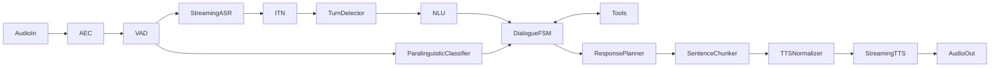

# Architecture

Turnwise is a local, full-duplex clinic receptionist. This milestone is the event bus, the audio front end, spoken-form ASR, turn-taking, spoken NLU, and the dialogue FSM with SQLite tools: typed events, bounded queues, a PCM16 WebSocket, one resample at ingress, Silero VAD, a stub ASR pool that emits `PARTIAL`/`FINAL`, rule-based ITN, a clinic-clock date resolver, a hybrid endpointer, gated barge-in, an NLU stage on `FINAL.spoken`, a table-driven dialogue machine, token-overlap FAQ (ADR-009), and a SQLite calendar. No TTS worker exists yet. The LLM client is a stub (T1.4.3 blocked). Real Zipformer and Whisper rows are `blocked` (ADR-006). `python -m evals.bench` times those workers off the call path and writes `docs/benchmarks.md` from JSON.

Design constraints are ADR-001 (the FSM owns state), ADR-002 (bounded queues and generation cancellation), ADR-003 (model choice waits on measured rows), ADR-004 (hardware tier, blocked), ADR-006 (ASR backend, blocked until finalize p50 exists), and ADR-009 (token-overlap FAQ until embeddings are measured).

## Pipeline



`ResponsePlanner` emits either a template or a grammar-constrained model proposal. The model does not write dialogue state. `ITN` produces written forms; a separate deterministic resolver, using the session clock and timezone, turns "next Tuesday" into an instant. Those two steps are not the same component.

On the server, `audio_in` resamples then forwards to `vad`, which fans out in-speech frames to `asr`, `endpoint`, and `barge`. ASR finals fan out to `endpoint`, `barge`, and `nlu`. Browser AEC is not a server stage. ITN and temporal resolution run inside the ASR stage on finals only. The NLU stage reads `FINAL.spoken`, never `normalized`, applies self-repair, and resolves `doctor` against the roster. NLU events go to `dialogue`. TTS is not built. SAY payloads are templates (and a filler flag) waiting for Phase 7.

AEC runs in the browser (`echoCancellation` on the microphone). The server does not cancel echo. `Session.request_barge_in` is a no-op unless `session.barge_in_enabled` is true, and that flag is the hello `aec` boolean from `track.getSettings()`, not the constraint the client asked for. Barge-in on speakers without that client flag is unsupported until a server AEC exists. The VAD stage does not call `request_barge_in`; the barge-in stage does, after AEC, 250 ms of speech, and a non-backchannel partial all pass.

Shared worker pools are process-wide, not one copy per call. The Silero VAD pool is built: one ONNX session, inference in a `ThreadPoolExecutor`, timeout `vad_timeout_ms` (30). The ASR pool is built as a stub until ADR-006 names weights: `asr_backend` empty refuses `AsrPool.load_real`, the process uses the stub, finish timeout `asr_finish_timeout_ms` (200), speaking sessions dequeue first. The turn-completeness scorer is a hashed-ngram linear ONNX (`from_scratch`). CPU p50 on this host is in `docs/results/phase4.md`; `turn_model_enabled` defaults true. A missing weight file is an unavailable scorer and `p_complete=0`. No ADR-007. The NLU student is the same kind of hashed-ngram linear pair (`nlu_intent.onnx`, `nlu_bio.onnx`, encoder `from_scratch`). CPU p50 is in `docs/results/phase5.md`. `nlu_model_path` defaults empty so CI loads an unavailable scorer and emits `nlu_ok=0`. Timeout `nlu_timeout_ms` (40). No ADR-008. The LLM client is `LlmClient.unavailable` until T1.4.3 unblocks; tests use a stub. TTS is not. A worker result carries the generation captured at submit time and is discarded if the session has moved on. Cancelling the session task does not stop a call already inside the worker. SQLite connections are opened per tool call in a worker thread, not on the event loop and not as a process global.

## Endpointer

`should_end_turn` is the policy. Order is locked by `tests/test_endpoint_policy.py`:

1. Empty text returns false.
2. If `expected_slot` is `phone` or `dob` and silence is under `endpoint_digit_patience_ms` (1000), return false. This runs **before** `p_complete`, so a high completeness score cannot cut a phone number.
3. Digit slots then use `endpoint_digit_hard_ms` (2000). Non-digit slots use `endpoint_hard_silence_ms` (1200). Digit slots skip the 800 ms default.
4. If `p_complete` ≥ 0.85 and silence ≥ 200 ms, return true.
5. If `p_complete` ≥ 0.5 and silence ≥ 500 ms, return true.
6. Otherwise return true when silence ≥ 800 ms on a non-digit slot.

`p_complete` is scored on the stable prefix plus `expected_slot`. A classifier timeout is `p_complete=0`; silence rules still run. Barge-in requires `barge_in_enabled`, ≥ 250 ms of speech, and a partial that `is_backchannel` rejects. `okay` is a backchannel on `none` and an answer on `confirm`. Default phrases never include `yes`. Played text is the acked prefix from `PlaybackCursor.note_chunk`, not the full SAY string. A missing map yields empty `played_text` and `turnwise_playback_unmap_total`.

## Spoken NLU

`pipeline/stages/nlu.py` consumes `FINAL` and ignores every other kind. The student scores `spoken`. Self-repair (`no`, `sorry`, `i mean`, `actually`) keeps the later span of the same slot. `doctor` is resolved with `0.6 * JaroWinkler(metaphone) + 0.4 * JaroWinkler` after stripping `dr`/`doctor`. A tie inside `phonetic_margin` or a score below `phonetic_min_score` emits candidates and no id. Timeouts and missing weights emit `nlu_ok=0`. `dialogue.regex_slots` is not imported by `server.app`. Golden slot F1 is unpublished (`docs/results/phase5.md`).

## Dialogue FSM and tools

`pipeline/stages/dialogue.py` consumes `NLU`. The table in `dialogue/transitions.toml` is the source of transitions; `dialogue/diagram.py` renders the appendix C Mermaid from that table. Named guards and actions, no `eval`. An event with no matching row returns the same state object. The LLM never writes slots or the calendar. `apply_proposal` returns the same object when a slot fails ISO / roster / phone checks. Calendar writes use `BEGIN IMMEDIATE` and idempotency key `session_id:turn_id`. A tool past 300 ms emits `SAY` with `filler=1` and does not cancel the SQLite thread. Urgent keywords (`nlp/urgent.py`) classify before intent; a `book` hypothesis cannot veto `chest pain`. FAQ retrieval is token overlap (ADR-009). Results: `docs/results/phase6.md`.

## Event schema

`pipeline.event.Event` is a frozen dataclass.

| Field | Meaning |
|---|---|
| `kind` | `audio`, `partial`, `final`, `turn_end`, `nlu`, `tool_result`, `say`, `tts_chunk`, `barge_in`, `session_end` |
| `session_id` | Opaque id. Not a name, date of birth, or phone number. |
| `turn_id` | Monotonic per session. Starts at 0. |
| `generation` | Cancellation epoch, copied from the session when the event is created. |
| `frame_index` | Shared audio clock. `None` for events that are not tied to a frame. |
| `payload` | Flat JSON scalars. Frozen. Never logged or copied onto a span. |
| `ts_monotonic` | `time.monotonic()` at creation. |

`Session.create_event` stamps the current turn and generation. `Session.next_turn` opens a turn without cancelling speech. `Session.barge_in` increments generation and turn, then cancels tasks registered with `track_speaking`. `Session.request_barge_in` is the barge-in stage hook: it calls `barge_in` only when `barge_in_enabled` is true. The barge-in stage snapshots PCM, calls that hook, then restores the interrupting frames so ASR still sees the barge utterance.

PCM16 bytes live on the session (`put_pcm` / `get_pcm` / `take_wire_pcm`), keyed by `frame_index`. `Event.payload` stays scalars (`samples=320`). Audio is never a hex dump in the payload, a log field, or a span attribute. `barge_in` drops the PCM maps so a cancelled generation cannot be scored as a new utterance. The barge-in stage restores a snapshot taken before that clear.

An event is stale when its session id or generation does not match the live session. Stale events are dropped. They are the normal barge-in path.

## Backpressure

Each stage builds an `asyncio.Queue` with `stage_queue_maxsize` (default 32). `Stage.emit` waits up to `stage_put_timeout_s` (default 0.25 seconds). On timeout it increments `turnwise_backpressure_timeouts_total` and raises `StageBackpressureError`. The producer stage fails. The queue never grows without bound and never drops the oldest item to hide a stuck consumer.

One session owns one task per stage. A slow call does not share its inbox with another call.

## Cancellation

```
producer reads session.generation
  → Event frozen with that generation
  → emit() drops a stale or foreign event, or puts it in the next inbox
  → the consumer drops the event again if generation moved while it was queued
  → a matching event gets a span, then the handler
barge_in() bumps generation and turn_id, then cancels speaking tasks
```

There is no await inside `barge_in` between the increment and the cancels, so a task that resumes sees the new generation.

`Stage.run` handles `CancelledError` by clearing the cancellation count (Python 3.11 raises again at the next await while `cancelling()` is non-zero), running the cleanup hook once, and re-raising. A handler exception is counted, logged with the bound ids, cleaned up, and re-raised. The stage task ends. A supervisor that restarts a stage is not part of this milestone; the owner closes the session.

Spans use `session_id`, `turn_id`, `generation`, `stage`, `model`, and `latency_ms`. `model` is `none` until a stage calls a model. The VAD stage sets `model` to the ONNX file name (or `unavailable` / energy fallback) and `audio_quality` to `ok`, `clipped`, or `dead`. The payload is not an attribute.

## Workers and the HTTP process

`SessionStore` lives on the ASGI app container, created in `create_app` and passed into sessions. It is not a module global. The Prometheus `CollectorRegistry` is the same kind of object: one per app, so tests can build two apps in one process. The OpenTelemetry provider is also per app. The global tracer provider is left unset.

`GET /health` and `GET /metrics` are liveness and scrape. `GET /` serves the capture client. `TURNWISE_WS_PATH` (default `/v1/audio`) is a binary WebSocket:

| Byte 0 | Body |
|---|---|
| `0x01` | uint32 LE length + UTF-8 JSON hello (`session_id`, `sample_rate_hz`, `frame_samples`, `aec`, `ns`) |
| `0x02` | uint32 LE `frame_index` + PCM16 (`sample_rate_hz * frame_ms / 1000` samples) |
| `0x03` | uint32 LE play-ack `frame_index` |
| `0x04` | close |

Hello `sample_rate_hz` must be in `ws_allowed_sample_rates` (`8000`, `16000`, `48000`). Ingress resamples once to 16 kHz / 20 ms / 320 samples (640 bytes). A PCM payload whose sample count does not match the hello rate, a `frame_index` gap larger than one skipped index (sequence `0,1,4` closes), a decreasing index, or a second hello closes the socket with code 1003. `python -m server` binds `TURNWISE_HTTP_HOST` and `TURNWISE_HTTP_PORT` (defaults `127.0.0.1:8000`). Compose sets the host to `0.0.0.0`.

`pipeline/audio/format.py` is the only resampler. Later stages must not import it. Silero wants 512 samples; the VAD stage buffers privately and does not change the 320-sample bus. If `client/prompts/headphones.pcm` is missing, the server logs `prompt_missing` and leaves barge-in disarmed when AEC is false.

OTLP export uses a bounded batch queue (`otel_max_queue_size`, default 2048). If Jaeger is down, the SDK drops spans after that queue fills and the process stays up. `otel_enabled` can turn export off; spans are still created so stages have one code path.

## Metrics

Counters are created without a `_total` suffix. Prometheus adds it on the scrape.

| Exported name | When it moves |
|---|---|
| `turnwise_stage_latency_seconds` | Handler time for an event that was not dropped. Label `stage`. |
| `turnwise_queue_depth` | Inbox size after put and after get. Label `stage`. |
| `turnwise_events_dropped_stale_total` | Generation mismatch. Label `stage`. |
| `turnwise_stage_errors_total` | Labels `stage`, `reason` (`handler`, `foreign_session`, `unknown_session`). |
| `turnwise_backpressure_timeouts_total` | Put exceeded the timeout. Label `stage`. |
| `turnwise_barge_in_total` | `Session.barge_in` ran. |
| `turnwise_ttfa_seconds` | First played frame, filler included. No observations yet. |
| `turnwise_ttfa_content_seconds` | First played non-filler frame. No observations yet. |
| `turnwise_ws_frames_total` | Accepted WebSocket protocol messages. Label `direction`. |
| `turnwise_ws_rejects_total` | Rejected WebSocket protocol messages. Label `reason`. |
| `turnwise_audio_resample_seconds` | Time to resample one ingress frame to 16 kHz. |
| `turnwise_audio_clock_gaps_total` | Client indexes that skipped one expected frame. |
| `turnwise_aec_disabled_sessions_total` | Hello reported `echoCancellation` false. |
| `turnwise_vad_prob` | Silero or energy-fallback speech probability. |
| `turnwise_vad_latency_seconds` | VAD inference including executor wait. |
| `turnwise_vad_fallback_total` | Frames scored by the energy gate instead of ONNX. |
| `turnwise_vad_hang_total` | Utterances forced idle by `vad_max_utterance_ms`. |
| `turnwise_preroll_underrun_total` | Speech starts whose pre-roll was shorter than `vad_preroll_ms`. |
| `turnwise_audio_dead_total` | Sessions closed after a silent microphone window. |
| `turnwise_audio_clipped_total` | Sessions flagged for clipping. |
| `turnwise_asr_finalize_seconds` | Time to finish one utterance decode. |
| `turnwise_asr_dropped_generation_total` | ASR hypotheses dropped after barge-in. |
| `turnwise_asr_stable_lag_seconds` | Delay from the audio event to a newly stable prefix. |
| `turnwise_hotword_updates_total` | Hotword list rebuilds when `expected_vocab_id` changes. |
| `turnwise_itn_errors_total` | ITN timeouts and exceptions that kept spoken form. |
| `turnwise_itn_seconds` | ITN wall time including executor wait. |
| `turnwise_temporal_unresolved_total` | Finals whose relative date produced no instant. |
| `turnwise_temporal_seconds` | Relative-date resolver wall time. |
| `turnwise_endpoint_decisions_total` | Endpointer hold versus end. Label `result`. |
| `turnwise_endpoint_silence_ms` | Silence at an endpointer decision, milliseconds. |
| `turnwise_turn_model_seconds` | Turn-completeness ONNX wall time. |
| `turnwise_turn_model_timeouts_total` | Turn-completeness inferences that exceeded `turn_timeout_ms`. |
| `turnwise_backchannel_ignored_total` | Barge-in candidates dropped as backchannels. |
| `turnwise_playback_unmap_total` | Barge-in with no frame-to-text map. |
| `turnwise_playback_ack_ahead_total` | Play acks ahead of any sent chunk. |
| `turnwise_cancel_latency_seconds` | `t_last outbound PCM write - t_barge_in return`. |
| `turnwise_response_gap_seconds` | `TURN_END` to first server outbound write. Not TTFA. |
| `turnwise_early_cutoff_total` | `TURN_END` labeled before the scenario last token. |
| `turnwise_false_barge_in_total` | Cancels whose fixture label is not `should_barge`. |
| `turnwise_missed_barge_in_total` | Labeled `should_barge` bursts the policy did not cancel. |
| `turnwise_nlu_seconds` | NLU student wall time including executor wait. |
| `turnwise_nlu_reject_total` | NLU timeouts and missing weights that emitted `nlu_ok=0`. |
| `turnwise_disambiguation_total` | Doctor spans that did not resolve to a single catalog id. |
| `turnwise_repair_applied_total` | Utterances where a self-repair replaced an earlier slot span. |
| `turnwise_fsm_rejects_total` | FSM events with no matching row. Label `guard`. |
| `turnwise_fsm_transitions_total` | FSM transitions. Labels `state`, `next`. |
| `turnwise_confirm_explicit_total` | Explicit confirmation prompts for a critical slot. |
| `turnwise_repair_total` | Repair asks. Label `slot`. |
| `turnwise_handoff_total` | Handoffs. Label `reason`. |
| `turnwise_llm_seconds` | LLM client wall time. Stub path unused on the live call. |
| `turnwise_llm_timeouts_total` | LLM calls that exceeded `llm_timeout_ms`. |
| `turnwise_faq_ungrounded_total` | FAQ replies with zero chunk ids. Must stay 0 on a miss. |
| `turnwise_proposal_rejects_total` | LLM proposals rejected by validators. |
| `turnwise_calendar_seconds` | Calendar tool wall time including executor wait. |
| `turnwise_calendar_conflicts_total` | Booking writes that lost the slot version. |
| `turnwise_calendar_errors_total` | Calendar open or write failures. |
| `turnwise_tool_filler_total` | Tool calls that emitted a filler SAY before completing. |
| `turnwise_tool_retries_total` | Calendar retries after timeout or `CalendarError`. |
| `turnwise_urgent_keyword_total` | Utterances that matched the deterministic urgent list. |

Logs go through structlog. `session_id`, `turn_id`, and `generation` are bound for the handler. Configured PII field names are HMAC-SHA256'd. A log key named `payload` is replaced with `omitted`. If `TURNWISE_PII_HASH_KEY` is unset, the process generates a key and logs `pii_hash_key_unset` once; hashes will not join across restarts.

## Latency budget

These are allocations of the targets in `docs/SLOs.md`, not measurements. The sum leaves 65 ms before the 700 ms P50 line. That margin is where a short localhost hop has to fit. Network RTT beyond localhost is not in the sum.

The endpoint floor is inside the user-perceived number: the agent is not allowed to answer before the turn is over.

| Stage | Target ms |
|---|---|
| Ingress frame | 20 |
| VAD | 10 |
| ASR finalize | 100 |
| ITN plus temporal resolve | 10 |
| Turn-detector compute | 10 |
| Endpoint floor | 200 |
| NLU | 30 |
| FSM | 5 |
| Planner, template | 5 |
| Chunker plus text normalization | 5 |
| TTS first chunk | 200 |
| Playout buffer | 40 |
| **Sum** | **635** |

A turn that calls the language model replaces the 5 ms template planner. The rest of the template path is 630 ms, so the model has 570 ms inside the 1200 ms P95 line to produce first content audio. That 570 ms is an allocation, not a measured time-to-first-token. Cached fillers may satisfy time-to-first-audio; they do not satisfy time-to-first-content-audio.

Browser AEC is off this server budget. If the browser adds delay, it counts against the 65 ms margin and then against the target.

## Measured stage hop

Sequential `emit` of one event into a stage whose handler returns immediately. Twenty warmup iterations, then 200 samples. The clock starts immediately before `emit` and stops when the handler begins. This is the bus, not a model.

Three consecutive runs of `tests/test_stage_overhead.py` on Python 3.11.9, Windows 10.0.26300, reported medians of **0.0825 ms**, **0.0806 ms**, and **0.0734 ms**. The test fails if a run's median reaches 5 ms. The sample starts at the `perf_counter` taken in the argument to `create_event` and stops when the handler starts; `emit` is the next statement.

Resample of one 20 ms 48 kHz frame to 16 kHz: p50 **0.1446 ms** (`docs/results/phase2.md`). Silero VAD inference p50 **0.5195 ms** after warmup on `silero_vad.onnx`. Both sit inside the 20 ms ingress and 10 ms VAD allocations.

ITN rule fallback p50 **0.0459 ms** and temporal `"next Tuesday"` p50 **0.0078 ms** (`docs/results/phase3.md`). Sum **0.0537 ms** inside the 10 ms ITN-plus-temporal allocation. NeMo did not import (`ModuleNotFoundError`).

Turn-completeness ONNX p50 **0.1425 ms** (`docs/results/phase4.md`), inside the 10 ms turn-detector allocation. Synthetic barge-in cancel latency **0.0543 ms** (TARGET 100 ms).

NLU student ONNX p50 **0.3993 ms** (`docs/results/phase5.md`), inside the 30 ms NLU allocation. No ADR-008.

No time-to-first-audio sample has been recorded. Real ASR finalize p50 is blocked (ADR-006).

## Failure policy

Every external call gets a timeout from settings. Rows without a live stage are the contract later work has to meet.

| Failure | Detection | Fallback |
|---|---|---|
| Silent or clipped mic | RMS gate over `audio_silence_window_s` | One `SESSION_END` (`audio_dead`); clip sets session quality |
| Browser AEC unavailable | Flag on the client hello | Barge-in off; headphones prompt or `prompt_missing` |
| VAD worker timeout | Two `vad_timeout_ms` failures, or missing ONNX | Energy gate; `turnwise_vad_fallback` |
| ASR timeout or confidence collapse | `asr_finish_timeout_ms`, or missing word scores | Empty spoken `asr_ok=0`; slot confidence 0.0 |
| ITN or date-resolver failure | Exception, timeout, or unresolved relative | Keep spoken, `normalized_ok=0`; `temporal_unresolved` |
| Turn-detector timeout | Timeout | Silence-only endpoint from config |
| NLU timeout or reject | Timeout or confidence | Re-prompt; handoff after the configured attempt limit |
| Illegal FSM proposal | Validator reject | Stay in the state and re-prompt |
| Tool slower than 300 ms | Timeout | Cached filler, one retry, same idempotency key |
| Slot taken between offer and confirm | Optimistic-lock conflict | Re-offer alternatives |
| Language model timeout or down | Timeout or health check | Templates only |
| Chunker holds too long | Max-hold timer | Flush a safe clause |
| Text-normalization failure on a confirmation | Exception | Generic re-prompt; do not speak the raw entity |
| TTS down | Timeout or health check | Pre-rendered phrase set |
| Client ack stalls | Ack timeout | Bump generation and stop playout |
| Paralinguistics timeout | Timeout | Score from dialogue signals only |
| Urgent keyword hit | Deterministic matcher | Escalate even if the classifier disagrees |
| Stage inbox put times out | `stage_put_timeout_s` | `StageBackpressureError`; the producer stage fails |
| Misrouted event | Session id is not the stage's id, or the session is gone | Count and drop; the stage stays up |

## Local stack

From `infra/`:

```bash
docker compose -f infra/docker-compose.yml up --build
```

That starts the app, Prometheus (port 9090), Grafana (port 3000, anonymous viewer), and Jaeger (UI 16686, OTLP gRPC 4317). The Grafana dashboard `Turnwise` is provisioned from `infra/grafana/dashboards/turnwise.json`. TTFA panels stay empty until a later stage records samples.

Settings and defaults are in `server/config.py` and `.env.example`.

## What this milestone does not do

- No TTS worker. Ingress, VAD, the ASR stub, the endpointer, gated barge-in, spoken NLU, the dialogue FSM, FAQ overlap, and SQLite bookings are live. The NLU student trains on stub-ASR text; Zipformer/Whisper weights are not pinned (ADR-006 blocked). Golden slot F1 is unpublished (`golden_incomplete`). The LLM is a stub. `regex_slots` is not on the default import path.
- No model is pinned for ASR, LLM, or TTS. ADR-003 stays Proposed. ADR-004 is blocked until those rows are `ok`.
- No session supervisor. A failed stage task stays failed until the owner closes it.
- Playback acks and `frame_index` are on the event so later stages share a clock.
- PII redaction covers configured log keys and any `payload` key. A span that later sets a raw name as an attribute would bypass it; stage code must keep using ids and `model` only. PCM must stay off the payload.
- Native Windows does not pip-install NeMo text processing. The rule fallback covers clocks, digit runs, and month names. The import error class is in `docs/results/phase3.md`.
- The hardware bench does not sit on the call path. A `blocked` or `not_present` cell is not a zero.
- Server-side AEC is a non-goal. The speaker-versus-headphones row in `docs/results/phase2.md` is `not run`.
