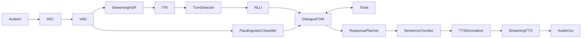

# Architecture

Turnwise is a local, full-duplex clinic receptionist. This milestone is the bus those stages will sit on: typed events, a per-call generation clock, bounded queues, and telemetry. No audio, recognizer, dialogue machine, tool, or model worker exists yet. The packages `models/`, `dialogue/`, `nlp/`, `tools/`, `evals/`, and `training/` say so in their modules.

Design constraints are ADR-001 (the FSM owns state), ADR-002 (bounded queues and generation cancellation), and ADR-003 (model choice waits on benchmarks).

## Pipeline



`ResponsePlanner` emits either a template or a grammar-constrained model proposal. The model does not write dialogue state. `ITN` produces written forms; a separate deterministic resolver, using the session clock and timezone, turns "next Tuesday" into an instant. Those two steps are not the same component.

AEC runs in the browser (`echoCancellation` on the microphone). The server does not cancel echo. Barge-in on speakers without that client flag is unsupported until a server AEC exists.

Shared worker pools (ASR, TTS, small ONNX models, the language-model client) are process-wide, not one copy per call. They are not built. When they are, a result carries the generation captured at submit time and is discarded if the session has moved on. Cancelling the session task does not stop a GPU call already inside the worker. Pool batch wait stays at a few milliseconds. The session currently being talked over is served first on the ASR pool so barge-in is not stuck behind another call's decode.

## Event schema

`pipeline.event.Event` is a frozen dataclass.

| Field | Meaning |
|---|---|
| `kind` | `audio`, `partial`, `final`, `turn_end`, `nlu`, `tool_result`, `say`, `tts_chunk`, `barge_in`, `session_end` |
| `session_id` | Opaque id. Not a name, date of birth, or phone number. |
| `turn_id` | Monotonic per session. Starts at 0. |
| `generation` | Cancellation epoch, copied from the session when the event is created. |
| `frame_index` | Shared audio clock. `None` for events that are not tied to a frame. |
| `payload` | Flat JSON scalars. Frozen. Never logged or copied onto a span. |
| `ts_monotonic` | `time.monotonic()` at creation. |

`Session.create_event` stamps the current turn and generation. `Session.next_turn` opens a turn without cancelling speech. `Session.barge_in` increments generation and turn, then cancels tasks registered with `track_speaking`.

An event is stale when its session id or generation does not match the live session. Stale events are dropped. They are the normal barge-in path.

## Backpressure

Each stage builds an `asyncio.Queue` with `stage_queue_maxsize` (default 32). `Stage.emit` waits up to `stage_put_timeout_s` (default 0.25 seconds). On timeout it increments `turnwise_backpressure_timeouts_total` and raises `StageBackpressureError`. The producer stage fails. The queue never grows without bound and never drops the oldest item to hide a stuck consumer.

One session owns one task per stage. A slow call does not share its inbox with another call.

## Cancellation

```
producer reads session.generation
  → Event frozen with that generation
  → emit() drops a stale or foreign event, or puts it in the next inbox
  → the consumer drops the event again if generation moved while it was queued
  → a matching event gets a span, then the handler
barge_in() bumps generation and turn_id, then cancels speaking tasks
```

There is no await inside `barge_in` between the increment and the cancels, so a task that resumes sees the new generation.

`Stage.run` handles `CancelledError` by clearing the cancellation count (Python 3.11 raises again at the next await while `cancelling()` is non-zero), running the cleanup hook once, and re-raising. A handler exception is counted, logged with the bound ids, cleaned up, and re-raised. The stage task ends. A supervisor that restarts a stage is not part of this milestone; the owner closes the session.

Spans use `session_id`, `turn_id`, `generation`, `stage`, `model`, and `latency_ms`. `model` is `none` until a stage calls a model. The payload is not an attribute.

## Workers and the HTTP process

`SessionStore` lives on the ASGI app container, created in `create_app` and passed into sessions. It is not a module global. The Prometheus `CollectorRegistry` is the same kind of object: one per app, so tests can build two apps in one process. The OpenTelemetry provider is also per app. The global tracer provider is left unset.

`GET /health` and `GET /metrics` are liveness and scrape. `GET /` serves the capture client. `TURNWISE_WS_PATH` (default `/v1/audio`) is a binary WebSocket:

| Byte 0 | Body |
|---|---|
| `0x01` | uint32 LE length + UTF-8 JSON hello (`session_id`, `sample_rate_hz`, `frame_samples`, `aec`, `ns`) |
| `0x02` | uint32 LE `frame_index` + PCM16 (640 bytes at 16 kHz / 20 ms) |
| `0x03` | uint32 LE play-ack `frame_index` |
| `0x04` | close |

A hello whose rate is not 16 kHz, a PCM payload that is not 640 bytes, a decreasing `frame_index`, or a second hello closes the socket with code 1003. `python -m server` binds `TURNWISE_HTTP_HOST` and `TURNWISE_HTTP_PORT` (defaults `127.0.0.1:8000`). Compose sets the host to `0.0.0.0`.

OTLP export uses a bounded batch queue (`otel_max_queue_size`, default 2048). If Jaeger is down, the SDK drops spans after that queue fills and the process stays up. `otel_enabled` can turn export off; spans are still created so stages have one code path.

## Metrics

Counters are created without a `_total` suffix. Prometheus adds it on the scrape.

| Exported name | When it moves |
|---|---|
| `turnwise_stage_latency_seconds` | Handler time for an event that was not dropped. Label `stage`. |
| `turnwise_queue_depth` | Inbox size after put and after get. Label `stage`. |
| `turnwise_events_dropped_stale_total` | Generation mismatch. Label `stage`. |
| `turnwise_stage_errors_total` | Labels `stage`, `reason` (`handler`, `foreign_session`, `unknown_session`). |
| `turnwise_backpressure_timeouts_total` | Put exceeded the timeout. Label `stage`. |
| `turnwise_barge_in_total` | `Session.barge_in` ran. |
| `turnwise_ttfa_seconds` | First played frame, filler included. No observations yet. |
| `turnwise_ttfa_content_seconds` | First played non-filler frame. No observations yet. |
| `turnwise_ws_frames_total` | Accepted WebSocket protocol messages. Label `direction`. |
| `turnwise_ws_rejects_total` | Rejected WebSocket protocol messages. Label `reason`. |

Logs go through structlog. `session_id`, `turn_id`, and `generation` are bound for the handler. Configured PII field names are HMAC-SHA256'd. A log key named `payload` is replaced with `omitted`. If `TURNWISE_PII_HASH_KEY` is unset, the process generates a key and logs `pii_hash_key_unset` once; hashes will not join across restarts.

## Latency budget

These are allocations of the targets in `docs/SLOs.md`, not measurements. The sum leaves 65 ms before the 700 ms P50 line. That margin is where a short localhost hop has to fit. Network RTT beyond localhost is not in the sum.

The endpoint floor is inside the user-perceived number: the agent is not allowed to answer before the turn is over.

| Stage | Target ms |
|---|---|
| Ingress frame | 20 |
| VAD | 10 |
| ASR finalize | 100 |
| ITN plus temporal resolve | 10 |
| Turn-detector compute | 10 |
| Endpoint floor | 200 |
| NLU | 30 |
| FSM | 5 |
| Planner, template | 5 |
| Chunker plus text normalization | 5 |
| TTS first chunk | 200 |
| Playout buffer | 40 |
| **Sum** | **635** |

A turn that calls the language model replaces the 5 ms template planner. The rest of the template path is 630 ms, so the model has 570 ms inside the 1200 ms P95 line to produce first content audio. That 570 ms is an allocation, not a measured time-to-first-token. Cached fillers may satisfy time-to-first-audio; they do not satisfy time-to-first-content-audio.

Browser AEC is off this server budget. If the browser adds delay, it counts against the 65 ms margin and then against the target.

## Measured stage hop

Sequential `emit` of one event into a stage whose handler returns immediately. Twenty warmup iterations, then 200 samples. The clock starts immediately before `emit` and stops when the handler begins. This is the bus, not a model.

Three consecutive runs of `tests/test_stage_overhead.py` on Python 3.11.9, Windows 10.0.26300, reported medians of **0.0825 ms**, **0.0806 ms**, and **0.0734 ms**. The test fails if a run's median reaches 5 ms. The sample starts at the `perf_counter` taken in the argument to `create_event` and stops when the handler starts; `emit` is the next statement.

No time-to-first-audio sample has been recorded.

## Failure policy

Stages below are not implemented. The detection and fallback are the contract they have to meet. Every external call gets a timeout from settings.

| Failure | Detection | Fallback |
|---|---|---|
| Silent or clipped mic | RMS gate over a configured window | Tell the caller and end the session |
| Browser AEC unavailable | Flag on the client hello | Barge-in off; headphones required |
| VAD worker timeout | Per-call timeout | Hard silence ceiling only |
| ASR timeout or confidence collapse | Timeout, then a low-confidence streak | Offer a callback or a human |
| ITN or date-resolver failure | Exception, or an unresolved relative date | Keep the spoken form and re-ask critical slots |
| Turn-detector timeout | Timeout | Silence-only endpoint from config |
| NLU timeout or reject | Timeout or confidence | Re-prompt; handoff after the configured attempt limit |
| Illegal FSM proposal | Validator reject | Stay in the state and re-prompt |
| Tool slower than 300 ms | Timeout | Cached filler, one retry, same idempotency key |
| Slot taken between offer and confirm | Optimistic-lock conflict | Re-offer alternatives |
| Language model timeout or down | Timeout or health check | Templates only |
| Chunker holds too long | Max-hold timer | Flush a safe clause |
| Text-normalization failure on a confirmation | Exception | Generic re-prompt; do not speak the raw entity |
| TTS down | Timeout or health check | Pre-rendered phrase set |
| Client ack stalls | Ack timeout | Bump generation and stop playout |
| Paralinguistics timeout | Timeout | Score from dialogue signals only |
| Urgent keyword hit | Deterministic matcher | Escalate even if the classifier disagrees |
| Stage inbox put times out | `stage_put_timeout_s` | `StageBackpressureError`; the producer stage fails |
| Misrouted event | Session id is not the stage's id, or the session is gone | Count and drop; the stage stays up |

## Local stack

From `infra/`:

```bash
docker compose -f infra/docker-compose.yml up --build
```

That starts the app, Prometheus (port 9090), Grafana (port 3000, anonymous viewer), and Jaeger (UI 16686, OTLP gRPC 4317). The Grafana dashboard `Turnwise` is provisioned from `infra/grafana/dashboards/turnwise.json`. TTFA panels stay empty until a later stage records samples.

Settings and defaults are in `server/config.py` and `.env.example`.

## What this milestone does not do

- No WebSocket, audio, VAD, ASR, NLU, FSM, tools, or TTS.
- No model is pinned. ADR-003 stays Proposed until `docs/benchmarks.md` exists.
- No session supervisor. A failed stage task stays failed until the owner closes it.
- Playback acks and `frame_index` are on the event so later stages share a clock. Nothing fills them from a microphone yet.
- PII redaction covers configured log keys and any `payload` key. A span that later sets a raw name as an attribute would bypass it; stage code must keep using ids and `model` only.
- Native Windows does not pip-install NeMo text processing. That dependency is not in this milestone.
