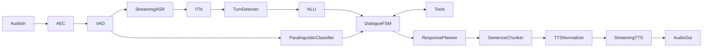
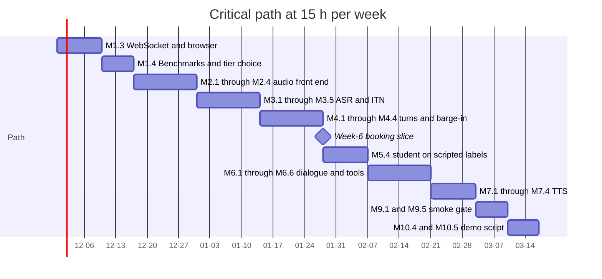

# Turnwise execution plan

This file is the program contract for the ten phases in `docs/plan/01_phase_foundation.md` through `docs/plan/10_phase_hardening_launch.md`. Catalogs, formulas, and the master task index live in `docs/plan/11_appendices.md`. Binding constraints already in the repo are `.cursor/rules/turnwise.mdc`, `docs/ARCHITECTURE.md`, `docs/SLOs.md`, and ADR-001, ADR-002, and ADR-003. Where this plan names a file that already exists, the task is marked `landed` and the acceptance criterion is the test that already passes. Where it names a file that does not exist, the task is `forward`.

No latency or accuracy figure in this plan is a measurement unless it cites a test that has already been run. The only such figure today is the in-process stage hop in `docs/ARCHITECTURE.md`: three runs of `tests/test_stage_overhead.py` on Python 3.11.9, Windows 10.0.26300, medians 0.0825 ms, 0.0806 ms, and 0.0734 ms. Every product SLO is a TARGET and is unmet.

## Executive summary

Turnwise is a fully local, full-duplex clinic receptionist. It books, reschedules, and cancels appointments, answers clinic FAQs from retrieved documents, and escalates urgent symptoms and repeated repair failure to a human. Speech recognition, a small encoder for intents and slots, and speech synthesis sit on the hot path. A language model is allowed to paraphrase a template, answer a grounded FAQ, or propose a structured `(intent, slots)` object. It does not own dialogue state, dates, availability, booking writes, or urgency.

The runtime is one asyncio task per stage per call, connected by bounded queues. Every event carries `session_id`, `turn_id`, and `generation`. Barge-in increments generation and turn, cancels speaking tasks, and causes later stages to drop stale events. Model workers are process-wide pools. A worker result is discarded when the session generation has moved since the job was submitted. `task.cancel()` does not abort an in-flight GPU call.

The forward schedule at 15 hours a week is 15 weeks and 225 hours. The task table sums to more than that because the 500-example hand review and the full 900-call matrix are included at their real size. The Gantt below is the 225-hour critical path. Tasks tagged `slip` in the phase files are the first to move past week 15 if the week slips. They are not optional for the SLO gates. They are optional for a week-15 demo that still has a database-checked booking, a barge-in, a noisy name, and an urgent escalation.

## Problem statement

A clinic phone agent fails in ways a text chatbot does not. The recognizer rewrites "Dr. Khan" as "Dr. Con". The caller says "Tuesday — no, Wednesday" and a bag-of-words NLU keeps Tuesday. A fixed silence timeout either cuts a phone number into pieces or waits so long the call feels dead. The agent talks over the caller because the microphone still contains the agent's own voice. A language model asked to "just book it" invents a slot that the database then stores. Evaluating on clean transcripts reports a slot F1 the audio path will never see.

The product has to act on audio, keep a deterministic belief about the appointment, and show the latency the caller hears: time from the end of their speech to the first frame that actually played, not tokens per second.

## Goals

1. Time to first played audio TARGET P50 ≤ 700 ms and P95 ≤ 1200 ms on the hardware tier chosen in T1.4.5, measured on localhost, filler included. Time to first content audio is recorded separately and has no numeric target until T9.4.1.
2. Task success TARGET ≥ 90% on clean audio and ≥ 75% at 10 dB SNR, judged by the database row, not by a model.
3. False barge-in TARGET < 2% of agent utterances. Early cutoff TARGET < 5% of user turns.
4. Urgent-case recall TARGET ~100% with the keyword path alone sufficient. False urgent escalation is reported and has no numeric cap in this plan.
5. Critical-slot error after confirmation TARGET ~0%, defined as confirmed value versus the scenario value. A yes to a wrong readback is a failure.
6. FAQ answers that are not grounded in a retrieved chunk are refusals. Hallucination rate is a reported gate with TARGET 0 on the FAQ scenario set once M9.3 exists. Until that set exists the target is the definition, not a measured rate.
7. Slot F1 is computed on recognizer output. No numeric gate until the golden set from M5.3 exists. The phase 5 exit writes the measured F1 into `docs/results/phase5.md` and does not invent it here.
8. $0 to run after the hardware the operator already owns. No hosted speech or model API on the default path.

## Explicit non-goals

- HIPAA certification, a signed BAA, or a claim of compliance. Phase 10 documents the obligations and the controls that were built.
- Server-side acoustic echo cancellation. The browser sets `echoCancellation`. A missing client flag disables barge-in and tells the caller to use headphones.
- Multilingual recognition, outbound dialing, payments, insurance eligibility, and prescribing.
- One model instance per call. Pools are process-wide.
- Letting the language model choose the next dialogue state, resolve "next Tuesday", check the calendar, write a booking, or decide urgency.
- Regex extraction of intents from free-form model prose. Structured model output is grammar-constrained.
- Training NLU on clean text and reporting that number as the production number.
- A 900-call real-time suite described as an overnight job. Functional calls use a virtual clock. A smaller real-time set measures barge-in and time-to-first-audio.
- Pinning sherpa-onnx, NeMo, Kokoro, Piper, or a GGUF build by version in this document. T1.4.2 through T1.4.4 record the versions that were actually downloaded. Until those tasks finish, every version string is VERIFY AT PHASE 1 BENCHMARK.

## SLO table

Formulas are the ones in appendix E. "Phase" is the phase that first emits the metric. The gate is phase 9 for task and safety rates, and phase 7 plus phase 4 for the latency histograms. Status of every row is unmet.

| Metric | Definition | Formula | Target | Measurement | Phase |
|---|---|---|---|---|---|
| TTFA P50 | End of user speech (VAD endpoint) to client ack of the first played frame. Filler counts. | p50 of `turnwise_ttfa_seconds` | ≤ 700 ms | Histogram on localhost. Not socket-write time. | 7 records, 9 gates |
| TTFA P95 | Same clock as P50. | p95 of `turnwise_ttfa_seconds` | ≤ 1200 ms | Same histogram. | 7 records, 9 gates |
| TTFA content P50 | Same clock, frames whose phrase is in the filler set ignored. | p50 of `turnwise_ttfa_content_seconds` | No numeric target | Separate histogram so a filler cannot pass the 700 ms line alone. | 7 |
| Task success, clean | Database matches the scenario goal. | successes / finished clean scenarios | ≥ 90% | `evals/judge_db.py` | 9 |
| Task success, 10 dB SNR | Same, noise mixed at 10 dB SNR. | successes / finished 10 dB scenarios | ≥ 75% | Same judge, SNR label from the scenario. | 9 |
| False barge-in | Agent utterance cancelled without the caller taking the turn. | false cancels / agent utterances | < 2% | Playback cursor plus backchannel labels. | 4 defines, 9 reports |
| Early cutoff | Reply started before the scenario's user turn was complete. | early ends / user turns | < 5% | Virtual-clock and real-time sets, labeled separately. | 4 defines, 9 reports |
| Slot F1 on ASR output | Slot spans on recognizer text, not the clean script. | micro-F1 over BIO on ASR hypotheses | Report only until M5.3; then the phase 5 doc sets the regression bar from the measured number | Golden set, recognizer column only. | 5 |
| Urgent-case recall | Urgent scenarios that entered `URGENT`. | escalated urgent / urgent scenarios | ~100% | Keyword path tested with the classifier disabled. | 6 implements, 9 reports |
| Critical-slot error after confirmation | Confirmed value ≠ scenario value. | mismatches / confirmed critical slots | ~0% | Includes yes-to-wrong-readback. | 6 implements, 9 reports |
| False urgent escalation | Non-urgent scenarios that entered `URGENT`. | false escalations / non-urgent scenarios | Report only | Past-tense chest pain is expected to fire. | 6, 9 |
| FAQ hallucination rate | FAQ replies with no retrieved chunk, or a citation that does not contain the claim. | bad replies / FAQ replies | TARGET 0 on the FAQ set | Retrieval ids logged on the span. | 6 implements, 9 reports |

## Architecture

AEC is in the browser. ITN does not resolve relative dates. A second deterministic step, `nlp/temporal.py`, uses the session clock and `clinic_timezone`. The paralinguistic branch is advisory. The keyword matcher in `nlp/urgent.py` escalates even when that branch is down or disagrees.

### Event schema

`pipeline.event.Event` is a frozen dataclass. Payload values are `str | int | float | bool | None`, stored in a `MappingProxyType`. `session_id` is an opaque UUID. `frame_index` is the shared 16 kHz frame clock, or `None` when the event is not tied to a frame. `generation` is copied from the session at `Session.create_event`. Consumers drop the event when `event.generation != session.generation` or the session id is not the stage's id.

Kinds already in code: `audio`, `partial`, `final`, `turn_end`, `nlu`, `tool_result`, `say`, `tts_chunk`, `barge_in`, `session_end`. Appendix B adds the payload fields each kind gains per phase. New kinds are not added. New facts go in `payload`.

### Cancellation

`Session.barge_in` increments `generation` and `turn_id`, copies the speaking-task set, clears it, then cancels those tasks. There is no await between the increment and the cancels. `next_turn` increments `turn_id` only, for a clean handoff when the agent finished and the caller starts a new turn.

`Stage.emit` drops a stale event before the put. The consumer drops it again if generation moved while the event sat in the queue. A foreign session id increments `turnwise_stage_errors_total{reason="foreign_session"}` and is dropped. The stage stays up. A rising foreign count is a routing bug, not a reason to kill the call.

Speaking tasks are the language-model stream, TTS synthesis, and audio send, registered with `track_speaking`. Stage tasks are not speaking tasks. Barge-in must not cancel the VAD or ASR stage, or the caller's interruption has no consumer. Worker submits capture generation at submit time. The pool drops the result on mismatch. This is required by ADR-002 and is not implemented until T3.1.1 and T7.4.1.

Python 3.11 re-raises `CancelledError` at the next await while `Task.cancelling()` is non-zero. `Stage.run` uncancels, runs the cleanup hook once, then re-raises. That behavior is already tested in `tests/test_stage.py`.

### Backpressure

Each stage inbox is an `asyncio.Queue` with `stage_queue_maxsize` default 32. `emit` waits at most `stage_put_timeout_s` default 0.25 s. Timeout increments `turnwise_backpressure_timeouts_total` and raises `StageBackpressureError`. The producer stage fails. The queue does not drop the oldest event. One session does not share an inbox with another session.

Pool batch wait, when pools exist, is a separate setting `worker_batch_wait_ms` default 2. Filling a batch to raise throughput is rejected by the TTFA budget. The session whose agent is currently speaking gets ASR priority so barge-in audio is not stuck behind another call.

### Worker pools

| Pool | Owners | Isolation |
|---|---|---|
| ASR | one streaming recognizer per call inside a process-wide pool of recognizer slots | generation stamped at `start_stream` |
| ONNX | turn classifier, NLU student, optional emotion model | one session per `run` call, timeout from settings |
| LLM | llama.cpp or the binary T1.4.3 actually measured | grammar on every structured call, prefix cache for the system prompt |
| TTS | Kokoro or Piper, device chosen in T7.4.4 | phrase cache is outside the pool |

No pool is constructed in the foundation milestone. `models/__init__.py` states that.

### Who decides

| Component | Decides | Does not decide |
|---|---|---|
| VAD | speech start, hangover | turn completeness |
| ASR | token sequence, word confidence, hotword application | intent, dates, bookings |
| ITN | written form of finals | "next Tuesday", timezone |
| Temporal resolver | absolute instants from the session clock | whether that instant is free |
| Turn classifier | `p_complete` | the endpoint by itself; the policy function does |
| NLU student | intent and BIO spans on ASR text | state transitions |
| Phonetic matcher | closed-set id or a disambiguation list | open-set patient names; those are confirmed, not catalog-matched |
| FSM | state, next question, confirm versus re-ask, handoff | prose wording beyond the template id |
| Urgent keywords | escalation | nothing else may veto it |
| Calendar tool | availability and the write | the caller's intent |
| LLM | paraphrase under a length cap, FAQ answer with citations, a proposal object | state, dates, availability, writes, urgency |
| Emotion model | calm / frustrated / distressed probabilities | escalation; the policy function does, and dialogue signals still run if the model times out |
| Soft judge | politeness and clarity scores | task success |

## Local stack

Versions are not facts. The cell VERIFY AT PHASE 1 BENCHMARK means T1.4.2, T1.4.3, or T1.4.4 writes the version into `docs/benchmarks.md` after a run on the operator's machine.

| Layer | Primary candidate | Alternative | Selection criterion |
|---|---|---|---|
| Transport | WebSocket, PCM16, 16 kHz, 20 ms frames | WebRTC via `aiortc` | WS first. WebRTC only if browser AEC cannot be turned on without it. |
| AEC / NS | Browser `echoCancellation` and `noiseSuppression` | Server AEC later | No server AEC in this program. Missing flag disables barge-in. |
| VAD | Silero ONNX, VERIFY AT PHASE 1 BENCHMARK | WebRTC VAD | Silero if the noise test in T2.3.4 shows fewer false starts than the energy gate. Energy gate remains the timeout fallback. |
| Streaming ASR | sherpa-onnx streaming Zipformer, VERIFY AT PHASE 1 BENCHMARK | faster-whisper plus LocalAgreement-2 | Zipformer if finalize latency fits the 100 ms budget. Whisper only if entity WER on the name list is materially better and the stabilization delay is published. Hotwords must work in the pinned build, not only in the README. |
| ITN | `nemo_text_processing` WFST, VERIFY AT PHASE 1 BENCHMARK | Hand-written rules for dates, times, phones | NeMo if it imports in the Linux or WSL2 environment. Native Windows pip is unsupported because of Pynini. Rules ship anyway for the temporal resolver's input normalization when NeMo is absent. |
| Dates | Deterministic resolver in `nlp/temporal.py` | None | The LLM is forbidden. |
| Turn detector | Small encoder, ONNX INT8, trained in M4.2 | A published turn model, compared in T4.2.4 | Own model if CPU p50 is under the 10 ms TARGET on the bench host. Otherwise document the miss and keep the silence policy. |
| NLU | Encoder student, ONNX INT8 | LLM plus GBNF as a fallback proposal only | Student on the hot path. LLM only when the student rejects or the intent is `out_of_scope`. |
| LLM | llama.cpp server, 3B–8B instruct, Q4 or Q5, VERIFY AT PHASE 1 BENCHMARK | Ollama if the bench shows equal TTFT | Grammar-constrained. Prefix cache for the system prompt. |
| TTS | Kokoro, VERIFY AT PHASE 1 BENCHMARK | Piper | CPU if T7.4.4 shows first-chunk p50 inside 200 ms. GPU only if CPU misses and the contention test in M10.2 still meets TTFA P95. |
| Emotion | emotion2vec or a wav2vec2 fine-tune, chosen in T8.1.2 by validation macro-F1 on a held-out acted set | Dialogue signals only | Acted-set F1 does not transfer. M8.4 publishes the calibration curve. Dialogue signals are the fallback, not a second place. |
| Store | SQLite | Postgres | SQLite with `BEGIN IMMEDIATE`. Postgres is out of scope. |
| Traces | OpenTelemetry to Jaeger | none | Already bootstrapped. Global tracer provider stays unset. |
| Metrics | Prometheus and Grafana | none | Registry is per app, not the process default. |

## Hardware tiers

T1.4.5 records which tier the operator's machine is. The plan does not assume a GPU.

| Tier | ASR | LLM | TTS | What changes |
|---|---|---|---|---|
| CPU-only | streaming Zipformer INT8, pool size 1 | 3B Q4 if TTFT fits the 570 ms P95 remainder, else templates only and the LLM tier is recorded as unavailable | Piper or Kokoro on CPU, whichever T7.4.4 measures inside 200 ms first-chunk p50 | Emotion model stays off the hot path. NLU and turn models are INT8 ONNX. |
| 8 GB VRAM | Zipformer on CPU so the GPU is free for the LLM | 7B–8B Q4 or Q5, one slot, batch wait 2 ms | TTS pinned to CPU | If TTFA P95 breaks under two concurrent calls in M10.2, drop to the 3B model before moving TTS onto the GPU. |
| 16 GB+ VRAM | Zipformer still on CPU unless T3.2.2 shows a GPU build with lower finalize time and equal entity WER | 8B Q5, prefix cache | TTS may use the GPU only after the contention matrix says P95 still meets 1200 ms | Emotion model may use the GPU off the speech-to-speech critical path, one utterance at a time, with the timeout in `emotion_timeout_ms`. |

## Repo layout

| Path | Purpose |
|---|---|
| `server/` | ASGI app, settings, logging, tracing, WebSocket, playback acks, degradation. |
| `pipeline/` | Event, session, stage runtime, and one module per stage. |
| `pipeline/audio/` | Resample, frame clock, pre-roll, quality. |
| `models/` | Pool clients. No weights in git. |
| `dialogue/` | FSM table, slots, validators, confirmation, repair, planner. |
| `nlp/` | ITN, temporal resolver, hotwords, chunker, TN, phonetic match, disfluency, urgent keywords. |
| `tools/` | SQLite calendar and FAQ retrieval. |
| `evals/` | Benchmarks, simulator, judges, ablations, load. |
| `training/` | Turn detector, NLU distillation, emotion fine-tune. Data sets are gitignored except the golden schema and a tiny fixture. |
| `client/` | Browser capture and playback. |
| `infra/` | Compose, Prometheus, Grafana, Jaeger. |
| `tests/` | Unit and integration tests. |
| `docs/` | Architecture, SLOs, ADRs, this plan, `docs/results/phaseN.md` written by tasks. |
| `docs/adr/` | Decision records. |
| `scripts/` | Model download. |

## Engineering conventions

Python 3.11 or newer. `mypy --strict` and `ruff` clean on CI. Public data is a `dataclass(slots=True)` or a pydantic model. Stages take handlers and pools by constructor injection. No `print`. structlog with `session_id`, `turn_id`, and `generation` bound around `handle`. No payload on a span. PII field names in `pii_fields` are HMAC-SHA256. An unset `pii_hash_key` generates a process-local key and logs `pii_hash_key_unset` once.

Async tasks catch `CancelledError`, clean up once, and re-raise. No bare `except`. No unbounded queue. No unbounded retry: calendar writes retry once with the same idempotency key. Sync inference and sync database calls run in an executor or inside the pool process, not on the event loop.

Thresholds and paths live in `server/config.py` with the `TURNWISE_` prefix. Starting-point thresholds are labeled STARTING POINT in appendix A and are illegal to treat as tuned until the task that sweeps them has written `docs/results/`.

Definition of done for a forward task: implementation without a stub, the named tests including the failure path, metrics wired, config key added, `docs/results/phaseN.md` updated when the task produces a number, and an ADR when the task chooses between two designs.

## Latency budget

Allocations, not measurements, except the stage-hop row. Sum 635 ms. Margin to the 700 ms P50 line is 65 ms for a short localhost hop. The endpoint floor is inside the caller's perceived wait.

| Stage | Allocation ms | Owner task |
|---|---|---|
| Ingress frame | 20 | T1.3.3 |
| VAD | 10 | T2.3.2 |
| ASR finalize | 100 | T3.1.2 |
| ITN plus temporal resolve | 10 | T3.4.1, T3.5.1 |
| Turn-detector compute | 10 | T4.2.4 |
| Endpoint floor | 200 | T4.1.1 |
| NLU | 30 | T5.4.3 |
| FSM | 5 | T6.1.1 |
| Planner, template | 5 | T7.1.1 |
| Chunker plus TN | 5 | T7.2.1, T7.3.1 |
| TTS first chunk | 200 | T7.4.2 |
| Playout buffer | 40 | T7.4.2 |
| Stage hop, measured | 0.07–0.08 ms median, three runs | `tests/test_stage_overhead.py` |

A language-model turn replaces the 5 ms planner. The other template stages sum to 630 ms, leaving 570 ms inside the 1200 ms P95 line. That 570 ms is an allocation. T1.4.3 measures TTFT and does not declare the allocation met.

## Risk register

| Risk | Likelihood | Impact | Mitigation | Phase | Trigger |
|---|---|---|---|---|---|
| Zipformer entity WER misses clinic names | High | Callers cannot book a named doctor | State-dependent hotwords plus phonetic catalog match. Publish the ablation. | 3, 5 | Entity WER with bias still above the clean-name fixture in T3.3.3 |
| Whisper stabilization delay blows the 100 ms finalize budget | High | TTFA P50 missed | Keep Zipformer as the default if T3.2.2 says so. Do not ship LA-2 on the hot path. | 3 | Median stabilization delay above 100 ms |
| NeMo will not import on native Windows | High | ITN task blocks | Run ITN in WSL2 or the Compose image. Ship the rule subset for phones and clock times. | 3 | Import error recorded in T3.4.1 |
| Browser AEC off, barge-in fires on speaker echo | High | False barge-in over 2% | Client hello flag. Barge-in disabled without it. | 2, 4 | `aec` false on the hello, or false-barge rate on the speaker fixture |
| Endpoint `p_complete` cuts phone numbers | Medium | Early cutoff over 5% | Digit-slot patience runs before the probability branch. | 4 | Fixture "555 0100" with internal pauses ends before 10 digits |
| Student NLU trained on clean text | Medium | Slot F1 collapses at 10 dB | Training rows are TTS then MUSAN then ASR. Clean-text training is an ablation, not the default. | 5 | Ablation gap in T9.5.3 |
| LLM writes a booking | Medium | Double book or a hallucinated row | FSM is the only writer. Proposal tests reject state, date math, and writes. | 6 | Any test where a proposal string changes SQLite without the tool |
| Yes to a wrong readback | Medium | Critical-slot error | Read back spelled names and digit strings. Yes binds the played string, compared to the scenario. | 6, 9 | Scenario with a forced ASR substitution |
| Acted emotion does not match callers | High | Useless escalation | Dialogue-signal fallback. Publish the curve. Do not block launch on emotion F1. | 8 | Calibration slope near zero on the held-out call set |
| 900 real-time calls cannot finish overnight | High | Eval never runs | Virtual clock for the matrix. Real-time subset capped at 30 calls. | 9 | Wall clock of one real-time call times the subset size |
| GPU contention between LLM and TTS | Medium | P95 over 1200 ms past one call | TTS on CPU first. Measure three strategies in M10.2. | 10 | P95 break at concurrency 2 |
| SQLite write lock under concurrent bookings | Low | Failed writes | `BEGIN IMMEDIATE`, idempotency key, one retry. Load test reports the knee. | 6, 10 | `database is locked` in the load log |
| PII in traces | Medium | Log leak | Payload omitted. Field hash. Review of span attributes in T10.3.3 | 10 | A test finds `patient_name` plaintext in an exported span |
| Hand review of 500 rows slips the calendar | High | NLU gate has no truth | Split into four 125-row tasks. Smoke eval uses the scripted caller before the golden set is done. | 5 | T5.3.2 unfinished at the start of week 8 |

## Timeline

Available time is 15 hours a week for 15 weeks, 225 hours. Landed foundation work is not in that budget. Forward critical path below is the week-15 demo. Slip tasks (golden-set rows 251–500, full 900-call matrix, emotion training, blog post) move first. Their hours still count in appendix K.

The week-6 slice, at the milestone `m1`, is silence endpointing, a deterministic slot matcher that phase 5 removes from the default path, templates, and one SQLite book with ten scripted database checks. That matcher is task T6.1.6 inside phase 6's first milestone, started early, and deleted from the default path by T5.4.3. It does not parse model prose.

Critical path order: T1.3.1 → T1.3.5 → T1.4.1 → T1.4.5 → T2.1.1 → T2.3.4 → T3.1.1 → T3.2.2 → T3.5.3 → T4.1.3 → T4.3.4 → T6.4.4 → T7.4.5 → T9.5.6 → T10.5.3. A slip of T3.2.2 blocks the stack choice and is the path's single longest research task. If the bench host is CPU-only and Zipformer finalize p50 is inside 100 ms, T3.2.1 (LocalAgreement) stays in the repo as the ablation and leaves the default path the same day.
