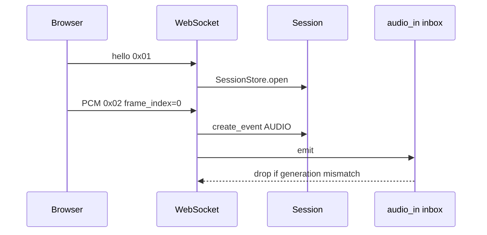

# Phase 1 — Foundation and benchmarking

## 1.0 Overview

This phase finishes the process skeleton and measures the machines the later phases will run on. The event bus, settings, tracing, metrics, CI, and the Compose observability stack are already in the tree. They stay in the plan so the acceptance tests have an owner. What is not in the tree is the WebSocket audio path, the browser client, and `docs/benchmarks.md`.

For the product, nothing else can be timed until a 20 ms PCM frame can enter a session and a benchmark has named the hardware tier. For a senior portfolio, the bus is the artifact that shows cancellation and backpressure as code rather than a diagram. The benchmark file is the artifact that shows model choice as a measurement rather than a preference.

## 1.1 Entry criteria

- The repo builds with `uv sync` on Python 3.11.
- `tests/test_stage.py`, `tests/test_session.py`, `tests/test_backpressure.py`, and `tests/test_stage_overhead.py` pass. Those tests are the exit evidence for M1.1 and M1.2.
- No model weight is committed.

## 1.2 Architecture and design

M1.1 and M1.2 do not add a new runtime. M1.3 adds a WebSocket that emits `EventKind.AUDIO` into a per-session `Stage` named `audio_in`. M1.4 adds a benchmark driver that imports pool protocols and records wall time. It does not sit on the call path.

```python
class AudioHello(BaseModel):
    session_id: str
    sample_rate_hz: int
    frame_samples: int
    aec: bool
    ns: bool

class PcmFrame(BaseModel):
    frame_index: int
    pcm16: bytes
```

The wire format is binary, not JSON audio. Byte 0 is the message type: `0x01` hello JSON (UTF-8, length in bytes 1–4 little-endian), `0x02` one PCM frame, `0x03` client playback ack, `0x04` close. A PCM frame body is `frame_index` as uint32 little-endian followed by exactly `frame_samples * 2` bytes. At 16 kHz and 20 ms, `frame_samples` is 320 and the PCM payload is 640 bytes. Anything else closes the socket with code 1003.

```python
async def audio_in_handler(event: Event) -> None:
    ...
```

The handler does not resample. Resample is phase 2. Phase 1 rejects a hello whose `sample_rate_hz` is not 16000.



Config keys introduced here, defaults in parentheses: `ws_path` (`/v1/audio`), `ws_sample_rate_hz` (16000), `ws_frame_ms` (20), `ws_max_sessions` (8). Existing keys stay as in `server/config.py`: `stage_queue_maxsize` 32, `stage_put_timeout_s` 0.25, `otel_endpoint` `http://localhost:4317`, `pii_fields` the name, dob, and phone list.

## 1.3 Milestones

### M1.1 Tooling, typed config, CI, logging, tracing, metrics

Goal: one process that lints, typechecks, tests, and exposes `/health` and `/metrics`.
Demo-able outcome: `uv run pytest` is green and `GET /metrics` lists the TTFA histograms at count 0.

| Task | Description | Files | Depends on | Hours | Status | Acceptance |
|---|---|---|---|---|---|---|
| T1.1.1 | uv project, ruff, mypy strict, pytest-asyncio | `pyproject.toml` | none | 3 | landed | `uv run ruff check .` and `uv run mypy server pipeline tests` exit 0 |
| T1.1.2 | Frozen pydantic settings, `TURNWISE_` prefix, blank PII key becomes unset | `server/config.py`, `.env.example` | T1.1.1 | 3 | landed | `tests/test_config.py` rejects port 0, queue 0, and a bad log level |
| T1.1.3 | structlog plus HMAC redaction; payload key omitted | `server/log_setup.py`, `server/pii.py` | T1.1.2 | 3 | landed | `tests/test_pii.py` hashes `patient_name` and does not leave the raw string in the event dict |
| T1.1.4 | Per-app tracer and Prometheus registry | `server/telemetry.py`, `pipeline/metrics.py` | T1.1.2 | 4 | landed | Spans in `tests/test_stage.py` carry `session_id`, `turn_id`, `generation`, `stage`, `model`, `latency_ms` |
| T1.1.5 | FastAPI `/health` and `/metrics` only | `server/app.py`, `server/__main__.py` | T1.1.4 | 2 | landed | `tests/test_app.py` sees TTFA count 0 and a 404 when metrics are disabled |
| T1.1.6 | GitHub Actions lint, format, mypy, pytest | `.github/workflows/ci.yml` | T1.1.1 | 2 | landed | Workflow file runs `uv sync --frozen` and the four commands |
| T1.1.7 | Compose app, Prometheus, Grafana, Jaeger | `Dockerfile`, `infra/docker-compose.yml`, `infra/prometheus.yml`, `infra/grafana/` | T1.1.5 | 4 | landed | `docker compose -f infra/docker-compose.yml config` succeeds. A full image boot is T10.4.2 |

Implementation notes. The logging module is `server/log_setup.py` because a module named `logging` shadows the stdlib and fails ruff rule A005. The OTLP batch queue is bounded by `otel_max_queue_size` (2048). Jaeger being down must not crash the process. The global tracer provider stays unset so tests can build two apps. Counters are constructed without a `_total` suffix. Grafana queries use the exported `_total` name.

Tests: `tests/test_config.py`, `tests/test_pii.py`, `tests/test_app.py`, `tests/test_stage.py::test_live_event_is_handled_and_spanned`.

Metrics: `turnwise_stage_latency_seconds`, `turnwise_queue_depth`, `turnwise_events_dropped_stale_total`, `turnwise_stage_errors_total`, `turnwise_backpressure_timeouts_total`, `turnwise_barge_in_total`, `turnwise_ttfa_seconds`, `turnwise_ttfa_content_seconds`.

Exit gate: the four commands in T1.1.6 pass locally, and `/metrics` shows both TTFA histograms at count 0.

### M1.2 Event bus, Session, barge-in, bounded Stage

Goal: stale work dies and a full queue fails the producer.
Demo-able outcome: a unit test cancels a speaking task on barge-in and a second test blocks then times out a put.

| Task | Description | Files | Depends on | Hours | Status | Acceptance |
|---|---|---|---|---|---|---|
| T1.2.1 | Frozen `Event` and `EventKind` | `pipeline/event.py` | T1.1.1 | 2 | landed | Empty session id, negative turn, and negative frame index raise `ValueError`. Payload assignment raises `TypeError` |
| T1.2.2 | `Session.barge_in`, `next_turn`, `track_speaking`, `SessionStore` | `pipeline/session.py` | T1.2.1 | 3 | landed | `tests/test_session.py` shows generation and turn both increment, and the speaking task's `CancelledError` handler runs |
| T1.2.3 | Bounded stage, stale drop, cleanup once | `pipeline/stage.py`, `pipeline/errors.py` | T1.2.2 | 4 | landed | Foreign session is counted and a later live event still runs. Handler exception cleans up once |
| T1.2.4 | Backpressure and hop-latency tests | `tests/test_backpressure.py`, `tests/test_stage_overhead.py` | T1.2.3 | 4 | landed | Put on a full inbox of size 1 raises `StageBackpressureError`. Median hop stays under 5 ms |

Implementation notes. `barge_in` must not await. Stage tasks are not registered as speaking tasks. `emit` drops stale events before `Queue.put`, and `run` drops them again after `Queue.get`, because generation can move while the event is queued. Cleanup sets a flag before the await so a second cancel does not run the hook twice. Stage names match `[a-z][a-z0-9_]{0,63}` so Prometheus labels stay bounded.

Tests named above, plus `tests/test_stage.py::test_queued_event_is_dropped_when_generation_moves` and `tests/test_stage.py::test_two_stages_forward_live_events_and_drop_stale_ones`.

Metrics: the same counters as M1.1, now moved by the tests.

Exit gate: `uv run pytest tests/test_session.py tests/test_stage.py tests/test_backpressure.py tests/test_stage_overhead.py` passes, and `docs/ARCHITECTURE.md` quotes the measured hop from the test log rather than a hand-typed target.

### M1.3 WebSocket PCM16 transport and browser client

Goal: a browser microphone frame becomes an `AUDIO` event with a monotonic `frame_index`.
Demo-able outcome: the page shows a moving frame counter and the server test receives 50 frames of a 440 Hz tone with indexes 0 through 49.

| Task | Description | Files | Depends on | Hours | Status | Acceptance |
|---|---|---|---|---|---|---|
| T1.3.1 | Binary hello, frame, ack, and close parser | `server/transport.py` | T1.2.1 | 4 | landed | `tests/test_transport.py` rejects a frame whose PCM length is not 640 bytes and rejects a decreasing `frame_index` |
| T1.3.2 | Open a session on hello and close it on socket end | `server/ws.py` | T1.3.1, T1.2.2 | 4 | landed | `tests/test_ws_lifecycle.py` shows the store does not retain the session after a 1000 close |
| T1.3.3 | `audio_in` stage that only checks rate and enqueues | `pipeline/stages/audio_in.py` | T1.3.2, T1.2.3 | 4 | landed | An event emitted after `barge_in` is not delivered to the handler |
| T1.3.4 | Browser capture, 20 ms frames, playback of server PCM | `client/index.html`, `client/main.js` | T1.3.1 | 6 | landed (headphone check not run) | Manual script in `docs/results/phase1.md`: headphones, frame counter increases, a server-sent tone is audible |
| T1.3.5 | In-process tone round trip | `tests/test_ws_audio.py` | T1.3.3 | 4 | landed | 50 frames arrive in order. A client ack `0x03` advances `PlaybackCursor.acked_frame` |

Implementation notes. The server does not decode JSON per audio frame. Hello is the only JSON message. `getUserMedia` is called with `echoCancellation: true`, `noiseSuppression: true`, `channelCount: 1`. The AudioWorklet posts 320-sample blocks. If the browser delivers another size, the client buffers and slices. The server never resamples in this phase. Playback uses an AudioWorklet that pulls 320-sample blocks and sends `0x03` with the highest frame index it has queued to the device, not the highest frame it has received. That distinction is the barge-in cursor in phase 4.

Failure path tests: truncated frame, hello with `sample_rate_hz != 16000`, two hellos on one socket, ack for an unknown session.

Metrics: `turnwise_ws_frames_total{direction}`, `turnwise_ws_rejects_total{reason}`.

Exit gate: `tests/test_ws_audio.py` passes headless, and `docs/results/phase1.md` records the manual headphone check as pass or fail with the browser name. A fail does not invent a pass.

### M1.4 Hardware benchmark harness and stack decision record

Goal: write measured model times, then either accept a tier in an ADR or leave ADR-003 Proposed with the reason.
Demo-able outcome: `docs/benchmarks.md` has tables whose cells came from a command log, and each cell names the version string the tool printed.

| Task | Description | Files | Depends on | Hours | Status | Acceptance |
|---|---|---|---|---|---|---|
| T1.4.1 | Benchmark driver: warmup, samples, p50, p95, command line, version | `evals/bench/harness.py` | T1.1.1 | 4 | forward | A fake sleep of 10 ms records p50 within 2 ms of 10 ms. The test uses a timer, not a model |
| T1.4.2 | ASR finalize and RTF for Zipformer and for Whisper plus LocalAgreement-2 | `evals/bench/asr.py`, `docs/benchmarks.md` | T1.4.1 | 6 | forward | The markdown table is generated from the JSON log. Versions are the strings the libraries printed. A failed download is a row with `status: blocked` and no invented millisecond |
| T1.4.3 | LLM time to first token and tokens per second | `evals/bench/llm.py`, `docs/benchmarks.md` | T1.4.1 | 4 | forward | Same JSON rule. Grammar on and off are two rows |
| T1.4.4 | TTS time to first chunk, CPU and GPU if a GPU exists | `evals/bench/tts.py`, `docs/benchmarks.md` | T1.4.1 | 4 | forward | CPU row is mandatory. GPU row is `not_present` when `nvidia-smi` fails, not a guessed number |
| T1.4.5 | Choose the hardware tier or record that the choice is blocked | `docs/adr/ADR-004-hardware-tier.md` | T1.4.2, T1.4.3, T1.4.4 | 2 | forward | ADR-004 states the tier from the table in the front matter. ADR-003 stays Proposed until a later ADR names exact builds |

Implementation notes. The driver writes `docs/results/bench/<utc>.json` and a human table. The human table is produced by the script so a hand edit cannot drift from the log. Warmup is 5 calls, then 20 measured calls, one model at a time, no other GPU process. LocalAgreement-2 in the bench is the prefix two consecutive hypotheses share. Stabilization delay in this phase is the wall time from end of a fixture file to the last committed word, not yet a streaming microphone. Phase 3 repeats it on the live socket.

Tests: `tests/test_bench_harness.py` uses the sleep double. Model tests are marked `bench` and are not on the default CI job.

Metrics: none on the call path. The JSON log is the record.

Exit gate: `docs/benchmarks.md` exists, every numeric cell has a JSON sibling, and ADR-004 names CPU-only, 8 GB, or 16 GB+ from the machine that ran the bench.

## 1.4 Data and models

N/A for training. Benchmark fixtures are 10 seconds of 16 kHz speech generated in T1.4.2 from a public domain sentence listed in the JSON (`license: public-domain` or the fixture's actual SPDX id, copied from the file header, not assumed). No clinic names are required yet. The name list arrives in T3.3.1.

## 1.5 Failure modes

| Failure | Detection | Fallback | Test |
|---|---|---|---|
| Hello sample rate is not 16 kHz | Parser | Close 1003, no session left open | `tests/test_transport.py` |
| PCM length is not 640 bytes | Parser | Close 1003, increment `ws_rejects` | `tests/test_transport.py` |
| Inbox full for 0.25 s | `StageBackpressureError` | Session closes, client sees close 1011 | `tests/test_ws_audio.py` |
| Jaeger down | Exporter queue drop | Process stays up, `/health` stays 200 | `tests/test_app.py` with `otel_enabled` true and a closed port |
| Model download fails | Non-zero exit of the bench | Row `blocked`, ADR-004 does not invent a tier from a missing row | `tests/test_bench_harness.py` on a missing binary path |
| PII key unset | Startup log `pii_hash_key_unset` | Process-local key | `tests/test_pii.py` |

## 1.6 Risks and mitigations

The bench host may not match the deploy host. ADR-004 names the host `platform.platform()` string from the JSON. A second host requires a second JSON file, not an edit of the first.

WebSocket backpressure at 0.25 s will drop calls if ASR is later synchronous on the event loop. The phase 1 test uses a handler that awaits. Phase 3's pool is the mitigation. The trigger is `turnwise_backpressure_timeouts_total` increasing during T1.3.5, which would mean the test harness itself is blocking.

## 1.7 Evaluation

Measured: stage-hop median, already written. WS frame reject rate on the bad-frame tests, expected 100% reject. Bench tables in `docs/results/phase1.md` and `docs/benchmarks.md`. Targets for ASR finalize, LLM TTFT, and TTS first chunk are the allocations in the front matter, labeled TARGET, filled only by the JSON.

## 1.8 Documentation and ADRs

Update `docs/ARCHITECTURE.md` with the WebSocket message types after T1.3.1. ADR-004 from T1.4.5. ADR-003 is not accepted in this phase.

## 1.9 Exit criteria and phase gate

- [x] T1.1.1 through T1.2.4 still pass after the WebSocket files land.
- [x] T1.3.5 passes headless.
- [x] `docs/results/phase1.md` records the headphone check without a blank result.
- [ ] `docs/benchmarks.md` has JSON-backed rows or explicit `blocked` rows.
- [ ] ADR-004 names a tier or names the missing measurement that blocks the tier.
- [ ] No model version in the docs lacks the VERIFY tag unless it appears in the JSON log.

## 1.10 Portfolio artifacts

The stage-hop number and the barge-in test are the interview exhibit for cancellation. The benchmark JSON is the exhibit for refusing to pick a model from a blog post. The WebSocket frame diagram is the exhibit for a real-time transport that is not a base64 JSON message. Screenshot: Grafana with TTFA count still 0, captioned as honest. Chart: p50 bars from `docs/benchmarks.md` after the bench, with `blocked` drawn as a gap, not a zero.
