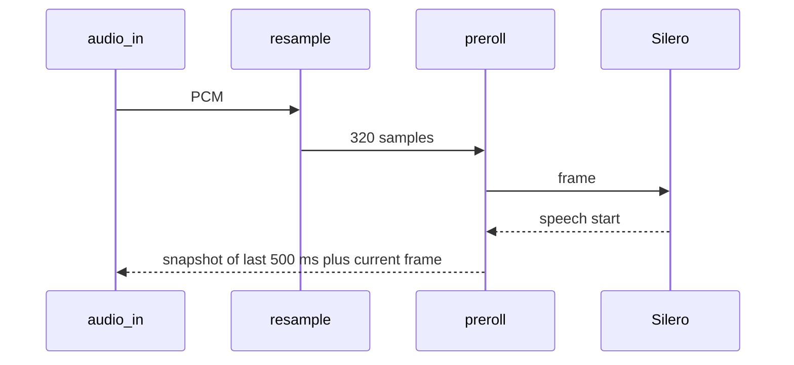

# Phase 2 — Audio front end

## 2.0 Overview

Phase 2 makes the samples that reach the recognizer a single 16 kHz mono stream with the onset included, and it refuses to pretend barge-in works when the browser is not cancelling echo. The product failure this prevents is the missing first syllable and the self-trigger on speaker playback. The portfolio exhibit is a pre-roll test that fails if the recognizer would have started late, plus an explicit AEC limitation instead of a hidden one.

## 2.1 Entry criteria

- M1.3 exit gate is checked. `AUDIO` events exist and carry `frame_index`.
- T1.4.5 has named a tier or has a `blocked` row. VAD still proceeds on CPU either way. Silero's ONNX build string is VERIFY AT PHASE 1 BENCHMARK until T2.3.1 writes the file name it loaded.

## 2.2 Architecture and design

`pipeline/audio/format.py` is the only resampler. Later stages receive 16 kHz mono PCM16 and do not call it again. `pipeline/audio/clock.py` assigns `frame_index` from a counter that starts at 0 on session open and increments by one per 320-sample block after resampling. If the client already sent 16 kHz blocks, the index is the client's index and a mismatch with the server counter closes the socket.

`pipeline/audio/preroll.py` is a ring of the last `vad_preroll_ms` (500) of audio. On speech start the stage emits a single `AUDIO` event whose payload `pcm16_hex` is not used. Payload stays scalar, so the PCM bytes do not ride inside `Event.payload`. They ride on an `AudioBuffer` object keyed by `(session_id, frame_index)` in the session, and the event carries `frame_index` plus `payload["samples"]=320`. The buffer is dropped when generation changes, except the pre-roll that belongs to the new utterance. Stuffing PCM into the logged payload is forbidden because the redactor would still have to omit it, and a miss would write audio into Jaeger.

```python
def resample_mono_pcm16(pcm: bytes, src_hz: int, dst_hz: int) -> bytes: ...

class Preroll:
    def push(self, frame: bytes) -> None: ...
    def snapshot(self) -> bytes: ...
```

```python
def vad_decision(prob: float, state: VadState, settings: Settings) -> VadState: ...
```

`VadState` is `idle` or `in_speech`. Enter `in_speech` only after `vad_speech_start_ms` (200) of frames with probability ≥ `vad_speech_threshold` (STARTING POINT 0.5). Leave `in_speech` only from the endpoint policy in phase 4, not from a short silence inside this stage. Phase 2's VAD stop is a safety hang: `vad_max_utterance_ms` (15000) forces an end and increments an error counter so a stuck threshold cannot pin the recognizer.



Config: `vad_window_samples` 512, `vad_speech_threshold` 0.5, `vad_speech_start_ms` 200, `vad_preroll_ms` 500, `vad_max_utterance_ms` 15000, `audio_silence_rms` 0.005 STARTING POINT, `audio_silence_window_s` 3.0, `audio_clip_fraction` 0.01, `audio_clip_peak` 32760.

## 2.3 Milestones

### M2.1 Single-point resample and frame clock

Goal: every downstream frame is 320 samples at 16 kHz, produced in one function.
Demo-able outcome: an 8 kHz fixture comes out at twice the sample count, and a second call on the output is a no-op that the test forbids by asserting the resampler is not imported in `pipeline/stages/asr.py`.

| Task | Description | Files | Depends on | Hours | Status | Acceptance |
|---|---|---|---|---|---|---|
| T2.1.1 | Linear resample of mono PCM16, tested against a sine at 8 kHz and 48 kHz | `pipeline/audio/format.py` | T1.3.3 | 4 | forward | `tests/test_resample.py` peak frequency within 1 bin of 440 Hz after resample to 16 kHz |
| T2.1.2 | Server frame clock and rejection of gaps larger than 2 frames | `pipeline/audio/clock.py` | T2.1.1 | 2 | forward | `tests/test_clock.py` closes the logical stream on index 0,1,4 |
| T2.1.3 | Wire resample once at ingress | `pipeline/stages/audio_in.py` | T2.1.2 | 3 | forward | Grep test `tests/test_no_second_resample.py` fails if `resample_mono_pcm16` is imported outside `audio_in` and `format.py` |

Implementation notes. Use a small linear interpolator, not a hidden dependency, unless T1.4.5's tier already has a resample library pinned in the JSON. If a library is used, the test still checks the sine. Do not resample per stage to "fix" a model that wanted 16 kHz. Models that want another rate get a view inside their pool, and that view is not written back to the bus.

Tests: the three files above. Failure path: odd byte length raises `ValueError` and does not emit.

Metrics: `turnwise_audio_resample_seconds`, `turnwise_audio_clock_gaps_total`.

Exit gate: a 48 kHz tone fixture produces a continuous `frame_index` with no duplicate and no gap, and the resample histogram p50 is recorded in `docs/results/phase2.md` from the test machine.

### M2.2 Client AEC and NS contract

Goal: barge-in cannot arm unless the client says AEC is on.
Demo-able outcome: a hello with `aec: false` is accepted for capture, the session flag `barge_in_enabled` is false, and a speech-start during agent playback does not call `Session.barge_in`.

| Task | Description | Files | Depends on | Hours | Status | Acceptance |
|---|---|---|---|---|---|---|
| T2.2.1 | Pass constraint results back from `getUserMedia` | `client/main.js` | T1.3.4 | 3 | forward | The hello JSON includes the boolean `MediaTrackSettings` actually returned, not the requested ideal |
| T2.2.2 | Store the flag on the session | `pipeline/session.py`, `server/ws.py` | T2.2.1 | 2 | forward | `tests/test_aec_flag.py` reads `session.barge_in_enabled is False` when the hello says false |
| T2.2.3 | Document the speaker limitation and assert the flag gates barge-in | `docs/results/phase2.md` | T2.2.2 | 2 | forward | A direct `session.barge_in` from the VAD hook does not run when the flag is false. The test calls the hook |

Implementation notes. `getUserMedia` can accept the constraint and still report `echoCancellation: false` after the fact. The client must read `track.getSettings()` after the promise resolves. Server-side AEC is a non-goal. The spoken fallback when the flag is false is the template id `headphones_required`, played from the phrase cache once that cache exists. Until phase 7, the server sends the raw PCM of a single pre-rendered file in `client/prompts/headphones.pcm` if the file is present, otherwise it logs `prompt_missing` and continues without barge-in. The log line is the failure, not a silent enable.

Tests: `tests/test_aec_flag.py`. Manual row in `docs/results/phase2.md`: speakers versus headphones, expected barge-in false on speakers if the browser reports AEC false.

Metrics: `turnwise_aec_disabled_sessions_total`.

Exit gate: the unit test passes and the manual row is filled with the browser's reported settings, not a guess.

### M2.3 Silero VAD, hysteresis, 500 ms pre-roll

Goal: speech start does not fire on a single noisy frame, and the 500 ms before the start is still available.
Demo-able outcome: a fixture with 400 ms of speech preceded by a known tone includes that tone in the snapshot.

| Task | Description | Files | Depends on | Hours | Status | Acceptance |
|---|---|---|---|---|---|---|
| T2.3.1 | ONNX VAD pool, timeout, generation check | `models/vad_pool.py` | T1.4.1 | 6 | forward | A job submitted at generation 0 is dropped when the session is at generation 1 before the result is applied. Timeout uses `vad_timeout_ms` default 30 |
| T2.3.2 | Hysteresis state machine | `pipeline/stages/vad.py` | T2.3.1 | 4 | forward | `tests/test_vad_hysteresis.py`: one frame at 0.99 does not start speech. 200 ms at 0.6 does |
| T2.3.3 | Pre-roll ring | `pipeline/audio/preroll.py` | T2.1.2 | 3 | forward | `tests/test_preroll.py` snapshot length equals 500 ms plus the triggering frame, within one frame |
| T2.3.4 | Noise versus tone fixture | `tests/test_vad_noise.py` | T2.3.2, T2.3.3 | 4 | forward | MUSAN-or-local noise at the level documented in the fixture header causes fewer starts than a counted speech fixture. The counts are written to `docs/results/phase2.md` by the test output, not typed in advance |

Implementation notes. Silero's window is 512 samples at 16 kHz in current public builds. VERIFY AT PHASE 1 BENCHMARK against the ONNX file's metadata. If the file wants 512 and the bus frame is 320, the VAD stage buffers to 512 and does not change the bus frame. The RNN state is per session and resets on `session_end` and on barge-in generation change so a new utterance does not inherit the old hidden state. Blocking the event loop with ONNX is forbidden: `vad_pool` runs inference in an executor and the stage awaits the future with a timeout.

The energy gate fallback, used only when the pool times out twice in a row, is RMS above `audio_silence_rms` for `vad_speech_start_ms`. It is deterministic and worse in noise. The counter `turnwise_vad_fallback_total` makes the degradation visible.

Tests: files in the table. Failure path: corrupt ONNX path raises at startup, not on the first caller.

Metrics: `turnwise_vad_prob` histogram, `turnwise_vad_latency_seconds`, `turnwise_vad_fallback_total`, `turnwise_preroll_underrun_total`.

Exit gate: hysteresis test passes, pre-roll length test passes, and the ONNX file name and opset are written into `docs/results/phase2.md`.

### M2.4 Silence, clipping, and session audio-quality score

Goal: a dead microphone or a clipped one ends or flags the call instead of producing empty transcripts.
Demo-able outcome: three seconds of zeros emit `audio_dead` once and move the session to a close template. A full-scale square wave sets `clipped` true.

| Task | Description | Files | Depends on | Hours | Status | Acceptance |
|---|---|---|---|---|---|---|
| T2.4.1 | RMS and clip fraction over a window | `pipeline/audio/quality.py` | T2.1.1 | 3 | forward | `tests/test_audio_quality.py` zeros cross `audio_silence_window_s`. A buffer with 2% samples at 32767 crosses `audio_clip_fraction` |
| T2.4.2 | Gauges and a single close event | `pipeline/stages/vad.py` | T2.4.1 | 2 | forward | The close event is emitted once, not once per frame |
| T2.4.3 | Quality score persisted on the session for the trace | `pipeline/session.py` | T2.4.2 | 2 | forward | Span attribute `audio_quality` is `dead`, `clipped`, or `ok`. The attribute is not a transcript |

Implementation notes. Score is the worst flag seen in the session: `dead` outranks `clipped`, `clipped` outranks `ok`. RMS uses integer squares and a shift to stay inside int64. The threshold 0.005 is a STARTING POINT on the int16 full scale (about 164 counts). T2.4.1's test uses constructed buffers so the threshold can move without rewriting the assertion: the test passes the threshold in, and the default is what production uses.

Tests: `tests/test_audio_quality.py` including a window that is silent for 2.9 s and must not fire.

Metrics: `turnwise_audio_dead_total`, `turnwise_audio_clipped_total`.

Exit gate: both counters move in tests, and a normal sine does not move them.

## 2.4 Data and models

Silero VAD weights, license checked in T2.3.1 and written into `docs/results/phase2.md`. If the license forbids redistribution, the download script fetches them and git ignores the file. Noise fixture: a short file whose header states the license. MUSAN is the preferred set if the license check passes. If it does not, T2.3.4 uses generated white noise and says so. No training.

## 2.5 Failure modes

| Failure | Detection | Fallback | Test |
|---|---|---|---|
| VAD timeout twice | Pool future | Energy gate, counter | `tests/test_vad_noise.py` with a stub pool that sleeps |
| Pre-roll shorter than 500 ms because the call just started | `len(snapshot) < expected` | Emit what exists, increment underrun | `tests/test_preroll.py` at t=100 ms |
| AEC flag false | Hello settings | Barge-in disabled | `tests/test_aec_flag.py` |
| Dead mic | RMS window | One close event | `tests/test_audio_quality.py` |
| Resample on a non-mono buffer | Channel count | Reject at ingress | `tests/test_resample.py` |

## 2.6 Risks and mitigations

Silero's 512-sample window and the 320-sample bus can drift if someone "fixes" the bus to 512 and breaks the 20 ms client contract. T2.1.3's frame size test locks 320 on the wire. The VAD buffer is private.

A too-low speech threshold starts on air-conditioner noise and inflates false barge-in later. The phase 2 noise fixture is the trigger. If false starts exceed speech starts on the noise file, raise `vad_speech_threshold` in an ADR rather than in a silent edit. That ADR is ADR-005, written only if the number forces a change.

## 2.7 Evaluation

`docs/results/phase2.md` contains: resample p50, VAD latency p50, false-start counts on noise versus speech, pre-roll length, and the browser AEC settings from the manual row. Targets: VAD compute allocation 10 ms, speech start not before 200 ms of positives, pre-roll 500 ms when the audio exists. Numbers come from the tests.

## 2.8 Documentation and ADRs

`docs/ARCHITECTURE.md` gains the audio buffer rule: PCM is not an event payload. ADR-005 only if the threshold moves. The speaker limitation is a paragraph in `docs/results/phase2.md`.

## 2.9 Exit criteria and phase gate

- [ ] Resample is referenced only from ingress.
- [ ] Pre-roll test passes.
- [ ] Hysteresis test passes.
- [ ] AEC false disables barge-in.
- [ ] Dead-mic test emits one close.
- [ ] `docs/results/phase2.md` has measured rows or explicit blocked rows.
- [ ] ONNX inference is not called on the event loop. The test patches the executor and fails if `run` is called inline.

## 2.10 Portfolio artifacts

Plot of VAD probability with the 200 ms gate drawn on top, from the fixture, saved as `docs/results/phase2_vad.png` by the test when matplotlib is installed, otherwise a CSV. The interview point is the pre-roll bug and the decision to keep AEC in the browser with a hard disable, not a promise of server AEC.
