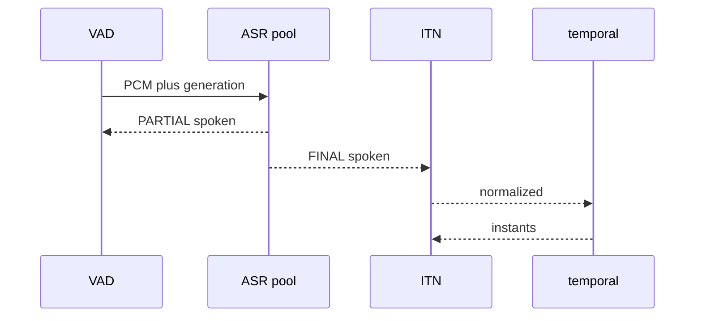

# Phase 3 — Streaming ASR and spoken-form NLP

## 3.0 Overview

Phase 3 turns audio into a partial stream and a final string, keeps the spoken form for NLU, and turns finals into written forms and absolute times without a language model. The product fails if doctor names are systematically substituted or if "next Tuesday" is computed by a model that is off by a week. The portfolio exhibit is the entity word-error ablation with biasing on and off, and the stabilization-delay number for Zipformer versus LocalAgreement-2, both written from the bench log.

## 3.1 Entry criteria

- M2.3 exit gate. Frames are 16 kHz and speech start emits a pre-roll snapshot.
- T1.4.2 has a JSON log or a `blocked` row. A blocked ASR row stops M3.2's comparison and is recorded as such. It does not stop the pool interface in M3.1, which is tested with a stub recognizer.

## 3.2 Architecture and design

`models/asr_pool.py` owns recognizer slots. A slot's `start_stream(session_id, generation)` returns a handle. `push(pcm)` and `finish()` return hypotheses. The pool drops a hypothesis whose generation is not current before the stage sees it.

```python
class AsrHypothesis(BaseModel):
    text: str
    words: list[WordConf]
    stable_prefix: str
    generation: int

class WordConf(BaseModel):
    text: str
    start_ms: int
    end_ms: int
    confidence: float
```

`pipeline/stages/asr.py` emits `PARTIAL` on each unstable update and `FINAL` when the endpoint says the utterance is done, or when the recognizer commits a stable prefix that the endpoint has not yet closed. Partials are not run through ITN.

`nlp/itn.py` reads finals only and writes `payload["spoken"]` and `payload["normalized"]`. `nlp/temporal.py` reads the normalized string plus `session.now` and `clinic_timezone`, and writes `payload["instants"]` as a JSON list encoded as a string of ISO-8601 values. The payload type is flat scalars, so the list is one string. The parser in the FSM rejects a string that does not match the ISO pattern.

```python
def resolve_relatives(text: str, now: datetime, zone: ZoneInfo) -> tuple[str, list[str]]: ...
```

"next Tuesday" uses the clinic zone, not the server's default zone. If `now` is Tuesday, "next Tuesday" is the Tuesday of the following week, not today. That rule is a unit test, not a library default assumed to be right.

Hotwords are a list rebuilt when the FSM state id changes. Phase 3 reads the state id from `Session.expected_vocab_id`, a string phase 6 sets. Until phase 6 sets it, the id is `greet` and the list is the clinic name plus the doctor roster file.



Config: `asr_backend` empty until T3.2.2 writes `zipformer` or `whisper_la2`, `asr_pool_slots` 1 on CPU-only and 2 on 16 GB, `asr_finish_timeout_ms` 200, `hotword_score` 1.5 STARTING POINT, `clinic_timezone` `America/New_York`, `doctor_roster_path` `data/doctors.txt`.

## 3.3 Milestones

### M3.1 Streaming ASR pool, partial and final events

Goal: a stub and a real backend both emit partials then one final, and a stale generation never emits.
Demo-able outcome: a 2-second fixture produces at least one `PARTIAL` and exactly one `FINAL` for that utterance id.

| Task | Description | Files | Depends on | Hours | Status | Acceptance |
|---|---|---|---|---|---|---|
| T3.1.1 | Pool protocol, timeout, generation drop | `models/asr_pool.py` | T2.3.1 | 6 | forward | `tests/test_asr_pool.py` drops a result stamped generation 0 after `barge_in` |
| T3.1.2 | Stage emits `PARTIAL` and `FINAL` without ITN | `pipeline/stages/asr.py` | T3.1.1 | 5 | forward | `tests/test_asr_stage.py` with the stub: partial text is a prefix of the final spoken text |
| T3.1.3 | Priority: the session that is in `speaking` is served first | `models/asr_pool.py` | T3.1.1 | 3 | forward | Two sessions queued, the speaking one completes first. Test uses the stub with a delay |

Implementation notes. The stub recognizer sleeps and returns a fixed transcript so CI does not download weights. The real backend is selected by `asr_backend` and refuses to start if the setting is empty. Word times are milliseconds from the start of the pre-roll snapshot. Confidence is the recognizer's word score if it has one. If the chosen build has no word scores, T3.1.2 writes `confidence: null` as a missing float by omitting the word from aggregation and setting slot confidence to 0.0, which forces confirmation later. It does not invent 1.0.

Tests: the two files, plus a malformed PCM length test that increments `turnwise_stage_errors_total{reason="handler"}` and does not crash the pool process.

Metrics: `turnwise_asr_finalize_seconds`, `turnwise_asr_dropped_generation_total`.

Exit gate: stub tests pass on CI. Real-backend tests are marked `bench` and run in T3.2.2.

### M3.2 Zipformer versus Whisper plus LocalAgreement-2

Goal: measure stabilization delay and entity errors, then set `asr_backend`.
Demo-able outcome: `docs/results/phase3.md` contains two rows from JSON, or one row and a `blocked` row.

| Task | Description | Files | Depends on | Hours | Status | Acceptance |
|---|---|---|---|---|---|---|
| T3.2.1 | LocalAgreement-2: commit the prefix two consecutive hypotheses share | `nlp/local_agreement.py` | T3.1.2 | 5 | forward | `tests/test_local_agreement.py`: "book tue" then "book tuesday at" commits "book " only after the second call agrees |
| T3.2.2 | Run both backends on the same 20 fixtures | `evals/bench/asr_compare.py`, `docs/benchmarks.md` | T3.2.1, T1.4.2 | 5 | forward | JSON contains `stabilization_delay_ms` p50 and p95 per backend. The markdown is rendered from the JSON |
| T3.2.3 | Write the choice | `docs/adr/ADR-006-asr-backend.md` | T3.2.2 | 3 | forward | ADR picks the backend whose finalize p50 is ≤ 100 ms TARGET. If neither is, it picks the lower one and marks the budget missed. It does not average them |

Implementation notes. Stabilization delay is the time from the end of the spoken word in the fixture alignment to the first hypothesis where that word sits inside `stable_prefix`. Fixtures without alignments report delay only at utterance end, and the column says `utterance_end`. LocalAgreement on Whisper is not the hot path unless ADR-006 says the delay fits. A 3-second delay from the published Whisper streaming papers is a reason to reject it, but this plan does not copy that number into the results file as if it were measured here.

Tests: `tests/test_local_agreement.py` including a case where the second hypothesis rewrites the first word and nothing is committed.

Metrics: `turnwise_asr_stable_lag_seconds`.

Exit gate: ADR-006 exists and `asr_backend` is set in the sample env file to the chosen value.

### M3.3 State-dependent hotword biasing

Goal: the doctor roster is boosted while the expected vocab is `doctor`, and month names are boosted while it is `date`.
Demo-able outcome: the same noisy name fixture scores a lower entity error with bias on than off, or the result says there was no change. Both outcomes are written.

| Task | Description | Files | Depends on | Hours | Status | Acceptance |
|---|---|---|---|---|---|---|
| T3.3.1 | Build the hotword list from roster plus state id | `nlp/hotwords.py`, `data/doctors.txt` | T3.1.2 | 3 | forward | `tests/test_hotwords.py` returns doctor names for `doctor` and weekday names for `date`, and does not return the roster for `phone` |
| T3.3.2 | Push the list into the recognizer when `expected_vocab_id` changes | `pipeline/stages/asr.py` | T3.3.1, T3.2.3 | 4 | forward | A stub records the list it was given. A change from `greet` to `doctor` changes the list |
| T3.3.3 | Entity WER on a 30-name fixture, bias on and off | `evals/bench/entity_wer.py` | T3.3.2 | 3 | forward | `docs/results/phase3.md` gains two WER numbers from the JSON. If the backend has no hotword API, the on-row is `unsupported` |

Implementation notes. `hotword_score` 1.5 is a STARTING POINT from the sherpa example default, not a tuned value. T3.3.3 runs score 1.0 and 1.5 and 2.0 if the API accepts a score. The chosen score is the one with the lowest entity WER that does not increase overall WER by more than 1 point absolute. If the API has no score, the column says `unsupported` and the default build score is used. Doctor names in `data/doctors.txt` are the closed set. They are not learned from audio.

Tests: `tests/test_hotwords.py`. Bench is mark `bench`.

Metrics: `turnwise_hotword_updates_total`.

Exit gate: the results file contains the on/off pair or `unsupported`, and the roster file is the only source of doctor strings.

### M3.4 WFST ITN, spoken form kept

Goal: finals gain a normalized string and the spoken string is unchanged.
Demo-able outcome: "march third at two thirty" yields a normalized form that still leaves the spoken payload equal to the recognizer text.

| Task | Description | Files | Depends on | Hours | Status | Acceptance |
|---|---|---|---|---|---|---|
| T3.4.1 | ITN wrapper with a timeout and a rule fallback | `nlp/itn.py` | T3.1.2 | 5 | forward | `tests/test_itn.py` on the rule fallback maps "two thirty" to a form containing "2:30". NeMo is used only if import succeeds |
| T3.4.2 | Apply ITN to finals only | `pipeline/stages/asr.py` | T3.4.1 | 2 | forward | A `PARTIAL` event's payload has `spoken` and no `normalized` |
| T3.4.3 | Failure keeps spoken text and sets `normalized_ok` false | `nlp/itn.py` | T3.4.1 | 3 | forward | A raised exception inside the wrapper becomes `normalized_ok=0` and does not drop the final |

Implementation notes. NeMo does not pip-install on native Windows because Pynini has no official wheel. T3.4.1 tries the import, records the exception class in the results file, and uses the rule fallback. The rule fallback covers clock times, digit sequences, and month names. It does not claim full WFST coverage. Relative phrases are left untouched for T3.5.1. Running ITN on partials is forbidden because partials rewrite and would churn the normalized string the UI might show. There is no UI in this phase. The event rule is still the rule.

Tests: `tests/test_itn.py` including a partial-versus-final assertion and an exception injection.

Metrics: `turnwise_itn_errors_total`, `turnwise_itn_seconds`.

Exit gate: finals from the stub carry both strings, partials carry one, and the results file states whether NeMo imported.

### M3.5 Relative dates and per-slot confidence

Goal: "next Tuesday" becomes an ISO instant from the session clock, and each slot span gets a confidence equal to the minimum word confidence inside the span.
Demo-able outcome: a table test across a DST boundary and a low-confidence span that scores below 0.6.

| Task | Description | Files | Depends on | Hours | Status | Acceptance |
|---|---|---|---|---|---|---|
| T3.5.1 | Deterministic relative resolver | `nlp/temporal.py` | T3.4.2 | 4 | forward | `tests/test_relative_dates.py`: Tuesday 2026-03-03, "next Tuesday" is 2026-03-10. "day after tomorrow" from a DST spring-forward date is two midnights in `clinic_timezone`, not 48 hours of UTC |
| T3.5.2 | Min word confidence over a span | `nlp/slot_confidence.py` | T3.1.2 | 3 | forward | `tests/test_slot_confidence.py` span covering 0.9 and 0.4 yields 0.4. Empty span yields 0.0 |
| T3.5.3 | Attach instants and confidences on the final | `pipeline/stages/asr.py` | T3.5.1, T3.5.2 | 2 | forward | The final payload includes `instants` and `slot_conf` strings. The LLM client is not imported in this module. A grep test enforces that |

Implementation notes. The resolver handles: today, tomorrow, day after tomorrow, next WEEKDAY, this WEEKDAY, and bare WEEKDAY. Bare WEEKDAY means the next occurrence, which may be today if the name matches today and the phrase is not "next". Ambiguous phrases such as "Tuesday or Wednesday" produce two instants and set `ambiguous=1`. The FSM must not pick one. Month-day without a year uses the next future date in the clinic zone, and a date more than 180 days out sets `needs_confirm=1` because the year guess is the risky part.

Slot spans in this phase are character ranges supplied by the caller of `slot_confidence`. Phase 5's NLU produces the ranges. Phase 3's test supplies them directly so the confidence function is done before the student model exists.

Tests: the two test modules. Failure path: unknown timezone name raises at startup, not on the first final.

Metrics: `turnwise_temporal_unresolved_total`, `turnwise_temporal_seconds`.

Exit gate: DST test and min-confidence test pass, and `pipeline/stages/asr.py` does not import an LLM client.

## 3.4 Data and models

ASR weights are downloaded, not committed. License strings are copied from the files into `docs/results/phase3.md`. Doctor roster is a 15-line fixture of invented names in `data/doctors.txt`, clearly fake, so no real patient or staff list enters git. The 30-name entity fixture is synthesized in T3.3.3 by TTS of those names. TTS version is whatever T1.4.4 recorded. If TTS is blocked, entity WER is `blocked` rather than scored on text alone. Text-only WER is not entity WER.

No training in this phase.

## 3.5 Failure modes

| Failure | Detection | Fallback | Test |
|---|---|---|---|
| ASR timeout | `asr_finish_timeout_ms` | Emit a final with empty spoken text and `asr_ok=0` | `tests/test_asr_stage.py` stub that hangs |
| Generation moved | Stamp mismatch | Drop hypothesis, increment counter | `tests/test_asr_pool.py` |
| No word confidence | Missing field | Slot confidence 0.0 | `tests/test_slot_confidence.py` |
| ITN exception | Catch inside wrapper | Keep spoken, `normalized_ok=0` | `tests/test_itn.py` |
| Unresolved relative | No instant | `temporal_unresolved` counter, FSM will re-ask | `tests/test_relative_dates.py` phrase "sometime" |
| Hotword API missing | Backend capability flag | Row `unsupported`, bias off | `evals/bench/entity_wer.py` dry run |
| Rewrite of the first word across hypotheses | LocalAgreement | Commit nothing | `tests/test_local_agreement.py` |

## 3.6 Risks and mitigations

Zipformer may lose the name ablation even with hotwords. Mitigation is the phonetic matcher in phase 5, not a larger Whisper on the hot path. Trigger: entity WER with bias still above the unbiased Whisper row by more than 5 points absolute and Whisper delay still over 100 ms. In that case ADR-006 records a split: Zipformer for timing, and a second-pass rescore is a non-goal unless a later ADR adds it. This plan does not add the second pass.

NeMo in Docker but not on the developer's Windows venv will split results. The results file names the interpreter. The rule fallback is the Windows default.

## 3.7 Evaluation

`docs/results/phase3.md`: finalize p50 and p95 per backend, stabilization delay, entity WER on and off, ITN import status, temporal test pass, slot-confidence unit pass. Targets: finalize 100 ms, turn-detector is not this phase, ITN plus temporal allocation 10 ms measured by `turnwise_itn_seconds` and `turnwise_temporal_seconds` summed in the results file from histograms, not from a stopwatch in prose.

## 3.8 Documentation and ADRs

ADR-006. Update `docs/ARCHITECTURE.md` to name the chosen backend after ADR-006, with the JSON path. ADR-003 stays Proposed until the TTS and LLM rows are also chosen. Phase 3 may choose ASR only.

## 3.9 Exit criteria and phase gate

- [ ] Stub ASR tests pass on CI without weights.
- [ ] ADR-006 exists.
- [ ] Partials are not normalized.
- [ ] Spoken form is preserved on finals.
- [ ] DST unit test passes.
- [ ] Entity ablation is a number pair or `blocked` or `unsupported`, never a blank cell.
- [ ] No LLM import in the ASR stage.

## 3.10 Portfolio artifacts

One chart, two bars, entity WER bias on versus off, from the JSON. One chart, stabilization delay p50 for both backends. Interview point: ITN and relative dates are different functions, and the second one uses the clinic clock. Interview point: word confidence missing becomes 0.0 so the confirmation policy fails closed.
