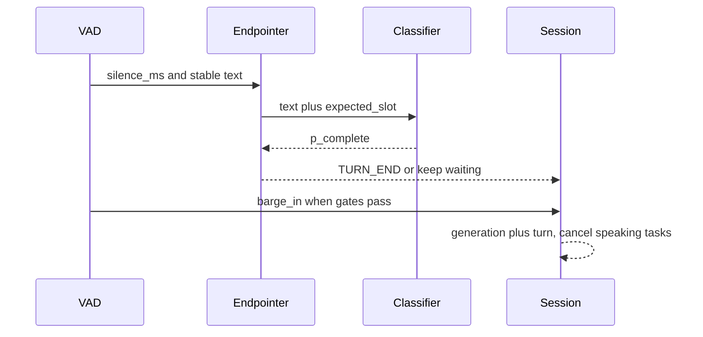

# Phase 4 — Turn-taking

## 4.0 Overview

Phase 4 decides when the caller has finished and when the caller has interrupted. A fixed silence timeout either cuts phone numbers or leaves a hole before every reply. The portfolio exhibit is the ordered policy function, the cancellation-latency measurement against a 100 ms TARGET, and a backchannel filter that is state-dependent so "okay" can still answer a yes/no question.

## 4.1 Entry criteria

- M3.1 stub path emits `FINAL` and `PARTIAL`.
- M2.2 `barge_in_enabled` exists.
- M1.3 playback ack `0x03` advances `PlaybackCursor.acked_frame`. If T1.3.5 slipped, M4.3 cannot exit. M4.1 can still be unit-tested on text.

## 4.2 Architecture and design

```python
def should_end_turn(
    silence_ms: float,
    text: str,
    p_complete: float,
    expected_slot: str,
    settings: Settings,
) -> bool:
    ...
```

Order, which the test locks:

1. Empty text returns false.
2. If `expected_slot` is `phone` or `dob` and `silence_ms` is under `endpoint_digit_patience_ms` (1000), return false. This runs before `p_complete`.
3. If `silence_ms` is at least `endpoint_hard_silence_ms` (1200), return true.
4. If `p_complete` is at least 0.85 and `silence_ms` is at least 200, return true.
5. If `p_complete` is at least 0.5 and `silence_ms` is at least 500, return true.
6. Otherwise return true when `silence_ms` is at least 800.

The probabilities 0.85 and 0.5 and the silence floors are STARTING POINT values in settings: `endpoint_high_p`, `endpoint_high_silence_ms`, `endpoint_mid_p`, `endpoint_mid_silence_ms`, `endpoint_default_silence_ms`.

`p_complete` comes from the ONNX classifier. Its input is the stable prefix plus the expected-slot id, not the raw partial that LocalAgreement has not committed. If the classifier times out, `p_complete` is 0 and the silence rules still run.

Barge-in while the agent is speaking requires all of: `barge_in_enabled`, at least `barge_in_min_speech_ms` (250) of VAD speech, and a stable partial that `is_backchannel` rejects. `is_backchannel` returns true only when the expected slot is not a yes/no slot and the text is in the list `mm-hmm`, `mhm`, `uh-huh`, `yeah`, `ok`, `okay` after stripping. Duration under 400 ms is required as well. "okay" during `confirm` is not a backchannel.

Playback: the FSM stores `played_text` as the prefix of the spoken string whose audio frames have been acked. Barge-in passes that prefix, not the full `SAY` text.

Cancellation latency TARGET ≤ 100 ms from the barge-in decision to the last PCM frame written to the socket. The measurement is a synthetic clock in T4.4.1, not a guess.



## 4.3 Milestones

### M4.1 Hybrid endpointer with slot patience

Goal: the policy function matches the order above, including the digit exception.
Demo-able outcome: a phone string with 700 ms internal silence does not end, and the same silence on an open question does end once it hits 800 ms.

| Task | Description | Files | Depends on | Hours | Status | Acceptance |
|---|---|---|---|---|---|---|
| T4.1.1 | Implement `should_end_turn` from settings | `pipeline/stages/endpoint.py` | T3.1.2 | 4 | landed | `tests/test_endpoint_policy.py` covers empty text, digit patience before a high `p_complete`, hard ceiling, and the 800 ms default |
| T4.1.2 | Read `expected_slot` from the session | `pipeline/session.py` | T4.1.1 | 2 | landed | Default slot is `none`. A setter used by tests changes the policy result |
| T4.1.3 | Emit `TURN_END` once per utterance | `pipeline/stages/endpoint.py` | T4.1.2 | 3 | landed | Two evaluations after the first true do not emit a second `TURN_END` until the next speech start |

Implementation notes. The hard ceiling is after the digit check so a slow phone number is not cut at 1200 ms either, until `endpoint_digit_hard_ms` (2000). That second ceiling exists so a caller who went silent forever still ends. It is a setting. The first version of this function in the design notes put the 1200 ms return before the digit check. That bug is the first test in the file.

Tests: `tests/test_endpoint_policy.py` with one case per branch, plus a case that `p_complete` 0.99 and silence 300 ms does not end a `phone` slot.

Metrics: `turnwise_endpoint_decisions_total{result}`, `turnwise_endpoint_silence_ms` histogram.

Exit gate: every branch has a failing-then-passing test, and the digit branch is asserted to run first by a comment in the test name `test_digit_patience_beats_high_p_complete`.

### M4.2 Turn-completion classifier

Goal: a small ONNX model returns `p_complete` in under 10 ms CPU p50 on the bench host, or the miss is recorded and the silence policy remains.
Demo-able outcome: `docs/results/phase4.md` has a latency row from the harness and an accuracy row on a held-out truncation set.

| Task | Description | Files | Depends on | Hours | Status | Acceptance |
|---|---|---|---|---|---|---|
| T4.2.1 | Build truncation pairs from fixture sentences | `training/turn/build_truncation.py` | T3.2.3 | 4 | landed | Each complete sentence yields one positive and at least one prefix labeled incomplete. Output JSONL validates |
| T4.2.2 | Train a small encoder | `training/turn/train.py` | T4.2.1 | 8 | landed | Held-out accuracy is written to `docs/results/phase4.md` from the script. Hyperparameters in the script header are STARTING POINT: learning rate 2e-5, 3 epochs, batch 32, max length 64 |
| T4.2.3 | Export ONNX INT8 and load through the ONNX pool | `models/onnx_pool.py`, `training/turn/export.py` | T4.2.2 | 3 | landed | The pool times out at `turn_timeout_ms` default 20 and returns an error the endpointer treats as `p_complete=0` |
| T4.2.4 | Measure CPU latency | `evals/bench/turn_latency.py` | T4.2.3 | 2 | landed | p50 under 10 ms TARGET or a row `budget_missed` with the measured p50. No hand-typed 10 ms |

Implementation notes. Training data is public sentences plus the synthetic caller lines from phase 5 if those exist. Phase 4 does not block on phase 5. The truncation script can run on a 2,000-line local text file checked into `training/turn/fixtures.txt` with a license header. The feature is the text plus a special token for `expected_slot`. "Wednesday" is a positive when the slot is `date` and a negative when the slot is `none` and the sentence was cut from a longer booking request. That contrast is the reason the slot id is an input. If the latency budget is missed, ADR-007 records silence-only as the default and keeps the model behind a flag `turn_model_enabled` default false.

Tests: `tests/test_turn_pool_timeout.py`, `tests/test_truncation_labels.py`. Training is mark `bench`.

Metrics: `turnwise_turn_model_seconds`, `turnwise_turn_model_timeouts_total`.

Exit gate: latency row exists, and the endpointer still passes T4.1.3 when the model returns 0.

### M4.3 Barge-in, backchannels, playback cursor

Goal: agent speech stops on a real interruption and does not stop on a backchannel, and the FSM learns the text that was actually acked.
Demo-able outcome: a test plays 10 frames, acks 4, interrupts, and the recorded played prefix corresponds to frames 0–3.

| Task | Description | Files | Depends on | Hours | Status | Acceptance |
|---|---|---|---|---|---|---|
| T4.3.1 | Barge-in gates | `pipeline/stages/barge.py` | T4.1.2, T2.2.2 | 4 | landed | `tests/test_barge_policy.py` requires 250 ms of speech. 100 ms does not fire. AEC false does not fire |
| T4.3.2 | State-dependent backchannel list | `nlp/backchannel.py` | T4.3.1 | 3 | landed | "okay" is a backchannel when the slot is `none` and is not when the slot is `confirm` |
| T4.3.3 | Map acked frame index to a text prefix | `server/playback.py` | T1.3.5, T4.3.1 | 4 | landed | `tests/test_playback_prefix.py` with a known frame-to-character table returns the prefix for the acked frame, not the full string |
| T4.3.4 | On barge-in, store the prefix and cancel speaking tasks | `pipeline/stages/barge.py` | T4.3.2, T4.3.3 | 3 | landed | `tests/test_barge_in_policy.py` asserts `session.played_text` and that a tracked TTS task raises `CancelledError` |

Implementation notes. Frame-to-character alignment in this phase is linear over the PCM length of the chunk that the TTS stage will later tag. Until TTS exists, the test injects the map. Phase 7 must call `PlaybackCursor.note_chunk(start_frame, end_frame, text)`. A missing map yields an empty `played_text` and a counter `turnwise_playback_unmap_total`, which fails closed: the FSM treats the confirmation as unheard and repeats it.

Backchannel list is a setting `backchannel_phrases`, default the six strings above. Adding "yes" is forbidden in the default because "yes" is an answer on `confirm`.

Tests: the files in the table. Failure path: ack frame index ahead of any sent frame is ignored and counted.

Metrics: `turnwise_barge_in_total` already exists and must increment only when the gates pass, not when a backchannel is ignored. Add `turnwise_backchannel_ignored_total`.

Exit gate: the four tests pass, and a backchannel does not increment `turnwise_barge_in_total`.

### M4.4 Cancellation latency and turn metrics

Goal: measure time from the barge-in call to the stop of outbound PCM, and define the rate counters phase 9 will read.
Demo-able outcome: a synthetic test prints the latency into `docs/results/phase4.md` via the test log line `cancel_latency_ms=`.

| Task | Description | Files | Depends on | Hours | Status | Acceptance |
|---|---|---|---|---|---|---|
| T4.4.1 | Synthetic clock from `barge_in` to last outbound write | `evals/turn/latency.py` | T4.3.4 | 3 | landed | The test fails if the measured latency on the stub audio sender exceeds 100 ms. The stub sender is in-process, so a miss means the cancellation path itself is slow, not the sound card |
| T4.4.2 | Counters for early cutoff, response gap, false barge-in, missed barge-in | `pipeline/metrics.py` | T4.4.1 | 2 | landed | Counters exist and the definitions in appendix E match the increment sites |
| T4.4.3 | Scripted false and missed cases | `tests/test_cancel_latency_synthetic.py` | T4.4.2 | 3 | landed | A backchannel does not increment false barge-in. A 300 ms speech burst with a non-backchannel partial does increment a hit. A burst the policy ignores increments missed only when the fixture is labeled `should_barge` |

Implementation notes. False barge-in and missed barge-in need a label. In unit tests the label is on the fixture. In the eval harness the label comes from the scenario's `barge_in: true` plus the time range. Do not infer the label from whether the model fired. Response gap is `first_audio_frame_ts - turn_end_ts` using `time.monotonic`. It is not TTFA until the client ack exists. Both are recorded. TTFA uses the ack. Response gap uses the server write. The SLO uses TTFA.

Tests: `tests/test_cancel_latency_synthetic.py`.

Metrics: `turnwise_cancel_latency_seconds`, `turnwise_response_gap_seconds`, `turnwise_early_cutoff_total`, `turnwise_false_barge_in_total`, `turnwise_missed_barge_in_total`.

Exit gate: the synthetic latency test passes on the developer machine and the number is copied into `docs/results/phase4.md` from the log. TARGET is 100 ms. A miss fails the test, which is intentional for the stub path. If the real socket path misses later, that is a phase 7 regression, not a reason to weaken this test.

## 4.4 Data and models

Truncation corpus from `training/turn/fixtures.txt`. Starting point hyperparameters are in T4.2.2. Export is ONNX INT8. Model card fields written by the export script: training data file hash, base encoder name VERIFY AT PHASE 1 BENCHMARK if a pretrained encoder is used, or `from_scratch` if it is a tiny transformer trained only on the truncation file, metric names, and the latency JSON path. No claim of accuracy in this plan.

## 4.5 Failure modes

| Failure | Detection | Fallback | Test |
|---|---|---|---|
| Classifier timeout | 20 ms | `p_complete=0`, silence rules | `tests/test_turn_pool_timeout.py` |
| High `p_complete` during a phone number | Policy order | Keep listening until digit patience ends | `tests/test_endpoint_policy.py` |
| Backchannel during confirm | Slot id | Treat as a real turn | `tests/test_barge_policy.py` |
| AEC off | Session flag | Do not barge in | `tests/test_barge_policy.py` |
| Ack ahead of sent audio | Cursor check | Ignore ack | `tests/test_playback_prefix.py` |
| No frame-to-text map | Unmap counter | Empty played text, repeat confirmation | `tests/test_playback_prefix.py` |
| Endpoint fires twice | Latch | One `TURN_END` | `tests/test_endpoint_policy.py` |

## 4.6 Risks and mitigations

The 10 ms classifier budget may miss on CPU. ADR-007 keeps silence rules. The product still has the digit exception, which is the bug that actually cuts phone numbers. Trigger: T4.2.4 row `budget_missed`.

Played-text alignment will be wrong if TTS speaks faster than the linear map. Phase 7 replaces the linear map with chunk boundaries. Until then the counter `turnwise_playback_unmap_total` is the trigger to repeat confirmations rather than trust a bad prefix.

## 4.7 Evaluation

`docs/results/phase4.md`: policy tests pass, classifier latency p50, held-out accuracy from the training script, synthetic cancel latency, false-barge unit counts. Targets: classifier 10 ms, cancel 100 ms, false barge-in rate is not estimated from ten unit fixtures. The rate TARGET is phase 9.

## 4.8 Documentation and ADRs

ADR-007 if the classifier misses the budget. Otherwise a short note in the results file that it met the budget and the flag `turn_model_enabled` is true. Update the endpoint section of `docs/ARCHITECTURE.md` so the digit-before-probability order matches the code.

## 4.9 Exit criteria and phase gate

- [x] Digit patience beats high `p_complete` in a test.
- [x] One `TURN_END` per utterance.
- [x] Backchannel does not increment barge-in.
- [x] "okay" on `confirm` is not a backchannel.
- [x] Played prefix follows the acked frame.
- [x] Synthetic cancel latency is in the results file.
- [x] Classifier latency is in the results file or marked `budget_missed` with ADR-007.

## 4.10 Portfolio artifacts

The policy function printed beside the test names. A timeline diagram of ack frames versus generated text for one interruption. Interview point: response gap and TTFA are different clocks, and the SLO uses the ack. Interview point: backchannels are slot-dependent.
