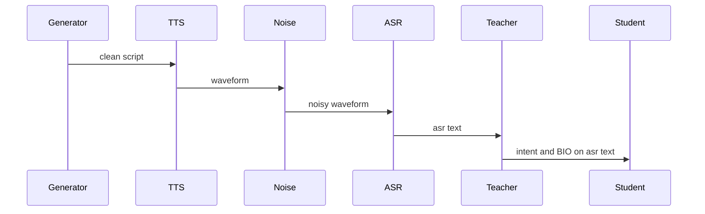

# Phase 5 — Spoken NLU

## 5.0 Overview

Phase 5 trains the intent and slot tagger on text the recognizer actually emitted, not on the clean script the caller was supposed to say. It also keeps the last value in a self-repair and maps closed-set names onto the doctor roster. The portfolio exhibit is the teacher-versus-student table on the golden set's ASR column, and the phonetic sweep that replaces the starting thresholds 0.82 and 0.05.

The week-6 deterministic matcher is not this phase's output. T6.1.6 builds that matcher so a booking demo can exist before the student is trained. T5.4.3 removes it from the default path.

## 5.1 Entry criteria

- ADR-006 has chosen an ASR backend, or the entity bench is `blocked`. If it is `blocked`, T5.2.2 cannot render ASR text and the phase stops at the schema, which is recorded in `docs/results/phase5.md`.
- T1.4.3 can run the local LLM, or teacher labeling is `blocked` the same way. No cloud labeling API is introduced to fill the gap.

## 5.2 Architecture and design

```python
class CallerScript(BaseModel):
    script_id: str
    intent: str
    slots: dict[str, str]
    persona: str
    disfluency: bool
    text: str

class AsrTrainRow(BaseModel):
    script_id: str
    spoken_clean: str
    asr_text: str
    intent: str
    bio_asr: list[str]
```

BIO tags are projected from the clean script onto `asr_text` with a Levenshtein alignment. Insertions in the ASR string are `O`. Deletions drop the clean token's tag. Substitutions keep the tag if the phonetic matcher says the tokens are the same entity, otherwise `O` and the row is flagged `align_low` for the golden review.

```python
def project_bio(clean_tokens: list[str], clean_tags: list[str], asr_tokens: list[str]) -> list[str]: ...

def resolve_entity(heard: str, candidates: list[str], settings: Settings) -> ResolveResult: ...
```

`ResolveResult` is either one id, or `None` plus up to three candidates when the score is below `phonetic_min_score` or the top two scores differ by less than `phonetic_margin`. Titles `dr`, `doctor` are stripped before scoring. The function does not write the database.

The student is a joint classifier: one encoder, an intent head, a BIO head. ONNX INT8. The stage `pipeline/stages/nlu.py` reads `FINAL.spoken`, never `normalized`, and emits `NLU`.



Config: `nlu_model_path` empty until export, `phonetic_min_score` 0.82 STARTING POINT, `phonetic_margin` 0.05 STARTING POINT, `nlu_timeout_ms` 40, `nlu_min_intent_confidence` 0.6 STARTING POINT.

## 5.3 Milestones

### M5.1 Synthetic caller corpus

Goal: a JSONL of caller scripts with intent and slots filled from the schema, varied by persona and disfluency.
Demo-able outcome: 200 scripts validate, covering every intent at least 10 times.

| Task | Description | Files | Depends on | Hours | Status | Acceptance |
|---|---|---|---|---|---|---|
| T5.1.1 | Schema and persona list | `training/nlu/schema.py` | T3.5.1 | 3 | done | `tests/test_caller_schema.py` rejects an unknown intent and a slot not in appendix D |
| T5.1.2 | Generate scripts with the local LLM under a grammar | `training/nlu/generate.py` | T5.1.1, T1.4.3 | 5 | done | Output JSONL parses. If the LLM bench is `blocked`, the task writes 200 hand-authored fixture lines instead and labels the file `hand_authored` |
| T5.1.3 | Commit the schema and a 20-line fixture, gitignore the full JSONL | `training/nlu/fixture_scripts.jsonl` | T5.1.2 | 2 | done | The fixture is enough for unit tests. The full set path is in the results file |

Implementation notes. The grammar forces `intent` and slot keys. Free text is only the `text` field. Personas are `brief`, `verbose`, `disfluent`. Disfluent scripts must contain one of: "no", "sorry", "I mean", "actually". The generator is seeded. The seed is recorded. Invented patient names are from a fixed fake list in the schema file, not from a real directory.

Tests: `tests/test_caller_schema.py`.

Metrics: none.

Exit gate: fixture validates and the full file's line count is in `docs/results/phase5.md` or the file is marked `hand_authored`.

### M5.2 Render, recognize, align, teach

Goal: each script gains an ASR transcript and BIO tags on that transcript.
Demo-able outcome: one fixture script round-trips through the stub TTS and stub ASR in CI, and the alignment test covers insertion, deletion, and substitution.

| Task | Description | Files | Depends on | Hours | Status | Acceptance |
|---|---|---|---|---|---|---|
| T5.2.1 | TTS render and MUSAN mix at a requested SNR | `training/nlu/render_audio.py` | T5.1.3, T1.4.4 | 5 | done | `tests/test_snr.py` mixes a sine and noise and the measured SNR is within 1 dB of the request. TTS itself is mark `bench` |
| T5.2.2 | Recognize with the chosen backend | `training/nlu/recognize.py` | T5.2.1, T3.2.3 | 5 | done | Rows contain `asr_text`. A stub ASR returns the clean text with one forced substitution so CI can align |
| T5.2.3 | Project BIO through alignment | `training/nlu/align_bio.py` | T5.2.2 | 5 | done | `tests/test_bio_projection.py` covers insert, delete, and a phonetic substitution that keeps the tag |
| T5.2.4 | Teacher labels the ASR string, constrained to the script's intent unless the ASR text is empty | `training/nlu/teach.py` | T5.2.3, T1.4.3 | 3 | done | The teacher cannot emit a slot key outside the schema. Test feeds a grammar reject and expects the row to be dropped, not patched by regex |

Implementation notes. SNR is `10 * log10(signal_power / noise_power)` after aligning lengths. The noise file's license is checked the same way as phase 2. Teacher input is the ASR text plus the clean slots as a hint the prompt calls unreliable. The hint is a compromise so the teacher does not invent a different appointment. The golden review, not the teacher, is the truth. Rows with `align_low` are oversampled into the review queue.

Tests: `tests/test_snr.py`, `tests/test_bio_projection.py`, `tests/test_teacher_grammar.py`.

Metrics: `training` is offline. The script writes `rows_dropped`.

Exit gate: projection tests pass, and a bench run's row count is recorded or marked `blocked`.

### M5.3 Hand-verified golden set

Goal: 500 rows whose intent and BIO tags a human accepted.
Demo-able outcome: `training/nlu/golden.jsonl` has 500 lines, each with `reviewer` and `reviewed_at`.

| Task | Description | Files | Depends on | Hours | Status | Acceptance |
|---|---|---|---|---|---|---|
| T5.3.1 | Sample 500 rows, oversampling `align_low` and each intent | `training/nlu/golden_sample.py` | T5.2.4 | 3 | done | The sample report shows every intent present |
| T5.3.2 | Review rows 1–125 | `training/nlu/golden.jsonl` | T5.3.1 | 8 | open | 125 lines have reviewer ids. This is human time. A script checks the count |
| T5.3.3 | Review rows 126–250 | `training/nlu/golden.jsonl` | T5.3.2 | 8 | slip | Same check at 250 |
| T5.3.4 | Review rows 251–375 | `training/nlu/golden.jsonl` | T5.3.3 | 8 | slip | Same check at 375 |
| T5.3.5 | Review rows 376–500 | `training/nlu/golden.jsonl` | T5.3.4 | 8 | slip | Same check at 500 |
| T5.3.6 | Schema test for the golden file | `tests/test_golden_schema.py` | T5.3.1 | 2 | done | A row missing `asr_text` or containing a clean-text-only tag set fails. The test runs on the fixture of 20 reviewed lines in CI. The 500-line file is checked by the same test when present |

Implementation notes. The reviewer field is a short id the operator chooses, not a guessed name. CI does not require all 500. The phase gate does. Slip tags mean these tasks move past week 15 before the demo script does. The student may train on teacher labels before the review finishes, but the number reported as slot F1 uses only reviewed rows. Reporting teacher-agreement as slot F1 is forbidden. The test `tests/test_golden_schema.py` includes a comment that states that, and `evals/nlu/score.py` refuses a file without `reviewer`.

Exit gate: 500 reviewed lines, or the phase results say `golden_incomplete` and slot F1 is not published.

### M5.4 Joint intent and slot student

Goal: an INT8 ONNX model scores the golden ASR column, and the stage emits `NLU` from spoken text.
Demo-able outcome: `docs/results/phase5.md` has student and teacher accuracy, slot F1, latency p50, and model size in MB, all from the scoring script.

| Task | Description | Files | Depends on | Hours | Status | Acceptance |
|---|---|---|---|---|---|---|
| T5.4.1 | Train the joint model | `training/nlu/train_student.py` | T5.2.4 | 6 | done | Script writes a metrics JSON. STARTING POINT: learning rate 3e-5, 5 epochs, batch 16, max length 128. The encoder name is whatever ADR-004's tier can run, recorded in the JSON |
| T5.4.2 | Export INT8 ONNX | `training/nlu/export_student.py` | T5.4.1 | 3 | done | File loads in `onnx_pool`. Size is in the JSON |
| T5.4.3 | NLU stage on spoken text, and remove the deterministic matcher from the default path | `pipeline/stages/nlu.py`, `dialogue/regex_slots.py` | T5.4.2, T6.1.6 | 3 | done | `tests/test_nlu_stage.py` feeds ASR text with a substitution and expects the student's spans. `regex_slots` is not imported by `server/app.py` |
| T5.4.4 | Score teacher and student on the golden ASR column | `evals/nlu/score.py` | T5.4.3, T5.3.6 | 3 | done | The scorer errors if `reviewer` is absent. Output is `docs/results/phase5.md` generated from JSON |

Implementation notes. Latency allocation for NLU is 30 ms. The scoring script measures p50 on CPU. A miss is reported, not hidden by running the LLM on the hot path. The LLM remains the proposal fallback for `out_of_scope` and for student intent confidence below `nlu_min_intent_confidence`. That fallback is phase 6. This phase only emits the confidence.

T5.4.3 depends on T6.1.6, which is allowed to land before this task. The dependency is a deletion, not a circular feature. The matcher file stays in the tree for the ablation T9.5.4 but is not on the default import path.

Tests: `tests/test_nlu_stage.py`, `tests/test_score_requires_reviewer.py`.

Metrics: `turnwise_nlu_seconds`, `turnwise_nlu_reject_total`.

Exit gate: results file contains the four comparison numbers or `golden_incomplete`. Default path does not import `regex_slots`.

### M5.5 Disfluency and phonetic resolution

Goal: "Tuesday no Wednesday" keeps Wednesday, and "Con" against the roster either becomes Khan or returns a disambiguation list.
Demo-able outcome: unit tests for both, plus a sweep file that replaces the starting thresholds only if the sweep ran.

| Task | Description | Files | Depends on | Hours | Status | Acceptance |
|---|---|---|---|---|---|---|
| T5.5.1 | Repair markers keep the later span of the same slot | `nlp/disfluency.py` | T5.4.3 | 3 | done | `tests/test_disfluency.py`: "Tuesday no Wednesday" yields Wednesday. "Tuesday no, the morning" does not delete Tuesday because "morning" is not a date |
| T5.5.2 | Phonetic score, title strip, margin | `nlp/phonetic.py` | T3.3.1 | 4 | done | `tests/test_phonetic.py` strips "Dr". A tie within the margin returns two candidates and no id |
| T5.5.3 | Wire both into the NLU stage before the event is emitted | `pipeline/stages/nlu.py` | T5.5.1, T5.5.2 | 3 | done | The emitted slots contain catalog ids, never the raw ASR string, for `doctor` |
| T5.5.4 | Sweep min score and margin on the golden set | `evals/nlu/phonetic_sweep.py` | T5.5.3, T5.3.6 | 3 | done | `docs/results/phase5_phonetic.md` lists the grid. Settings change only in that commit, citing the file |

Implementation notes. Markers are the list `no`, `sorry`, `i mean`, `actually`. A marker followed by a span of the same slot type replaces the earlier span. Two markers in one utterance apply left to right. The phonetic score is `0.6 * JaroWinkler(metaphone(heard), metaphone(candidate)) + 0.4 * JaroWinkler(heard, candidate)` after lowercasing and stripping titles. Metaphone is English-centric. The sweep is the authority, not the 0.82 constant. If the sweep is still slip, production keeps the starting point and the results file says `untuned`.

Closed-set slots are `doctor` and, when the service list exists, `service`. `patient_name` is not closed-set. It is confirmed, never forced onto the roster.

Tests: `tests/test_disfluency.py`, `tests/test_phonetic.py`, `tests/test_nlu_stage.py::test_doctor_slot_is_catalog_id`.

Metrics: `turnwise_disambiguation_total`, `turnwise_repair_applied_total`.

Exit gate: catalog-id test passes. Sweep is either a grid or `untuned`.

## 5.4 Data and models

Scripts: generated, license is the project's own output. Noise: MUSAN if the license check in T5.2.1 passes, else generated noise, stated in the results. Emotion corpora are not used here. Golden file is project data, not redistributed as a public dataset. Student model card: data hash, encoder name, hyperparameters actually used (the script writes them, replacing the starting point), INT8 size, golden F1. Training does not use SLURP labels as clinic intents. SLURP may be read as a format example in the schema module's comments. It is not mixed into the JSONL.

## 5.5 Failure modes

| Failure | Detection | Fallback | Test |
|---|---|---|---|
| LLM bench blocked | Flag | Hand-authored scripts, teacher skipped, student not trained | `tests/test_caller_schema.py` still passes |
| Alignment low | Flag on the row | Oversample into review, do not auto-accept | `tests/test_bio_projection.py` |
| Teacher grammar reject | Parser | Drop the row | `tests/test_teacher_grammar.py` |
| Student timeout | 40 ms | Emit `nlu_ok=0`. FSM re-asks. No regex on the ASR string | `tests/test_nlu_stage.py` |
| Phonetic tie | Margin | Disambiguation, no id | `tests/test_phonetic.py` |
| Raw doctor string | Slot type | Test fails if the emitted value is not in the roster | `tests/test_nlu_stage.py` |
| Golden incomplete | Missing reviewer | Scorer refuses to print F1 | `tests/test_score_requires_reviewer.py` |

## 5.6 Risks and mitigations

The teacher copies the clean hint and ignores ASR errors, which inflates F1. Mitigation: the reported F1 is on reviewed rows, and reviewers see `asr_text` and the waveform id, not only the clean line. Trigger: reviewer change rate above 20% of teacher tags, recorded in the golden file as `changed: true`. If that rate is high, T5.4.1 is rerun only after the review, which is why T5.4.4 is the publication step.

Hand review slips. The demo uses the scripted caller and the deterministic matcher until T5.4.3 deletes the matcher. The SLO for slot F1 stays unpublished rather than filled with teacher agreement.

## 5.7 Evaluation

`docs/results/phase5.md`: intent accuracy, slot micro-F1, latency p50, size, teacher versus student, all on the ASR column of reviewed rows. `docs/results/phase5_phonetic.md`: the sweep grid or `untuned`. No numeric F1 target in this plan. The first published F1 becomes the regression bar for T9.5.6, written into the smoke config in that task, not before the number exists.

## 5.8 Documentation and ADRs

ADR-008 if the student latency misses 30 ms and the hot path stays on the deterministic matcher longer than T5.4.3. Otherwise no ADR. Update appendix D only if a slot is added, which this phase does not do.

## 5.9 Exit criteria and phase gate

- [x] BIO projection tests pass.
- [x] SNR test passes within 1 dB.
- [x] Teacher output is grammar-constrained.
- [x] Golden file is 500 reviewed rows or explicitly `golden_incomplete`.
- [x] Scorer refuses unreviewed files.
- [x] Default path does not import `regex_slots`.
- [x] Doctor slots are catalog ids.
- [x] Results file has no number that lacks a JSON source.

## 5.10 Portfolio artifacts

The teacher-versus-student table. A single alignment example with an insertion marked `O`. The phonetic tie that asks "Khan or Kahn" rather than writing either. Interview point: training on clean text is the ablation, and the golden set is the only F1 that can be quoted.
