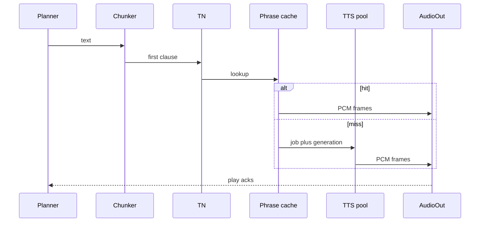

# Phase 7 — Response generation and streaming TTS

## 7.0 Overview

Phase 7 is the first time a caller can hear a reply. The planner already exists as a template-id plus an optional paraphrase (T6.3.4). This phase turns that string into streamed PCM, records how much of it the client acked, and observes the two TTFA histograms that have been registered since M1.1 at count 0. The product fails if "Dr. Khan" is spoken as "drive Khan", if the first clause waits for the whole paragraph, or if a filler satisfies the 700 ms target and the real answer arrives later unmeasured. The portfolio exhibit is the first-chunk aggressive flush, the phrase cache at 0 ms model time, and the TTFA versus TTFA-content pair on the same turn.

Deterministic: template selection after the FSM action, the chunker, text normalization, cache lookup, frame packing, the filler flag. Model-driven: optional paraphrase under the 180-character cap already enforced in T6.3.4. The model does not choose a voice, a rate, or a cache key.

## 7.1 Entry criteria

- M6.2 emits a template id and confirmed slot values. T6.3.4 discards over-long paraphrase.
- T4.3.3's `PlaybackCursor.note_chunk` exists. Phase 7 is the first caller of that API with real chunk boundaries.
- T1.4.4 has a TTS JSON row or `blocked`. A blocked row still allows the pool interface and the cache tests with a stub synthesizer that emits silence of a known duration.

## 7.2 Architecture and design

```python
def chunk_stream(buffer: str, first_chunk: bool, settings: Settings) -> tuple[list[str], str]: ...

def normalize_for_tts(text: str, context: TnContext) -> str: ...

class TnContext(BaseModel):
    spell_name: bool
    digit_mode: bool
    confirm: bool
```

```python
class TtsJob(BaseModel):
    session_id: str
    generation: int
    text: str
    voice: str
    speed: float
    cache_key: str | None
```

The cache key is `sha256(text + "|" + voice + "|" + f"{speed:.2f}")`. A hit returns the stored PCM and records `turnwise_tts_cache_hits_total`. A miss goes to the pool. The pool stamps `generation` at submit and drops the PCM if the session has moved. Phrase-cache entries for greetings and fillers are synthesized at process start in `models/tts_cache.py` and are not synthesized again.

Outbound frames are 20 ms (320 samples) by default, or 40 ms if `tts_frame_ms` is 40. The client ack still uses the frame index from ingress's clock? No. Playback uses a separate monotonic `play_frame_index` that starts at 0 for each `SAY` generation. Mixing the capture clock with the play clock is a bug T7.4.2's test forbids: an ack `0x03` body is `{stream: "play", frame_index: n}`. Capture frames stay on `stream: "cap"`.

TTFA: `turn_end_ts` is stored on the session when `TURN_END` is emitted. The first client play-ack of a frame whose `filler` flag is 0 or 1 observes `turnwise_ttfa_seconds`. The first play-ack of a frame whose `filler` flag is 0 observes `turnwise_ttfa_content_seconds`. If the first frame is content, both histograms receive the same sample.



Config: `tts_backend` empty until T7.4.4, `tts_voice` `default`, `tts_speed` 1.0, `tts_digit_speed` 0.85 STARTING POINT, `tts_frame_ms` 20, `tts_first_chunk_min_words` 4, `tts_later_min_words` 8, `tts_max_hold_ms` 400, `paraphrase_max_chars` 180 already in phase 6, `tts_timeout_ms` 800, `tts_warmup_phrases` the list in T7.4.3.

## 7.3 Milestones

### M7.1 Template planner and length-capped paraphrase

Goal: every `SAY` has a template id, and paraphrase is optional garnish that cannot change slot values.
Demo-able outcome: a book confirmation speaks the template when the stub paraphrase is empty, and speaks the stub paraphrase when it is 40 characters that still contain the doctor id and the ISO time in spoken form after TN.

| Task | Description | Files | Depends on | Hours | Status | Acceptance |
|---|---|---|---|---|---|---|
| T7.1.1 | Template catalog keyed by action and slot | `dialogue/templates.py`, `dialogue/templates.toml` | T6.2.1 | 4 | done | `tests/test_templates.py` every FSM action used in appendix C has a template. Missing key fails startup |
| T7.1.2 | Planner fills slots with confirmed values only | `dialogue/planner.py` | T7.1.1, T6.2.3 | 4 | done | A pending slot is rendered as empty and the template chooses the "ask" variant. Confirmed phone is passed to TN, not spoken raw in the planner |
| T7.1.3 | Optional paraphrase, cap already 180, plus a slot-presence check | `dialogue/planner.py` | T7.1.2, T6.3.4 | 3 | done | `tests/test_paraphrase_slots.py` discards paraphrase that drops the doctor id that the template contained. The spoken string then equals the template |

Implementation notes. The planner is deterministic once the paraphrase is discarded. The slot-presence check is a set inclusion of required surface forms after TN, not a semantic compare. If the template said "Doctor Khan" and the paraphrase says "the cardiologist", the check fails and the template wins. That is intentional: the confirmation must speak the catalog name.

Tests: `tests/test_templates.py`, `tests/test_paraphrase_slots.py`. Failure path: unknown template id raises at the FSM action, not at TTS.

Metrics: `turnwise_planner_paraphrase_discard_total{reason}` reasons `length`, `missing_slot`.

Exit gate: every action has a template, and a paraphrase that omits the doctor does not reach TTS.

### M7.2 Abbreviation-safe streaming chunker

Goal: the first clause of four or more words flushes without waiting for a period, and "Dr." does not split.
Demo-able outcome: "Dr. Khan can see you Wednesday at three p.m." yields a first chunk that includes "Dr. Khan" intact.

| Task | Description | Files | Depends on | Hours | Status | Acceptance |
|---|---|---|---|---|---|---|
| T7.2.1 | Chunker with abbreviation set | `nlp/chunker.py` | T7.1.2 | 4 | done | `tests/test_chunker.py` does not split on `Dr.`, `Mr.`, `Mrs.`, `Ms.`, `St.`, `e.g.`, `i.e.`, `p.m.`, `a.m.` |
| T7.2.2 | First-chunk min words 4, later 8, sentence end always eligible | `nlp/chunker.py` | T7.2.1 | 3 | done | A 4-word clause ending in a comma flushes when `first_chunk` is true and does not when it is false |
| T7.2.3 | Max-hold flush | `pipeline/stages/chunker.py` | T7.2.2 | 3 | done | A buffer with no boundary for `tts_max_hold_ms` 400 flushes a safe prefix of whole words. A test with a 20-word clause and a fake clock advances 400 ms and sees a flush |

Implementation notes. The abbreviation set is a setting `tts_abbrev` default the nine tokens above, compared casefold on the last token of the candidate. A max-hold flush never splits a token. If the buffer is a single 30-character token, it still flushes at hold because waiting forever is worse. Digit strings are one token if they have no spaces, so a phone number does not flush one digit at a time on hold.

Tests: `tests/test_chunker.py` including "Dr. Khan, your appointment is at 3 p.m." as the first-chunk case.

Metrics: `turnwise_chunk_flush_total{reason}` reasons `boundary`, `hold`.

Exit gate: abbreviation tests pass, and the hold test uses a fake clock, not `asyncio.sleep(0.4)` on the CI runner as the only proof.

### M7.3 Deterministic TTS normalization and prosody

Goal: times, phones, titles, and low-confidence names have one written-to-spoken mapping with no model.
Demo-able outcome: `14:30` becomes "two thirty p.m.", `5550100` becomes grouped digits, `Dr.` becomes "Doctor", and a low-confidence name is spelled.

| Task | Description | Files | Depends on | Hours | Status | Acceptance |
|---|---|---|---|---|---|---|
| T7.3.1 | TN rules for time, phone, title | `nlp/tn.py` | T7.2.1 | 5 | done | `tests/test_tn.py` table: `14:30` → a string containing "two" and "thirty" and "p.m." or "pm" as configured. Phone `5550100` is seven spoken digits. `Dr. Khan` starts with "Doctor" |
| T7.3.2 | Digit mode slows `speed` to `tts_digit_speed` | `pipeline/stages/tts_norm.py` | T7.3.1 | 2 | done | The `TtsJob.speed` is 0.85 STARTING POINT when `digit_mode` is true and 1.0 otherwise |
| T7.3.3 | Confirmation pause marker | `nlp/tn.py` | T7.3.1 | 2 | done | A confirm context inserts a break token the TTS backend documents. If the backend has no break, the normalizer inserts a comma. The test snapshots the string, not the audio |

Implementation notes. TN is the inverse of ITN and is a different module. Sharing NeMo is allowed if T3.4.1 imported it. If NeMo did not import, the rule table in `nlp/tn.py` is the production path, same as ITN's fallback. Year-guess dates are spoken as month, ordinal day, and year, never as ISO. Spelling a name uses letter-by-letter English letter names. The flag `spell_name` is true when the slot `patient_name` was explicit-confirmed (T6.2.1) on this turn.

Tests: `tests/test_tn.py`. Failure path: unknown character in a name becomes "symbol" and increments `turnwise_tn_unknown_char_total`. The call continues.

Metrics: `turnwise_tn_seconds`, `turnwise_tn_unknown_char_total`.

Exit gate: the table test passes, and `pipeline/stages/tts_norm.py` does not import an LLM client.

### M7.4 Phrase cache, frame streaming, CPU versus GPU

Goal: greetings and fillers have no synthesis on the hot path, PCM leaves in 20 ms frames, and ADR-010 records which device TTS uses.
Demo-able outcome: the greeting's TTS span has `cache=hit` and `latency_ms` under 5, and `turnwise_ttfa_seconds` has a sample after a stub client acks frame 0.

| Task | Description | Files | Depends on | Hours | Status | Acceptance |
|---|---|---|---|---|---|---|
| T7.4.1 | TTS pool, generation drop, timeout | `models/tts_pool.py` | T1.4.4, T3.1.1 | 6 | done | `tests/test_tts_pool.py` drops PCM stamped generation 0 after barge-in. Timeout 800 ms returns an error the out stage treats as the cached `cannot_speak` phrase if present, else session close |
| T7.4.2 | Pack PCM into `tts_frame_ms` frames and send `0x02` play stream | `pipeline/stages/audio_out.py`, `server/playback.py` | T7.4.1, T4.3.3 | 5 | done | `tests/test_audio_out_frames.py` 320-sample frames at 20 ms. Play acks use `stream=play`. Capture indexes are not compared to play indexes |
| T7.4.3 | Warmup cache at startup for the phrase list | `models/tts_cache.py` | T7.4.1 | 4 | done | List: greeting, `one_moment`, `could_you_repeat`, `headphones_required`, `seek_emergency`, `cannot_book_now`, `cannot_speak`, `goodbye`. `tests/test_tts_cache.py` second lookup does not call the pool |
| T7.4.4 | Measure first-chunk p50 on CPU and on GPU if present | `evals/bench/tts.py` (extend T1.4.4), `docs/adr/ADR-010-tts-device.md` | T7.4.3, T1.4.4 | 4 | done | ADR-010 picks CPU if CPU p50 is ≤ 200 ms TARGET. If CPU misses and GPU hits, GPU is allowed only if M10.2 has not yet shown a P95 break. Until M10.2, CPU is the default even if slower, and the miss is recorded |
| T7.4.5 | Observe TTFA histograms on play-ack | `pipeline/stages/audio_out.py` | T7.4.2, T6.5.2 | 3 | done | `tests/test_ttfa_observe.py` a filler then content produces two different samples. A content-only turn produces two equal samples. Count is no longer 0 |

Implementation notes. Default device is CPU because the 8 GB tier in the front matter pins TTS to CPU to leave the GPU for the LLM. T7.4.4 is not allowed to flip that default on a single-call bench. M10.2 is the contention measurement. Phrase cache is in memory, process-local, rebuilt at start. It is not Redis. A cache miss on a warmup phrase at runtime increments `turnwise_tts_cache_miss_warmup_total` because that means startup failed to fill the cache.

`cannot_speak` is itself cached. If TTS is down at runtime, audio_out plays that phrase from cache. If the cache is empty because TTS was down at startup, the session closes with a log `tts_unavailable`. That is the degradation ladder's TTS-down rung, tested in T10.3.1, referenced here so the pool error path is not a stub.

Tests: the four test modules. Failure path: empty PCM from the backend is an error, not a silent call.

Metrics: `turnwise_tts_first_chunk_seconds`, `turnwise_tts_cache_hits_total`, `turnwise_tts_cache_misses_total`, `turnwise_ttfa_seconds` (first observations), `turnwise_ttfa_content_seconds`.

Exit gate: TTFA count is > 0 in the unit test, cache hit avoids the pool, play and cap clocks are distinct, ADR-010 exists.

## 7.4 Data and models

TTS weights downloaded, license copied into `docs/results/phase7.md`. Warmup phrases are English clinic templates, invented. No training. If Kokoro and Piper both have JSON rows from T1.4.4, T7.4.4 compares first-chunk p50 and a round-trip TTS→ASR pronunciation error on the doctor roster. The pronunciation number is a TARGET of 0 substitutions on the 15-name roster, reported as a count, not a MOS. UTMOS is not run in this phase. If a UTMOS tool is added later it is a slip task, not a gate.

## 7.5 Failure modes

| Failure | Detection | Fallback | Test |
|---|---|---|---|
| Paraphrase drops a slot | Set inclusion | Template | `tests/test_paraphrase_slots.py` |
| Chunker sees "Dr." | Abbrev set | No split | `tests/test_chunker.py` |
| No boundary for 400 ms | Hold timer | Whole-word flush | `tests/test_chunker.py` |
| TN unknown char | Code point table | "symbol", counter | `tests/test_tn.py` |
| TTS timeout | 800 ms | Cached `cannot_speak` or close | `tests/test_tts_pool.py` |
| Stale generation PCM | Stamp | Drop | `tests/test_tts_pool.py` |
| Play ack on capture index | Stream field | Ignore, counter | `tests/test_audio_out_frames.py` |
| Cache miss on warmup phrase | Lookup | Synthesize once, increment miss-warmup | `tests/test_tts_cache.py` |
| Empty PCM | Length 0 | Error, not silence | `tests/test_tts_pool.py` |

## 7.6 Risks and mitigations

Kokoro on CPU may miss 200 ms first-chunk. Mitigation: cache covers the greeting and fillers so TTFA P50 can still pass on those turns; content TTFA will miss on cold synthesis. Trigger: T7.4.4 CPU row above 200 ms. Piper is the alternative on the same bench, not a silent swap. ADR-010 names the winner.

Linear playback maps from phase 4 are replaced by chunk boundaries here. If `note_chunk` is not called, `played_text` stays empty and confirmations do not bind (T6.2.1). The unmap counter from T4.3.3 must stay 0 in `tests/test_ttfa_observe.py`.

## 7.7 Evaluation

`docs/results/phase7.md`: first-chunk p50 CPU (and GPU if present), cache hit latency, TTFA unit-test samples, TN table pass, chunker cases pass, TTS→ASR substitutions on the roster if both models exist. Targets: first chunk 200 ms, playout frame 20 or 40 ms as configured, cache hit under 5 ms in-process. Product TTFA P50/P95 remain unmet until phase 9's real-time subset.

## 7.8 Documentation and ADRs

ADR-010 TTS device. Update `docs/ARCHITECTURE.md` to say TTFA histograms are observed on play-ack, not on socket write. Phrase-cache list is in the results file.

## 7.9 Exit criteria and phase gate

- [x] Every FSM action has a template.
- [x] Paraphrase cannot drop a catalog name.
- [x] "Dr." and "p.m." do not split.
- [x] TN table passes without an LLM import.
- [x] Cache hits skip the pool.
- [x] Play and capture clocks are separate.
- [x] TTFA and TTFA-content observe in a unit test.
- [x] ADR-010 names a device.

## 7.10 Portfolio artifacts

A waveform of the first chunk versus the full sentence, showing the early flush. A Grafana panel screenshot after T7.4.5 with a non-zero TTFA count, captioned as a unit-test scrape, not a 900-call result. Interview point: filler and content are different histograms. Interview point: confirmation binds the acked prefix, so `note_chunk` is part of the correctness path, not a metric nicety.
