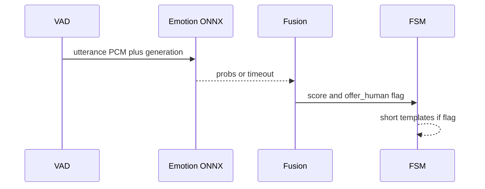

# Phase 8 — Paralinguistics and safety

## 8.0 Overview

Phase 8 adds an utterance-level audio emotion score and a late-fusion policy that can offer a human. It does not own urgency. T6.6.1's keyword path still escalates with this classifier unloaded. Acted-emotion corpora transfer poorly to clinic calls. The portfolio exhibit is the calibration curve that shows that, plus a fusion formula that still runs when the audio model times out.

Deterministic: keyword urgency, the fusion formula, the two-turn threshold, the TTS slowdown and template shortening. Model-driven: the three-class audio probabilities, a text-sentiment score. Neither model may write a booking or skip the keyword path.

## 8.1 Entry criteria

- M6.6 keyword tests pass.
- M4.2's ONNX pool exists so an emotion model can share it.
- CREMA-D and RAVDESS license check in T8.1.1. If redistribution is not allowed, the download script fetches them into a gitignored directory. Training does not start without a recorded license string in `docs/results/phase8.md`.

## 8.2 Architecture and design

```python
class EmotionProbs(BaseModel):
    calm: float
    frustrated: float
    distressed: float
    generation: int

def fuse(
    audio: EmotionProbs | None,
    text_score: float | None,
    repairs: int,
    repeated_no: int,
    barged: bool,
    settings: Settings,
) -> float:
    ...
```

Fusion, STARTING POINT weights that T8.4.2 may replace after the calibration file exists:

```
score = 0.4 * distressed_or_frustrated
      + 0.2 * (1 - text_score_clipped)
      + 0.2 * min(1, repairs / 3)
      + 0.1 * min(1, repeated_no / 2)
      + 0.1 * (1 if barged on this turn else 0)
```

`distressed_or_frustrated` is `audio.distressed + audio.frustrated` when audio is present, else 0. `text_score_clipped` is a 0–1 sentiment where 1 is calm; missing text score is 0.5 so it does not drive the result. If audio is `None`, the first term is 0 and the dialogue terms still run.

Policy: if `score` is at least `frustration_threshold` (STARTING POINT 0.65) on two consecutive user turns, set `session.offer_human` true, switch templates to the short set, and set TTS speed to `tts_frustrated_speed` (STARTING POINT 0.9). The FSM action is `offer_human`, which is not `HANDOFF`. Handoff still requires the repair ladder or an explicit `speak_to_human` intent. The agent asks "Would you like me to get a person?" and a yes then transitions to `HANDOFF`.



The emotion stage runs in parallel with NLU from the same `TURN_END` audio, not on the TTFA critical path. Its timeout `emotion_timeout_ms` default 80 must not delay `TURN_END` handling. The FSM reads the last fusion score; if it has not arrived by the planner, the planner uses dialogue terms only.

Config: `emotion_model_path` empty until export, `emotion_timeout_ms` 80, `frustration_threshold` 0.65 STARTING POINT, `frustration_turns` 2, `tts_frustrated_speed` 0.9, `sentiment_enabled` true.

## 8.3 Milestones

### M8.1 Utterance emotion classifier

Goal: a 3-class model exported to ONNX, or a documented skip if the license or the bench forbids training.
Demo-able outcome: `docs/results/phase8.md` has a confusion matrix on a held-out acted split, produced by the training script, or a `skipped` row with the license reason.

| Task | Description | Files | Depends on | Hours | Status | Acceptance |
|---|---|---|---|---|---|---|
| T8.1.1 | License and download for CREMA-D and RAVDESS | `training/emotion/data.md`, `scripts/download_emotion.py` | T1.4.5 | 3 | forward | The markdown quotes the license URL and whether research-only use is allowed. If not allowed, the script exits 2 and training is `skipped` |
| T8.1.2 | Map dataset labels onto calm / frustrated / distressed | `training/emotion/map_labels.py` | T8.1.1 | 3 | forward | Mapping table is in the file. Happy and neutral → calm. Angry and disgust → frustrated. Fear and sad → distressed. Unmapped labels are dropped and counted |
| T8.1.3 | Fine-tune wav2vec2 or load emotion2vec, chosen by held-out macro-F1 | `training/emotion/train.py` | T8.1.2 | 8 | slip | STARTING POINT: 3 epochs, lr 1e-5, batch 8. The script writes both candidates' macro-F1 if both run, and picks the higher. If only one library imports, that one is used and the other is `blocked` |
| T8.1.4 | Export ONNX and load through the pool | `training/emotion/export.py`, `models/onnx_pool.py` | T8.1.1 | 3 | forward | Timeout path returns `None` to fusion. Generation mismatch drops the result. If T8.1.3 has not produced weights, this task loads a stub that always returns `None`. T8.1.3 later replaces the stub file |

Implementation notes. T8.1.3 is slip because the week-15 demo does not need the audio model. T8.1.4 still lands a stub that always returns `None` so fusion tests run. Replacing the stub with the ONNX file is the same module. Class names stay three. A 7-class dataset is mapped, never exposed to the FSM.

Tests: `tests/test_emotion_map.py`, `tests/test_emotion_timeout.py`. Training is mark `bench`.

Metrics: `turnwise_emotion_seconds`, `turnwise_emotion_timeouts_total`.

Exit gate: mapping table exists, timeout returns `None`, and either an ONNX file or a stub is loaded.

### M8.2 Late fusion with text sentiment and dialogue signals

Goal: a single score whose dialogue terms work with audio equal to `None`.
Demo-able outcome: three repairs and two "no"s with no audio still exceed 0.65 under the starting weights, and a calm audio vector with zero repairs does not.

| Task | Description | Files | Depends on | Hours | Status | Acceptance |
|---|---|---|---|---|---|---|
| T8.2.1 | Text sentiment as a small lexicon plus optional model | `nlp/sentiment.py` | T8.1.4 | 3 | forward | Lexicon is deterministic. "please" and "thank you" raise the calm score. "stupid" and "useless" lower it. No cloud API. If a local model is added it is behind `sentiment_model_enabled` default false |
| T8.2.2 | Implement `fuse` from settings weights | `nlp/fusion.py` | T8.2.1 | 3 | forward | `tests/test_fusion.py` the two cases in the demo-able outcome, plus audio timeout identical to `None` |
| T8.2.3 | Read repair count, repeated no, barge-in from the session | `pipeline/stages/fusion.py` | T8.2.2, T6.2.2 | 2 | forward | A unit session with `attempts` and a barge-in flag produces the expected score within 1e-6 |

Implementation notes. Repeated "no" counts consecutive no answers on confirm, not the word "no" inside a repair ("Tuesday no Wednesday"). Disfluency already consumed that "no". The fusion stage must not double-count it. Weights are settings `fuse_w_audio`, `fuse_w_text`, `fuse_w_repair`, `fuse_w_no`, `fuse_w_barge` summing to 1.0. A startup check fails if they do not.

Tests: `tests/test_fusion.py`, `tests/test_sentiment_lexicon.py`.

Metrics: `turnwise_fusion_score` histogram.

Exit gate: audio-missing path is tested, and weights sum is validated at startup.

### M8.3 Deterministic escalation policy

Goal: two consecutive turns over the threshold offer a human, shorten templates, and slow TTS, without skipping keywords.
Demo-able outcome: turn 1 over threshold does not offer. Turn 2 does. A keyword hit on turn 1 still goes to `URGENT` regardless of the score.

| Task | Description | Files | Depends on | Hours | Status | Acceptance |
|---|---|---|---|---|---|---|
| T8.3.1 | Two-turn latch | `dialogue/frustration.py` | T8.2.3 | 3 | forward | `tests/test_frustration_policy.py` one turn does not set `offer_human`. Two do. A below-threshold turn resets the count |
| T8.3.2 | Short template set and TTS speed | `dialogue/templates.toml`, `pipeline/stages/tts_norm.py` | T8.3.1 | 3 | forward | Short templates exist for `ask_slot` and `confirm`. Speed becomes `tts_frustrated_speed` when the flag is set |
| T8.3.3 | Offer does not replace `URGENT` | `dialogue/table.py` | T8.3.1, T6.6.3 | 2 | forward | Keyword plus high score still ends in `URGENT`, not `offer_human` |

Implementation notes. The latch resets when the score is below threshold, so a single spike does not stick. `speak_to_human` intent still hands off on one turn without waiting for two frustrated turns. The offer question is template `offer_human`. Yes is the existing confirm path on that template, which is a yes/no slot, so "okay" is not a backchannel (T4.3.2).

Tests: `tests/test_frustration_policy.py`.

Metrics: `turnwise_offer_human_total`.

Exit gate: two-turn test, reset test, and urgent-precedence test pass.

### M8.4 Calibration curve and domain-shift write-up

Goal: publish that acted labels do not match a small held-out call-like set, or publish that the call-like set does not exist and therefore the audio model is off by default.
Demo-able outcome: `docs/results/phase8_calibration.md` is a table of predicted distressed versus a human label on 30 utterances, or a statement that the 30 do not exist and `emotion_model_enabled` defaults false.

| Task | Description | Files | Depends on | Hours | Status | Acceptance |
|---|---|---|---|---|---|---|
| T8.4.1 | Label 30 call-like utterances or record that they were not collected | `training/emotion/call_like.jsonl` | T8.1.4 | 4 | slip | 30 lines with `label` and `source`. If the operator declines collection, the file contains one JSON object `{"status":"not_collected"}` |
| T8.4.2 | Reliability table, 5 bins | `evals/emotion/calibrate.py` | T8.4.1 | 3 | slip | Script refuses to invent bins when status is `not_collected`. Otherwise writes ECE and a CSV |
| T8.4.3 | Default flag and the limitation paragraph | `docs/results/phase8.md`, `server/config.py` | T8.4.2 | 2 | forward | `emotion_model_enabled` defaults false unless T8.4.2 wrote an ECE and the operator flips the flag in an ADR. The paragraph states acted-to-call shift as a limitation even if ECE looks good |

Implementation notes. Thirty utterances are not a clinical study. The write-up must not claim they are. ECE on 30 bins of 6 is noisy; the table is an honesty artifact. Interviewers who have shipped emotion models look for this caveat. The default-off flag is the product consequence.

Tests: `tests/test_calibrate_refuses_missing.py`.

Metrics: none on the call path for calibration.

Exit gate: the limitation paragraph exists, and the default flag is false unless an ADR says otherwise.

## 8.4 Data and models

CREMA-D and RAVDESS: license strings from T8.1.1. Mapping in T8.1.2. Call-like 30: operator-recorded or `not_collected`. No production audio is retained by default (phase 10 retention). Training audio is gitignored. Model card: label mapping, acted-set macro-F1, ECE if computed, `emotion_model_enabled` default.

## 8.5 Failure modes

| Failure | Detection | Fallback | Test |
|---|---|---|---|
| License forbids use | Script exit 2 | Skip training, stub `None` | `tests/test_emotion_timeout.py` still passes |
| Emotion timeout | 80 ms | Dialogue terms only | `tests/test_emotion_timeout.py` |
| Stale generation | Stamp | Drop | pool test shared with T8.1.4 |
| Weights do not sum to 1 | Startup | Process refuses to start | `tests/test_fusion.py` |
| Keyword plus high frustration | Table order | `URGENT` | `tests/test_frustration_policy.py` |
| Calibration file missing | Status field | Scorer refuses, flag stays false | `tests/test_calibrate_refuses_missing.py` |
| Sentiment model wanted but disabled | Flag | Lexicon only | `tests/test_sentiment_lexicon.py` |

## 8.6 Risks and mitigations

Treating acted F1 as production quality. Mitigation: default-off, calibration file, limitation paragraph. Trigger: a README that quotes acted F1 as the product number. T10.5.1's README checklist forbids that quote.

Fusion weights that make three repairs always hand off. The policy offers a human, it does not hand off. Trigger: a test where `offer_human` is true and the state is `HANDOFF` without a yes. That test is in T8.3.1 and must fail the build.

## 8.7 Evaluation

`docs/results/phase8.md`: acted confusion matrix or `skipped`, timeout tests pass, fusion cases pass, urgent precedence pass, calibration table or `not_collected`, default flag value. No SLO is owned by this phase. Urgent recall remains the keyword path.

## 8.8 Documentation and ADRs

ADR-011 emotion default-off, written when T8.4.3 lands, even if the operator later enables the flag. The ADR is the place the flag flips, not a silent env change in production without a results file.

## 8.9 Exit criteria and phase gate

- [ ] Keyword path still tested with emotion unloaded.
- [ ] Fusion works with audio `None`.
- [ ] Two-turn offer, one-turn no offer, below-threshold reset.
- [ ] Offer is not handoff.
- [ ] Calibration file or `not_collected`.
- [ ] `emotion_model_enabled` default false unless ADR-011 says true.
- [ ] Limitation paragraph in the results file.

## 8.10 Portfolio artifacts

The calibration table, even if ugly. The fusion formula with the timeout term equal to zero. Interview point: keywords own safety; emotion owns courtesy. Interview point: acted datasets are a training convenience, not a production distribution.
