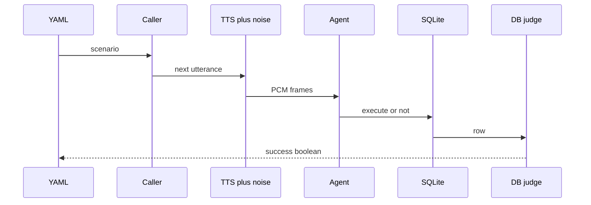

# Phase 9 — Evaluation harness and ablations

## 9.0 Overview

Phase 9 is the first time a product SLO can move from unmet to measured. Task success is a database assertion. A language-model judge scores politeness and clarity only. Functional volume uses a virtual clock so 900 calls are not 900 minutes of wall time. A 30-call real-time subset measures barge-in and TTFA. The CI smoke suite is a scripted, non-LLM caller so a prompt change cannot hide a regression.

The five ablations are the portfolio exhibit: silence versus hybrid endpointing, hotword bias on versus off, NLU trained on clean text versus ASR output, FSM-first versus a model-in-the-loop writer (the latter is expected to fail the write-safety tests), and Zipformer versus Whisper+LocalAgreement-2.

Deterministic: scenario schema, virtual clock, DB judge, SNR mix, the smoke gate. Model-driven: the optional spoken caller that generates the next utterance, and the soft judge. Neither model decides whether the appointment row is correct.

## 9.1 Entry criteria

- M6.4 writes appointments. M7.4.5 observes TTFA in unit tests.
- T5.4.4 may still be `golden_incomplete`. Slot F1 then stays unpublished and the smoke gate does not include it.
- T3.2.3 has ADR-006. Ablation 5 uses the non-default backend as the comparison, marked `blocked` if that backend never imported.

## 9.2 Architecture and design

```python
class Scenario(BaseModel):
    id: str
    goal: str
    intent: str
    slots: dict[str, str]
    persona: str
    noise_snr_db: float | None
    speaking_rate: float
    disfluency: bool
    barge_in: bool
    urgent: bool
    clock: str  # "virtual" or "realtime"
    caller: str  # "scripted" or "llm"
```

```python
class DbJudgement(BaseModel):
    success: bool
    reason: str
    appointment_id: str | None
    expected: dict[str, str]
    actual: dict[str, str]
```

Virtual clock: `session.now` is a `datetime` the simulator sets. Sleeps in the endpoint and TTS are scaled by `eval_time_scale` default 0, meaning endpoint silence thresholds are compared against simulated `silence_ms` the driver injects, not against wall time. Real-time mode sets `eval_time_scale` to 1 and uses wall clocks. Mixing the two in one process is forbidden; the driver is a separate process per mode.

The 900-call matrix is 50 templates × 3 personas × 3 SNR values (clean, 15 dB, 10 dB — the SLO names 10 dB; 15 dB is the middle point) × 2 rates. That product is 900. It runs in virtual-clock mode. Wall-clock estimate is written by the driver from its own elapsed time, not predicted in this plan.



Config: `eval_scenario_dir` `evals/scenarios`, `eval_time_scale` 0, `eval_realtime_n` 30, `eval_smoke_n` 30, `eval_soft_judge` false on CI, `eval_matrix_n` 900.

## 9.3 Milestones

### M9.1 Scenario schema and scripted non-LLM caller

Goal: YAML scenarios validate, and a scripted caller walks a book path without a language model.
Demo-able outcome: ten scripted scenarios produce ten DB judgements, at least one failure fixture that expects `success: false`.

| Task | Description | Files | Depends on | Hours | Status | Acceptance |
|---|---|---|---|---|---|---|
| T9.1.1 | Pydantic schema and YAML loader | `evals/schema.py` | T6.1.2 | 3 | forward | `tests/test_scenario_schema.py` rejects an unknown intent and a missing `urgent` boolean |
| T9.1.2 | Five fully worked examples matching appendix F | `evals/scenarios/examples/` | T9.1.1 | 3 | forward | Each example validates. The five ids are `book_happy`, `barge_mid_confirm`, `noisy_name`, `urgent_breathe`, `faq_hours` |
| T9.1.3 | Scripted caller: a list of utterances timed on the virtual clock | `evals/caller_scripted.py` | T9.1.2, T7.4.5 | 5 | forward | `tests/test_scripted_book.py` books the expected doctor and time. `tests/test_scripted_fail.py` expects no row when the caller hangs up early |
| T9.1.4 | Ten-scenario smoke list for the week-6 slice and for CI | `evals/scenarios/smoke.yaml` | T9.1.3 | 3 | forward | Ten ids, all `caller: scripted`, mix of book, cancel, faq, urgent |

Implementation notes. Scripted utterances are PCM files generated once by TTS in T9.1.3's setup, committed as 16 kHz fixtures if they are short, or generated in the test tmp dir from a text list if the TTS stub is in use. CI uses the stub: the agent under test in smoke mode can accept text injection behind `eval_text_inject` default false, true only in the eval process. Production WebSocket does not implement text injection. The test starts the app with the flag.

Tests: the files above. Failure path: a scenario with `urgent: true` and no keyword in the script fails the loader because the keyword path would not fire and the scenario would be a false miss.

Metrics: `turnwise_eval_runs_total{result}` in the driver process, not in production.

Exit gate: ten smoke scenarios validate, one intended fail is red, one book is green.

### M9.2 Spoken caller: TTS, SNR, rate, disfluency, barge-in injection

Goal: an LLM caller, when enabled, produces the next utterance from the agent's last `SAY`, then TTS and noise render it.
Demo-able outcome: one scenario with `caller: llm` completes on a developer machine, or the driver records `blocked` when T1.4.3 is blocked. CI does not run this caller.

| Task | Description | Files | Depends on | Hours | Status | Acceptance |
|---|---|---|---|---|---|---|
| T9.2.1 | LLM caller with a grammar for `{text, done}` | `evals/caller_llm.py` | T9.1.3, T6.3.1 | 5 | forward | Grammar rejects a reply that contains an ISO date the scenario did not allow the caller to know. The caller is a persona, not an oracle |
| T9.2.2 | TTS render, rate stretch, MUSAN mix | `evals/render.py` | T9.2.1, T5.2.1 | 4 | forward | Rate 0.9 and 1.1 are the two matrix rates. SNR None means clean. Reuses `tests/test_snr.py` |
| T9.2.3 | Barge-in injection at a scenario timestamp | `evals/barge_inject.py` | T9.2.2, T4.3.4 | 4 | forward | `tests/test_barge_inject.py` starts caller PCM while the agent is in `SAY` and expects `turnwise_barge_in_total` to move when the fixture is labeled `barge_in: true` |
| T9.2.4 | Disfluency insertion on the text before TTS | `evals/disfluency_inject.py` | T9.2.1 | 2 | forward | Inserts one marker from the T5.5.1 list when `disfluency: true` |

Implementation notes. The LLM caller must not receive the database state. It receives the scenario goal in natural language and the last agent text. If it says `done: true` early, the judge still looks at the database. A polite hang-up with no booking is a task failure for `goal: book`.

Tests: grammar test, barge inject test. LLM caller marked `bench`.

Metrics: driver-side only.

Exit gate: barge inject test passes on the scripted caller. LLM caller is optional for the gate.

### M9.3 Database judge and soft-quality LLM judge

Goal: task success is a row compare. Soft scores cannot flip that boolean.
Demo-able outcome: a booking with the wrong doctor is `success: false` even if the soft judge returns 5/5 politeness.

| Task | Description | Files | Depends on | Hours | Status | Acceptance |
|---|---|---|---|---|---|---|
| T9.3.1 | DB judge for book, reschedule, cancel, check, faq, urgent, handoff | `evals/judge_db.py` | T9.1.3, T6.4.4 | 5 | forward | Table-driven tests in `tests/test_judge_db.py` for each goal. FAQ success is "a chunk id was cited and the refusal template was not used", or the reverse for empty retrieval |
| T9.3.2 | Critical-slot compare uses confirmed values | `evals/judge_db.py` | T9.3.1, T6.2.1 | 3 | forward | Yes to a wrong readback is failure even if SQLite stored that wrong value. The expected slots are the scenario's, not the agent's belief |
| T9.3.3 | Soft judge, politeness and clarity only, off on CI | `evals/judge_soft.py` | T9.3.1 | 3 | forward | The combined report has `task_success` from T9.3.1 and `soft` nested. A test asserts `task_success` is independent of a stub soft score of 0 |
| T9.3.4 | FAQ hallucination: reply with zero chunk ids is a fail | `evals/judge_db.py` | T9.3.1, T6.3.3 | 2 | forward | The ungrounded counter plus the judge agree |

Implementation notes. Cancel success is the row gone or status `cancelled`. Reschedule success is the new instant. Urgent success is state `URGENT` and no appointment written. Handoff success is state `HANDOFF` and a summary containing only confirmed slots.

Tests: `tests/test_judge_db.py`, `tests/test_soft_cannot_override.py`.

Metrics: none in production.

Exit gate: wrong-doctor case is false, soft score cannot override, ungrounded FAQ is false.

### M9.4 Metric suite and ~900-call matrix on a virtual clock

Goal: run the matrix, write `docs/results/phase9.md` from JSON, and run 30 real-time calls for TTFA and barge-in.
Demo-able outcome: the driver prints elapsed wall time and 900 judgements, or a smaller N if the operator sets `eval_matrix_n`, which the results file must report as the actual N.

| Task | Description | Files | Depends on | Hours | Status | Acceptance |
|---|---|---|---|---|---|---|
| T9.4.1 | Metric aggregation matching appendix E | `evals/metrics.py` | T9.3.3, T4.4.2, T7.4.5 | 5 | forward | A fixture of 10 synthetic judgements produces the same p50 the formula specifies. TTFA content is separate |
| T9.4.2 | Virtual-clock matrix driver | `evals/run_matrix.py` | T9.4.1, T9.1.4 | 6 | forward | Default N is 900. The JSON includes `n`, `elapsed_s`, `time_scale`. A test runs N=2 |
| T9.4.3 | Real-time subset | `evals/run_realtime.py` | T9.4.2, T4.4.1 | 4 | forward | N=`eval_realtime_n` 30. TTFA histograms are scraped from the app. Results file labels them `realtime` |
| T9.4.4 | Render `docs/results/phase9.md` from JSON | `evals/render_results.py` | T9.4.2, T9.4.3 | 2 | forward | No number in the markdown lacks a JSON key |

Implementation notes. If 900 virtual calls do not finish in the operator's available window, they lower `eval_matrix_n` and the gate for "full matrix" is unmet while the smoke gate can still pass. This plan does not call 900 real-time calls an overnight job.

Tests: `tests/test_metrics_formulas.py`, `tests/test_matrix_n2.py`.

Metrics: the SLO histograms, now with eval samples.

Exit gate: N=2 test passes, and a full run either writes n=900 or writes the actual n without pretending it was 900.

### M9.5 Five ablations and CI smoke regression gates

Goal: each ablation is a pair of JSON files and a paragraph, and CI fails on a smoke-task-success drop or a P95 TTFA rise on the real-time subset when that subset is present.
Demo-able outcome: `docs/results/phase9_ablations.md` has five sections, each with a method, n, and a result-or-blocked.

| Task | Description | Files | Depends on | Hours | Status | Acceptance |
|---|---|---|---|---|---|---|
| T9.5.1 | Silence-only versus hybrid endpointing | `evals/ablate_endpoint.py` | T9.4.2, T4.1.3 | 3 | forward | Flag `turn_model_enabled` false versus true. Early-cutoff and response-gap columns |
| T9.5.2 | Hotword bias on versus off | `evals/ablate_bias.py` | T9.4.2, T3.3.3 | 3 | forward | Entity WER and task success. `unsupported` if the backend has no API |
| T9.5.3 | NLU trained on clean text versus ASR output | `evals/ablate_nlu.py` | T9.4.2, T5.4.4 | 4 | forward | Two student checkpoints. If the clean-text model was never trained, the row is `blocked` and the task that would have trained it is T5.4.1 with a `--clean` flag, 4 extra hours, slip |
| T9.5.4 | FSM-first versus model-in-the-loop writer | `evals/ablate_fsm.py` | T9.4.2, T6.3.2 | 4 | forward | The loop writer is a test double that applies proposals without validators. It must not be importable from `server/app.py`. Task success and illegal-write count. Illegal writes on the FSM path must be 0 |
| T9.5.5 | Zipformer versus Whisper+LocalAgreement-2 | `evals/ablate_asr.py` | T9.4.2, T3.2.3 | 3 | forward | TTFA and entity WER. Blocked if a backend is missing |
| T9.5.6 | CI smoke: 30 scripted scenarios, fail on task-success drop or P95 TTFA rise when realtime artifacts exist | `.github/workflows/ci.yml`, `evals/smoke_gate.py` | T9.1.4, T9.4.1 | 4 | forward | Gates: smoke task success below the previous artifact's success minus 5 points, or realtime P95 TTFA above 1200 ms when the artifact is present. First run writes the artifact. Slot F1 is added only after T5.4.4 published a number |

Implementation notes. The model-in-the-loop ablation is the dangerous one. The double lives under `evals/unsafe_llm_writer.py` and is imported only by the ablation driver. A grep test `tests/test_no_unsafe_writer_in_app.py` fails if `server/` imports it. The expected interview sentence is that this ablation is how we show the FSM earns its keep, and that the unsafe writer is not a product mode.

The smoke gate's 5-point slack is a STARTING POINT. Tightening it is a later commit citing a week of green runs. Inventing a slot-F1 gate before the golden set exists is forbidden; the gate file comments that.

Tests: `tests/test_no_unsafe_writer_in_app.py`, `tests/test_smoke_gate.py` with a fake previous artifact.

Metrics: CI status.

Exit gate: five ablation sections exist as result-or-blocked, grep test passes, smoke workflow runs the 30 scripted scenarios.

## 9.4 Data and models

Scenario YAML is project data. PCM fixtures for smoke are generated. MUSAN as in phase 5. LLM caller and soft judge use the same local model as T1.4.3, or are skipped. No extra training.

## 9.5 Failure modes

| Failure | Detection | Fallback | Test |
|---|---|---|---|
| Urgent scenario lacks a keyword | Loader | Reject YAML | `tests/test_scenario_schema.py` |
| Soft judge 0/5 | Nested field | Task success unchanged | `tests/test_soft_cannot_override.py` |
| Matrix n not 900 | JSON `n` | Report actual n | `tests/test_matrix_n2.py` |
| Realtime subset missing | No artifact | Smoke does not fail on TTFA | `tests/test_smoke_gate.py` |
| Unsafe writer imported in app | Grep test | CI fail | `tests/test_no_unsafe_writer_in_app.py` |
| Clean-text student missing | Ablation row | `blocked` | ablation driver |
| LLM caller blocked | Bench flag | Scripted only | smoke still runs |

## 9.6 Risks and mitigations

The LLM caller cheats by reading the agent's confirmation and saying yes to a wrong name. Mitigation: T9.3.2 compares scenario truth, so that yes is a task failure, which is the correct product outcome. Trigger: high task success with high critical-slot error. Both must be in the results file.

Virtual-clock endpointing underestimates early cutoff. Mitigation: the 30 real-time calls are the cutoff and TTFA numbers that the SLO table may quote. Virtual-clock early cutoff is labeled `virtual` and is not the SLO quote.

## 9.7 Evaluation

This phase is the evaluation. Outputs: `docs/results/phase9.md`, `docs/results/phase9_ablations.md`, smoke artifact, realtime artifact. Targets are the SLO table in the front matter. Status becomes met only for rows whose JSON supports them.

## 9.8 Documentation and ADRs

ADR-012 eval clocks: virtual versus realtime, which numbers may be quoted. README SLO table is filled in T10.5.1 from these JSON files, not by hand.

## 9.9 Exit criteria and phase gate

- [ ] Schema rejects bad YAML.
- [ ] Ten smoke scenarios run scripted.
- [ ] DB judge covers every goal.
- [ ] Soft judge cannot override.
- [ ] Matrix JSON reports actual n.
- [ ] Realtime n=30 or a recorded skip.
- [ ] Five ablations are result-or-blocked.
- [ ] Unsafe writer is not in `server/`.
- [ ] CI smoke job exists.

## 9.10 Portfolio artifacts

The ablation table. The quote rule: only realtime TTFA and DB-judged task success go in the README. Interview point: 900 is virtual. Interview point: the unsafe writer exists to lose. Interview point: yes to a wrong readback is a failed scenario, not a successful booking.
