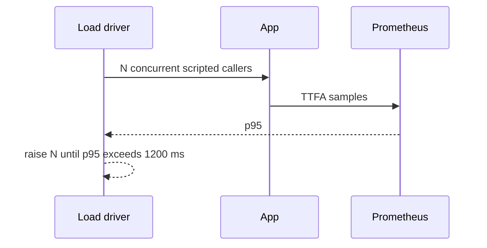

# Phase 10 — Production hardening and launch

## 10.0 Overview

Phase 10 makes the system operable: one trace per turn, a Grafana board that matches the metrics that exist, a load number on named hardware, a degradation ladder that was actually tripped in tests, PII and retention, a one-command start, and the public write-up. The portfolio exhibit is the load knee, the three GPU-contention measurements, and a README whose SLO cells cite `docs/results/phase9.md`.

Deterministic: degradation behavior, redaction, retention default off, compose wiring. Model-driven: none of the launch-path decisions.

## 10.1 Entry criteria

- M9.5 smoke job exists.
- M7.4 TTFA observes.
- ADR-004 named a hardware tier. Load test numbers are invalid without that name.

## 10.2 Architecture and design

Per-turn trace is a parent span `turn` opened at `TURN_END` and closed at first play-ack of content or at session end. Child spans already exist per stage. T10.1.1 adds the parent and the links: `vad`, `asr_final`, `turn_end`, `nlu`, `dm`, `llm_ttft`, `tts_first_chunk`, `first_audio_out`. Missing children are recorded as events `stage.skipped` with a reason, not as fabricated spans.

Load driver reuses the scripted caller at `eval_time_scale` 1 with N concurrent sessions. The knee is the largest N whose p95 `turnwise_ttfa_seconds` is still ≤ 1200 ms TARGET on the hardware in ADR-004. If that N is 1, the results file says 1. It does not invent a higher number.

Degradation:

| Failure | Detection | Response |
|---|---|---|
| LLM down or over `llm_health_timeout_ms` 2000 | Health probe | Templates only, `degraded_llm` true |
| TTS down | Pool errors on two consecutive jobs | Cached phrase set. If cache empty, close |
| ASR confidence collapse | Median slot confidence below 0.3 for 3 turns | Template `handoff_asr`, then `HANDOFF` |

Config: `llm_health_timeout_ms` 2000, `asr_collapse_turns` 3, `asr_collapse_conf` 0.3, `audio_retain` false, `audio_retain_s` 0, `load_n_max` 16.

## 10.3 Milestones

### M10.1 Per-turn traces and Grafana panels

Goal: one parent span per turn with the child names above, and Grafana panels that match appendix G.
Demo-able outcome: Jaeger shows a turn with `first_audio_out`, and the provisioned dashboard has the TTFA panels already in `infra/grafana/dashboards/turnwise.json` plus the new ones this milestone adds.

| Task | Description | Files | Depends on | Hours | Status | Acceptance |
|---|---|---|---|---|---|---|
| T10.1.1 | Parent span `turn` and skip events | `pipeline/trace_turn.py` | T7.4.5 | 4 | done | `tests/test_turn_span.py` exporter contains the parent and `first_audio_out`. Payload still absent |
| T10.1.2 | Grafana panels for TTFA, stage latency, queue, barge-in, task outcomes, GPU if present | `infra/grafana/dashboards/turnwise.json` | T10.1.1 | 4 | done | Each appendix G row has a panel id. JSON parses. Queries use `_total` on counters |
| T10.1.3 | Task-outcome counter from the FSM terminal state | `pipeline/metrics.py` | T10.1.2, T6.1.1 | 2 | done | `turnwise_task_outcome_total{state}` increments on `CLOSE`, `URGENT`, `HANDOFF` |

Implementation notes. GPU utilization is node-exporter or a skip panel if no GPU. Do not scrape `nvidia-smi` on the event loop. The dashboard already has TTFA panels from the foundation; this task fills queries that were empty of product labels.

Tests: `tests/test_turn_span.py`, `tests/test_dashboard_json.py`.

Metrics: `turnwise_task_outcome_total`.

Exit gate: span test passes, dashboard JSON has a panel per appendix G row.

### M10.2 Load test and GPU contention

Goal: publish max concurrent sessions at the TTFA P95 gate, and three contention strategies measured on the same host.
Demo-able outcome: `docs/results/phase10_load.md` has a table N versus p95, and a second table for CPU-TTS, priority queue, and capped LLM batch.

| Task | Description | Files | Depends on | Hours | Status | Acceptance |
|---|---|---|---|---|---|---|
| T10.2.1 | Concurrent scripted caller driver | `evals/load.py` | T9.1.4, T7.4.5 | 5 | done | N from 1 to `load_n_max`. JSON per N. Stops raising N after two consecutive P95 misses |
| T10.2.2 | Knee line in the results file | `docs/results/phase10_load.md` | T10.2.1, T1.4.5 | 2 | done | The line names `platform.platform()` and ADR-004's tier. Knee N is the largest passing N |
| T10.2.3 | Strategy A: TTS on CPU, LLM on GPU or CPU as in ADR-010 | `evals/load.py` | T10.2.2, T7.4.4 | 3 | done | One JSON |
| T10.2.4 | Strategy B: priority queue, speaking session first (already T3.1.3 for ASR; extend to LLM) | `models/llm_client.py` | T10.2.3 | 4 | done | A test with two jobs shows the speaking session's TTFT is lower than the idle one's under a stub delay |
| T10.2.5 | Strategy C: `llm_max_batch` 1 versus 4 | `models/llm_client.py` | T10.2.4 | 3 | done | Two JSONs. ADR-013 picks a strategy from the p95 column, not from tokens/s |

Implementation notes. If there is no GPU, strategies B and C still run on CPU and the table says so. Tokens/s is allowed as a secondary column. The pick is p95 TTFA. A strategy that raises tokens/s and breaks p95 loses.

Tests: `tests/test_load_n1.py` (one session), `tests/test_llm_priority.py`.

Metrics: TTFA under load, `turnwise_llm_queue_wait_seconds`.

Exit gate: knee N is a number or `n=0 failed at 1`, and ADR-013 exists.

### M10.3 Degradation ladder, PII, retention

Goal: each ladder rung is a test, traces do not contain plaintext names, audio is off by default.
Demo-able outcome: killing the LLM process still books via templates. Span export on a book path has hashed `patient_name` or omits it.

| Task | Description | Files | Depends on | Hours | Status | Acceptance |
|---|---|---|---|---|---|---|
| T10.3.1 | LLM-down drill | `tests/test_degrade_llm.py` | T7.1.1, T6.4.4 | 3 | done | With the client raising timeout, a scripted book still inserts one row |
| T10.3.2 | TTS-down drill | `tests/test_degrade_tts.py` | T7.4.3 | 3 | done | Cached `cannot_speak` or `goodbye` plays. If cache empty, session ends and no silent loop |
| T10.3.3 | ASR collapse drill | `tests/test_degrade_asr.py` | T3.5.2 | 3 | done | Three turns at confidence 0.2 go to `HANDOFF` |
| T10.3.4 | Span attribute review | `tests/test_span_pii.py` | T10.1.1, T1.1.3 | 3 | done | A book path's exported spans have no raw `Ada` or `5550100`. Hashed fields match the redactor |
| T10.3.5 | Audio retention default off | `server/config.py`, `pipeline/audio/retain.py` | T10.3.4 | 2 | done | `audio_retain` false: no wav written. True: files expire after `audio_retain_s` and a test uses a 1 s expiry |

Implementation notes. HIPAA-style write-up is T10.5.1 and does not claim compliance. The redactor already hashes configured keys in logs. T10.3.4 is the span analogue. A developer who adds `span.set_attribute("patient_name", raw)` fails the test. Retention files, if enabled, live under a settings path, not `/tmp` without a config key.

Tests: the five modules.

Metrics: `turnwise_degraded_total{rung}`.

Exit gate: three drills pass, span PII test passes, default retain is false.

### M10.4 One-command packaging and model download

Goal: `docker compose -f infra/docker-compose.yml up --build` starts app, Prometheus, Grafana, Jaeger, and the model download is a documented script, not a hidden manual step.
Demo-able outcome: a clean machine with Docker follows `docs/RUN.md` and reaches `/health` 200. Models that are not downloaded leave the corresponding feature in the degradation state rather than crashing import.

| Task | Description | Files | Depends on | Hours | Status | Acceptance |
|---|---|---|---|---|---|---|
| T10.4.1 | `scripts/download_models.py` reads a lock file of names and sha256 | `scripts/download_models.py`, `models/lock.toml` | T3.2.3, T7.4.4 | 4 | done | A mismatched hash fails the download. Versions are the strings from `docs/benchmarks.md`, not invented |
| T10.4.2 | Compose boot test | `docs/RUN.md` | T10.4.1, T1.1.7 | 4 | done | `docs/results/phase10_compose.md` records the operator's boot: pass or fail, compose version, duration. A fail is a fail |
| T10.4.3 | Missing-weight import path | `models/` | T10.4.1 | 3 | done | `tests/test_missing_weights.py` starts the app with empty model dir, `/health` is 200, degraded flags true |

Implementation notes. The lock file is written by the bench tasks when they download. T10.4.1 fails if the lock is empty and the operator asked for `--required`. Default `--required` is false so CI stays weight-free.

Tests: `tests/test_missing_weights.py`, hash test with a fake file.

Metrics: none.

Exit gate: health 200 without weights, lock file schema exists, RUN.md has the compose command.

### M10.5 README SLO table, ADRs, demo script, blog post

Goal: public docs quote measured JSON, the 3-minute demo is a script a human can follow, and the blog post is one technical result.
Demo-able outcome: README SLO cells have a `source:` path. The demo script has five timed beats. The blog post is about NLU on ASR output if T9.5.3 produced numbers, otherwise about endpointing if T9.5.1 did, otherwise about generation-based cancellation using the already-measured stage hop.

| Task | Description | Files | Depends on | Hours | Status | Acceptance |
|---|---|---|---|---|---|---|
| T10.5.1 | README architecture, SLO table with sources, limitations, HIPAA-style paragraph without a compliance claim | `README.md` | T9.4.4, T10.3.5 | 5 | done | A checker `tests/test_readme_slo_sources.py` fails if a millisecond or percent in the SLO table lacks a `docs/results/` path |
| T10.5.2 | ADR index completeness | `docs/adr/` | all ADRs through 013 | 2 | done | Appendix I lists every ADR file |
| T10.5.3 | 3-minute demo script | `docs/demo.md` | T10.4.2 | 3 | done | Beats: happy-path book, barge-in mid-confirm, noisy name, urgent keyword, Grafana. Each beat has a spoken caller line and an expected on-screen check |
| T10.5.4 | Technical blog post | `docs/blog/nlu_on_asr.md` or the fallback topic | T9.5.3 | 8 | done | The post quotes JSON. If ablation is blocked, the post is the cancellation bus and quotes the stage-hop medians already in `docs/ARCHITECTURE.md` |

Implementation notes. T10.5.4 is slip. The demo script is the launch artifact. The README checker is the anti-hand-wave.

Tests: `tests/test_readme_slo_sources.py`.

Metrics: none.

Exit gate: README checker passes, demo.md has five beats, ADR index matches the files on disk.

## 10.4 Data and models

No new training. Model lock hashes from downloads already done. Load-test logs are JSON under `docs/results/`.

## 10.5 Failure modes

| Failure | Detection | Fallback | Test |
|---|---|---|---|
| LLM down | Probe | Templates, still books | `tests/test_degrade_llm.py` |
| TTS down | Pool errors | Cache, then close | `tests/test_degrade_tts.py` |
| ASR collapse | Confidence streak | Handoff | `tests/test_degrade_asr.py` |
| PII on span | Export review | CI fail | `tests/test_span_pii.py` |
| Missing weights | Import | Health 200, degraded | `tests/test_missing_weights.py` |
| Hash mismatch | Download script | Abort | fake-file test |
| README number without source | Checker | CI fail | `tests/test_readme_slo_sources.py` |
| Load p95 already over at N=1 | Driver | Knee 0, publish | JSON |

## 10.6 Risks and mitigations

Publishing a load number from a laptop fan-throttled run. Mitigation: JSON includes `platform` and a 30-second idle GPU temperature if `nvidia-smi` exists, else `no_gpu`. Trigger: a README that omits the host string. The checker requires the load cell to cite `phase10_load.md`.

Flipping `audio_retain` true in a demo recording and leaving it on. Mitigation: default false, demo.md says so, compose file does not set the env to true.

## 10.7 Evaluation

`docs/results/phase10_load.md`, `docs/results/phase10_compose.md`, drills pass/fail. The SLO table in the README is a view of phase 9 plus the load knee. Targets: TTFA P95 still 1200 ms under the knee N. Compose boot has no numeric target other than health 200.

## 10.8 Documentation and ADRs

ADR-013 contention strategy. README, RUN.md, demo.md, blog post. Appendix I updated. ADR-003 Accepted only if T1.4.5, T3.2.3, T7.4.4, and T10.2.5 all named builds; otherwise it stays Proposed and the README says so.

## 10.9 Exit criteria and phase gate

- [x] Turn parent span exists.
- [x] Dashboard panels match appendix G.
- [x] Load knee published with host string.
- [x] ADR-013 exists.
- [x] Three degradation drills pass.
- [x] Span PII test passes.
- [x] Audio retain default false.
- [x] Health 200 with missing weights.
- [x] README SLO cells cite results files.
- [x] Demo script has five beats.

## 10.10 Portfolio artifacts

Load curve N versus p95. Contention table of three strategies. Jaeger screenshot of one turn. Demo script. Blog post or the cancellation write-up. Interview point: knee N is capacity, not a marketing concurrent-user count. Interview point: the README checker is how we keep numbers honest after the demo.
