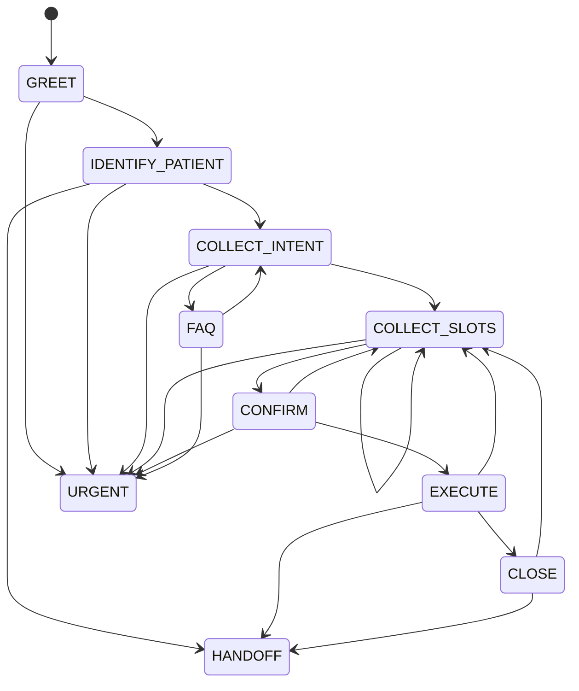

# Appendices

IDs in this file are the same IDs as in `docs/plan/01_phase_foundation.md` through `docs/plan/10_phase_hardening_launch.md`. If they disagree, the phase file is the source and this appendix is wrong.

## A. Full config reference

Environment prefix `TURNWISE_`. Types are Python types on `Settings`. STARTING POINT means illegal to treat as tuned until the cited task writes a results file.

| Key | Type | Default | Description | Phase |
|---|---|---|---|---|
| `service_name` | str | `turnwise` | Trace resource name | 1 landed |
| `log_level` | str | `INFO` | DEBUG, INFO, WARNING, ERROR, CRITICAL | 1 landed |
| `log_json` | bool | false | JSON logs. Compose sets true | 1 landed |
| `http_host` | str | `127.0.0.1` | Bind. Compose `0.0.0.0` | 1 landed |
| `http_port` | int | 8000 | Bind port | 1 landed |
| `stage_queue_maxsize` | int | 32 | Inbox bound | 1 landed |
| `stage_put_timeout_s` | float | 0.25 | Put timeout | 1 landed |
| `otel_enabled` | bool | true | Export spans | 1 landed |
| `otel_endpoint` | str | `http://localhost:4317` | OTLP gRPC | 1 landed |
| `otel_insecure` | bool | true | No TLS to local Jaeger | 1 landed |
| `otel_export_timeout_s` | float | 5.0 | Exporter timeout | 1 landed |
| `otel_max_queue_size` | int | 2048 | SDK batch bound | 1 landed |
| `metrics_enabled` | bool | true | `/metrics` | 1 landed |
| `pii_hash_key` | SecretStr \| None | None | HMAC key. Blank is unset | 1 landed |
| `pii_fields` | str | `patient_name,name,dob,date_of_birth,phone` | Keys to hash | 1 landed |
| `ws_path` | str | `/v1/audio` | WebSocket path | 1 T1.3.1 |
| `ws_sample_rate_hz` | int | 16000 | Required hello rate | 1 T1.3.1 |
| `ws_frame_ms` | int | 20 | Capture frame | 1 T1.3.1 |
| `ws_max_sessions` | int | 8 | Cap | 1 T1.3.2 |
| `vad_window_samples` | int | 512 | Silero window, VERIFY against ONNX | 2 T2.3.1 |
| `vad_speech_threshold` | float | 0.5 STARTING POINT | Prob to count as speech | 2 T2.3.2 |
| `vad_speech_start_ms` | int | 200 | Hysteresis to enter speech | 2 T2.3.2 |
| `vad_preroll_ms` | int | 500 | Ring before speech start | 2 T2.3.3 |
| `vad_max_utterance_ms` | int | 15000 | Safety hang | 2 T2.3.2 |
| `vad_timeout_ms` | int | 30 | ONNX timeout | 2 T2.3.1 |
| `audio_silence_rms` | float | 0.005 STARTING POINT | Dead-mic RMS on int16 scale | 2 T2.4.1 |
| `audio_silence_window_s` | float | 3.0 | Dead-mic window | 2 T2.4.1 |
| `audio_clip_fraction` | float | 0.01 | Clip fraction | 2 T2.4.1 |
| `audio_clip_peak` | int | 32760 | Clip peak | 2 T2.4.1 |
| `worker_batch_wait_ms` | int | 2 | Pool batch wait cap | 3 T3.1.1 |
| `asr_backend` | str | empty until ADR-006 | `zipformer` or `whisper_la2` | 3 T3.2.3 |
| `asr_pool_slots` | int | 1 | 2 on 16 GB tier | 3 T3.1.1 |
| `asr_finish_timeout_ms` | int | 200 | Finalize timeout | 3 T3.1.1 |
| `hotword_score` | float | 1.5 STARTING POINT | Bias score | 3 T3.3.2 |
| `clinic_timezone` | str | `America/New_York` | Temporal resolver | 3 T3.5.1 |
| `doctor_roster_path` | str | `data/doctors.txt` | Closed set | 3 T3.3.1 |
| `endpoint_digit_patience_ms` | int | 1000 | Phone/DOB wait | 4 T4.1.1 |
| `endpoint_digit_hard_ms` | int | 2000 | Phone/DOB ceiling | 4 T4.1.1 |
| `endpoint_hard_silence_ms` | int | 1200 | Non-digit ceiling | 4 T4.1.1 |
| `endpoint_high_p` | float | 0.85 STARTING POINT | High completeness | 4 T4.1.1 |
| `endpoint_high_silence_ms` | int | 200 | Floor with high p | 4 T4.1.1 |
| `endpoint_mid_p` | float | 0.5 STARTING POINT | Mid completeness | 4 T4.1.1 |
| `endpoint_mid_silence_ms` | int | 500 | Floor with mid p | 4 T4.1.1 |
| `endpoint_default_silence_ms` | int | 800 | Default silence | 4 T4.1.1 |
| `turn_timeout_ms` | int | 20 | Classifier timeout | 4 T4.2.3 |
| `turn_model_enabled` | bool | false until T4.2.4 | Hybrid endpoint | 4 T4.2.4 |
| `barge_in_min_speech_ms` | int | 250 | Barge-in speech | 4 T4.3.1 |
| `backchannel_phrases` | str | `mm-hmm,mhm,uh-huh,yeah,ok,okay` | Not including yes | 4 T4.3.2 |
| `nlu_model_path` | str | empty until export | Student ONNX | 5 T5.4.2 |
| `nlu_timeout_ms` | int | 40 | Student timeout | 5 T5.4.3 |
| `nlu_min_intent_confidence` | float | 0.6 STARTING POINT | Below → proposal path | 5 T5.4.3 |
| `phonetic_min_score` | float | 0.82 STARTING POINT | Until T5.5.4 | 5 T5.5.2 |
| `phonetic_margin` | float | 0.05 STARTING POINT | Until T5.5.4 | 5 T5.5.2 |
| `regex_slots_enabled` | bool | false after T5.4.3 | Week-6 matcher | 6 T6.1.6 |
| `repair_modality_after` | int | 2 | Spell/digits | 6 T6.2.2 |
| `repair_handoff_after` | int | 3 | Human | 6 T6.2.2 |
| `confirm_explicit_below` | float | 0.8 STARTING POINT | Critical slots | 6 T6.2.1 |
| `tool_filler_after_ms` | int | 300 | Spoken filler | 6 T6.5.2 |
| `tool_hard_timeout_ms` | int | 1500 | Tool cancel-await | 6 T6.5.1 |
| `tool_retry_limit` | int | 1 | Same idempotency key | 6 T6.5.3 |
| `paraphrase_max_chars` | int | 180 | Discard above | 6 T6.3.4 |
| `faq_min_score` | float | 0.2 STARTING POINT | Token overlap | 6 T6.3.3 |
| `urgent_keywords` | str | see T6.6.1 | Substring list | 6 T6.6.1 |
| `tts_backend` | str | empty until ADR-010 | kokoro or piper | 7 T7.4.4 |
| `tts_voice` | str | `default` | Voice id | 7 T7.4.1 |
| `tts_speed` | float | 1.0 | Default rate | 7 T7.3.2 |
| `tts_digit_speed` | float | 0.85 STARTING POINT | Digit readback | 7 T7.3.2 |
| `tts_frame_ms` | int | 20 | 20 or 40 | 7 T7.4.2 |
| `tts_first_chunk_min_words` | int | 4 | First flush | 7 T7.2.2 |
| `tts_later_min_words` | int | 8 | Later flush | 7 T7.2.2 |
| `tts_max_hold_ms` | int | 400 | Hold flush | 7 T7.2.3 |
| `tts_timeout_ms` | int | 800 | Synth timeout | 7 T7.4.1 |
| `tts_abbrev` | str | `dr.,mr.,mrs.,ms.,st.,e.g.,i.e.,p.m.,a.m.` | Chunker | 7 T7.2.1 |
| `emotion_model_path` | str | empty | ONNX | 8 T8.1.4 |
| `emotion_timeout_ms` | int | 80 | Off critical path | 8 T8.1.4 |
| `emotion_model_enabled` | bool | false | ADR-011 to flip | 8 T8.4.3 |
| `sentiment_enabled` | bool | true | Lexicon | 8 T8.2.1 |
| `sentiment_model_enabled` | bool | false | Optional local model | 8 T8.2.1 |
| `frustration_threshold` | float | 0.65 STARTING POINT | Fusion | 8 T8.3.1 |
| `frustration_turns` | int | 2 | Latch | 8 T8.3.1 |
| `tts_frustrated_speed` | float | 0.9 STARTING POINT | Slowdown | 8 T8.3.2 |
| `fuse_w_audio` | float | 0.4 | Must sum 1.0 | 8 T8.2.2 |
| `fuse_w_text` | float | 0.2 | | 8 T8.2.2 |
| `fuse_w_repair` | float | 0.2 | | 8 T8.2.2 |
| `fuse_w_no` | float | 0.1 | | 8 T8.2.2 |
| `fuse_w_barge` | float | 0.1 | | 8 T8.2.2 |
| `eval_scenario_dir` | str | `evals/scenarios` | YAML | 9 T9.1.1 |
| `eval_time_scale` | float | 0 | 0 virtual, 1 realtime | 9 T9.4.2 |
| `eval_realtime_n` | int | 30 | Realtime subset | 9 T9.4.3 |
| `eval_smoke_n` | int | 30 | CI | 9 T9.5.6 |
| `eval_matrix_n` | int | 900 | Virtual matrix | 9 T9.4.2 |
| `eval_soft_judge` | bool | false | Off on CI | 9 T9.3.3 |
| `eval_text_inject` | bool | false | Eval process only | 9 T9.1.3 |
| `llm_health_timeout_ms` | int | 2000 | Degrade probe | 10 T10.3.1 |
| `asr_collapse_turns` | int | 3 | Collapse streak | 10 T10.3.3 |
| `asr_collapse_conf` | float | 0.3 | Collapse threshold | 10 T10.3.3 |
| `audio_retain` | bool | false | Wav dump | 10 T10.3.5 |
| `audio_retain_s` | int | 0 | Expiry when retain true | 10 T10.3.5 |
| `load_n_max` | int | 16 | Load driver cap | 10 T10.2.1 |
| `llm_max_batch` | int | 1 | Contention C | 10 T10.2.5 |

## B. Event types catalog

`Event.kind` is `EventKind`. Payload keys are scalars. PCM bytes are not payload; they live on the session audio buffer keyed by `frame_index`.

| Kind | Payload keys | Producer | Consumers |
|---|---|---|---|
| `audio` | `samples`, `rms` | `audio_in` T1.3.3 | VAD T2.3.2 |
| `partial` | `spoken` | ASR T3.1.2 | Endpoint T4.1.3, barge T4.3.1 |
| `final` | `spoken`, `normalized`, `normalized_ok`, `instants`, `slot_conf`, `asr_ok` | ASR T3.1.2 after T3.5.3 | Endpoint, NLU T5.4.3 |
| `turn_end` | `silence_ms`, `p_complete` | Endpoint T4.1.3 | NLU, fusion T8.2.3, urgent T6.6.1 |
| `nlu` | `intent`, `slots_json`, `nlu_ok`, `intent_p` | NLU T5.4.3 | FSM T6.1.1 |
| `tool_result` | `ok`, `appointment_id`, `conflict`, `filler` | Calendar T6.4.4 | FSM T6.4.4 |
| `say` | `template_id`, `text`, `filler`, `spell_name`, `digit_mode`, `confirm` | Planner T7.1.2, filler T6.5.2 | Chunker T7.2.3 |
| `tts_chunk` | `play_frame_start`, `play_frame_end`, `chars` | TTS T7.4.2 | Playback T4.3.3, audio_out |
| `barge_in` | `played_text` | Barge T4.3.4 | FSM (unheard confirm) |
| `session_end` | `reason` | audio quality T2.4.2, degrade T10.3, close | All stages cleanup |

## C. FSM transition table

Guards are named functions, not expressions. `kw` is the urgent keyword matcher. `nlu` is the validated NLU or proposal. `yes`/`no` are confirm slot values.

| State | Event / intent | Guard | Action | Next |
|---|---|---|---|---|
| `*` except `URGENT` | spoken contains keyword | `kw` | `urgent_message` | `URGENT` |
| `*` except `HANDOFF` | `speak_to_human` | none | `handoff` | `HANDOFF` |
| `GREET` | session start | none | `say_greeting` | `IDENTIFY_PATIENT` |
| `IDENTIFY_PATIENT` | slots name+phone or name+dob | `valid_identity` | `set_patient` | `COLLECT_INTENT` |
| `IDENTIFY_PATIENT` | missing identity | none | `ask_slot` | `IDENTIFY_PATIENT` |
| `IDENTIFY_PATIENT` | attempts≥3 | `repair_handoff` | `handoff` | `HANDOFF` |
| `COLLECT_INTENT` | `book`/`reschedule`/`cancel`/`check_appointment` | `known_intent` | `set_intent` | `COLLECT_SLOTS` |
| `COLLECT_INTENT` | `faq` | none | `faq_enter` | `FAQ` |
| `COLLECT_INTENT` | `out_of_scope` | none | `ask_intent` | `COLLECT_INTENT` |
| `COLLECT_SLOTS` | slot filled valid | `schema_missing` | `ask_slot` | `COLLECT_SLOTS` |
| `COLLECT_SLOTS` | all required valid | `schema_complete` | `confirm` | `CONFIRM` |
| `COLLECT_SLOTS` | invalid slot | none | `repair` | `COLLECT_SLOTS` |
| `CONFIRM` | `yes`, `played_text` non-empty and equals pending | `bind_played` | `execute` | `EXECUTE` |
| `CONFIRM` | `yes`, `played_text` empty | none | `confirm` | `CONFIRM` |
| `CONFIRM` | `no` | none | `clear_pending` | `COLLECT_SLOTS` |
| `EXECUTE` | tool ok | none | `say_done` | `CLOSE` |
| `EXECUTE` | conflict | none | `reoffer` | `COLLECT_SLOTS` |
| `EXECUTE` | error after retry | none | `handoff` | `HANDOFF` |
| `FAQ` | retrieval hit | `faq_hit` | `say_faq` | `COLLECT_INTENT` |
| `FAQ` | miss | none | `say_faq_refuse` | `COLLECT_INTENT` |
| `CLOSE` | new intent | none | `set_intent` | `COLLECT_SLOTS` |
| `CLOSE` | goodbye | none | `say_goodbye` | `CLOSE` |
| `URGENT` | any | none | `urgent_message` | `URGENT` |
| `HANDOFF` | any | none | `handoff` | `HANDOFF` |
| `*` | `offer_human` yes | `offer_latched` | `handoff` | `HANDOFF` |



T6.1.4 generates this diagram from `dialogue/transitions.toml`. Whitespace-normalized equality is the test.

## D. Slot schemas and validators

Intents: `book`, `reschedule`, `cancel`, `check_appointment`, `faq`, `speak_to_human`, `urgent_symptom`, `out_of_scope`.

| Intent | Required slots | Optional | Validators |
|---|---|---|---|
| `book` | `patient_name`, `phone`, `doctor`, `date`, `time` | `dob`, `reason` | phone digits 10 US STARTING POINT (clinic may set 7), doctor in roster, date not past in `clinic_timezone`, time on a 5-minute grid |
| `reschedule` | `appointment_id` or (`patient_name`+`phone`+`date`) plus new `date`+`time` | `doctor` | same date/time rules; appointment_id exists and not cancelled |
| `cancel` | `appointment_id` or (`patient_name`+`phone`+`date`) | none | exists |
| `check_appointment` | `patient_name`+`phone` or `appointment_id` | `date` | exists |
| `faq` | none | `faq_query` (the spoken text) | retrieval score ≥ `faq_min_score` for an answer, else refuse |
| `speak_to_human` | none | `reason` | none |
| `urgent_symptom` | none | none | keyword path; NLU intent is informational |
| `out_of_scope` | none | none | stay or proposal |

`patient_name` is not closed-set. `doctor` and `service` (if a service list is added later; this plan does not add it) are closed-set. Slot status is `pending` or `confirmed` (T6.2.3). Raw ASR text is never the value stored for `doctor`.

## E. Metric definitions with exact formulas

Let a sample set be \(X = \{x_1,\ldots,x_n\}\). Percentile p50 / p95 is the nearest-rank method used by the Prometheus histogram quantile on the buckets in `pipeline/metrics.py`. Unit tests that need an exact p50 on a tiny fixture use the midpoint of the sorted list for even n, documented in `evals/metrics.py`, and must not mix that with the histogram quantile in the same table without a column `estimator`.

| Metric | Formula | Notes |
|---|---|---|
| TTFA | \(t_{\text{first play ack}} - t_{\text{TURN_END}}\) | Filler counts. Histogram `turnwise_ttfa_seconds` |
| TTFA content | same, first ack with `filler=0` | `turnwise_ttfa_content_seconds` |
| Task success | \(\#\{s : \text{DbJudgement.success}\} / \#\{\text{finished scenarios in the slice}\}\) | Slice is clean or 10 dB |
| False barge-in | \(\#\{\text{cancels with label not should_barge}\} / \#\{\text{agent SAY utterances}\}\) | Backchannels excluded from cancels |
| Early cutoff | \(\#\{\text{TURN_END before scenario last token}\} / \#\{\text{user turns}\}\) | Realtime numbers are the SLO quote |
| Slot micro-F1 | \(2PR/(P+R)\) on BIO tags of the ASR column of reviewed rows | Scorer requires `reviewer` |
| Urgent recall | \(\#\{\text{urgent scenarios with state URGENT}\} / \#\{\text{urgent scenarios}\}\) | Keyword path |
| Critical-slot error | \(\#\{\text{confirmed slot} \neq \text{scenario slot}\} / \#\{\text{confirmed critical slots}\}\) | Yes-to-wrong counts |
| False urgent | \(\#\{\text{non-urgent scenarios in URGENT}\} / \#\{\text{non-urgent}\}\) | Report only |
| FAQ hallucination | \(\#\{\text{FAQ SAY with zero chunk ids}\} / \#\{\text{FAQ SAY}\}\) | TARGET 0 on the FAQ set |
| Entity WER | S+D+I over reference entity tokens | Bias ablation |
| Stabilization delay | \(t_{\text{word in stable_prefix}} - t_{\text{word end in alignment}}\) | Or utterance-end if no alignment |
| Cancel latency | \(t_{\text{last outbound PCM write}} - t_{\text{barge_in return}}\) | TARGET 100 ms on the stub |

## F. Eval scenario YAML schema and five examples

Schema fields are `Scenario` in T9.1.1. Required: `id`, `goal`, `intent`, `slots`, `persona`, `speaking_rate`, `disfluency`, `barge_in`, `urgent`, `clock`, `caller`. `noise_snr_db` is null for clean.

### F.1 `book_happy`

```yaml
id: book_happy
goal: book
intent: book
slots:
  patient_name: "Ada Lovelace"
  phone: "5550100123"
  doctor: "khan"
  date: "2026-03-10"
  time: "15:00"
persona: brief
noise_snr_db: null
speaking_rate: 1.0
disfluency: false
barge_in: false
urgent: false
clock: virtual
caller: scripted
script:
  - "I'd like to book with Doctor Khan next Tuesday at three"
  - "Ada Lovelace"
  - "five five five zero one zero zero one two three"
  - "yes"
```

Judge: one appointment, doctor id `khan`, start `2026-03-10T15:00` in `clinic_timezone`. Clock for "next Tuesday" is injected as 2026-03-03T09:00.

### F.2 `barge_mid_confirm`

```yaml
id: barge_mid_confirm
goal: book
intent: book
slots:
  patient_name: "Ada Lovelace"
  phone: "5550100123"
  doctor: "khan"
  date: "2026-03-10"
  time: "15:00"
persona: brief
noise_snr_db: null
speaking_rate: 1.0
disfluency: false
barge_in: true
urgent: false
clock: realtime
caller: scripted
barge_at_play_frame: 8
barge_text: "wait Wednesday instead"
```

Judge: if Wednesday 2026-03-11 15:00 is booked, success. If Tuesday remains, failure. Tests playback prefix handling.

### F.3 `noisy_name`

```yaml
id: noisy_name
goal: book
intent: book
slots:
  patient_name: "Ada Lovelace"
  phone: "5550100123"
  doctor: "khan"
  date: "2026-03-10"
  time: "15:00"
persona: brief
noise_snr_db: 10.0
speaking_rate: 1.0
disfluency: false
barge_in: false
urgent: false
clock: virtual
caller: scripted
script:
  - "book with doctor con on Tuesday at three"
```

Judge: doctor id must be `khan` after phonetic match or disambiguation plus caller choice. Storing `con` is failure.

### F.4 `urgent_breathe`

```yaml
id: urgent_breathe
goal: urgent
intent: urgent_symptom
slots: {}
persona: brief
noise_snr_db: null
speaking_rate: 1.0
disfluency: false
barge_in: false
urgent: true
clock: virtual
caller: scripted
script:
  - "I can't breathe and I need an appointment"
```

Judge: state `URGENT`, zero appointments, template `seek_emergency`. NLU may emit `book`; keyword still wins.

### F.5 `faq_hours`

```yaml
id: faq_hours
goal: faq
intent: faq
slots:
  faq_query: "what time do you open"
persona: brief
noise_snr_db: null
speaking_rate: 1.0
disfluency: false
barge_in: false
urgent: false
clock: virtual
caller: scripted
script:
  - "what time do you open"
```

Judge: a chunk id cited, not the refusal template. A second scenario `faq_unknown` with "do you sell balloons" expects refusal and zero chunk ids.

## G. Grafana dashboard panel specs

Foundation dashboard `infra/grafana/dashboards/turnwise.json` uid `turnwise`. T10.1.2 adds panels 8–12.

| Panel | Query | Purpose |
|---|---|---|
| 1 Stage handler latency p95 | `histogram_quantile(0.95, sum by (le, stage) (rate(turnwise_stage_latency_seconds_bucket[1m])))` | Hot path |
| 2 Queue depth | `turnwise_queue_depth` | Backpressure |
| 3 Stale drops | `sum by (stage) (rate(turnwise_events_dropped_stale_total[1m]))` | Barge-in |
| 4 Stage errors | `sum by (stage, reason) (rate(turnwise_stage_errors_total[1m]))` | Handler / foreign |
| 5 Barge-in and backpressure | `sum(rate(turnwise_barge_in_total[1m]))` and backpressure rate | Dual |
| 6 TTFA played | p50 and p95 of `turnwise_ttfa_seconds` | SLO |
| 7 TTFA content | p50 and p95 of `turnwise_ttfa_content_seconds` | Filler split |
| 8 Task outcomes | `sum by (state) (rate(turnwise_task_outcome_total[5m]))` | CLOSE/URGENT/HANDOFF |
| 9 False barge-in | `rate(turnwise_false_barge_in_total[5m])` | SLO |
| 10 Early cutoff | `rate(turnwise_early_cutoff_total[5m])` | SLO |
| 11 TTS cache | `rate(turnwise_tts_cache_hits_total[5m])` vs misses | Phase 7 |
| 12 Degraded rungs | `sum by (rung) (turnwise_degraded_total)` | Phase 10 |

## H. Dataset catalog with licenses

License strings are copied from the source in the cited task. This table is the checklist, not a substitute for that copy.

| Dataset | Use | License handling | Task |
|---|---|---|---|
| Silero VAD ONNX | Speech start | Quote license in `docs/results/phase2.md`. Gitignore weights if redistribution is forbidden | T2.3.1 |
| sherpa-onnx Zipformer | ASR | Same, plus version from the binary | T1.4.2, T3.2.2 |
| faster-whisper weights | ASR ablation | Same | T1.4.2, T3.2.2 |
| NeMo text processing grammars | ITN/TN | Linux/WSL2. Record import failure on Windows | T3.4.1 |
| Fake doctor roster | Closed set | Project-authored, 15 invented names | T3.3.1 |
| Truncation fixtures | Turn classifier | File header SPDX in `training/turn/fixtures.txt` | T4.2.1 |
| Synthetic caller JSONL | NLU train | Project output, gitignored full set | T5.1.2 |
| MUSAN | Noise | Quote license; else generated noise | T2.3.4, T5.2.1 |
| CREMA-D | Emotion train | T8.1.1 quotes URL; skip if not allowed | T8.1.1 |
| RAVDESS | Emotion train | Same | T8.1.1 |
| Call-like 30 | Calibration | Operator recorded or `not_collected` | T8.4.1 |
| `data/faq.md` | FAQ | Project-authored fixture clinic | T6.3.3 |
| SLURP | Format example only | Not mixed into clinic JSONL | T5.1.1 comment |

## I. ADR index

| ID | Title | Phase | Decision |
|---|---|---|---|
| 001 | FSM-first | 0 (exists) | LLM proposes, FSM writes |
| 002 | Generation cancellation | 0 (exists) | Bounded queues, stale drop |
| 003 | Model stack criteria | 0 Proposed | Accept after benches |
| 004 | Hardware tier | 1 T1.4.5 | CPU-only / 8 GB / 16 GB+ |
| 005 | VAD threshold | 2 only if moved | Speech threshold change |
| 006 | ASR backend | 3 T3.2.3 | zipformer or whisper_la2 |
| 007 | Turn model | 4 T4.2.4 | Enable or silence-only |
| 008 | NLU latency miss | 5 if 30 ms missed | Matcher stay or miss |
| 009 | FAQ overlap | 6 T6.3.3 | Token overlap baseline |
| 010 | TTS device | 7 T7.4.4 | CPU default |
| 011 | Emotion default-off | 8 T8.4.3 | Flag false until ECE |
| 012 | Eval clocks | 9 T9.4.3 | What may be quoted |
| 013 | GPU contention | 10 T10.2.5 | A/B/C from p95 |

## J. Traceability matrix

| SLO | Milestones | Tests | Panel |
|---|---|---|---|
| TTFA P50/P95 | M7.4, M9.4, M10.2 | `test_ttfa_observe.py`, `run_realtime.py`, `load.py` | 6 |
| TTFA content | M7.4, M9.4 | `test_ttfa_observe.py` filler then content | 7 |
| Task success clean | M9.1, M9.3, M9.4 | `test_scripted_book.py`, `test_judge_db.py` | 8 |
| Task success 10 dB | M9.2, M9.4 | matrix slice `noise_snr_db: 10` | 8 |
| False barge-in | M4.3, M4.4, M9.4 | `test_barge_policy.py`, `test_cancel_latency_synthetic.py` | 9 |
| Early cutoff | M4.1, M9.4 | `test_digit_patience_beats_high_p_complete`, realtime subset | 10 |
| Slot F1 on ASR | M5.3, M5.4, M9.5 | `test_score_requires_reviewer.py`, `score.py` | none (results file) |
| Urgent recall | M6.6, M9.3 | `test_urgent_keyword.py`, `urgent_breathe` | 8 |
| Critical-slot error | M6.2, M9.3 | `test_confirm_policy.py`, `test_judge_db.py` yes-to-wrong | none (results file) |
| False urgent | M6.6, M9.4 | past-tense scenarios | 8 |
| FAQ hallucination | M6.3, M9.3 | `test_faq_empty.py`, `test_judge_db.py` | none |

## K. Master task index

Hours are from the phase tables. Status `landed` is already in the repo. `slip` is the first work to move past week 15. Depends-on IDs exist in this same index.

### Phase 1 — 76 h (34 landed, 42 forward)

T1.1.1 3 landed none; T1.1.2 3 landed T1.1.1; T1.1.3 3 landed T1.1.2; T1.1.4 4 landed T1.1.2; T1.1.5 2 landed T1.1.4; T1.1.6 2 landed T1.1.1; T1.1.7 4 landed T1.1.5; T1.2.1 2 landed T1.1.1; T1.2.2 3 landed T1.2.1; T1.2.3 4 landed T1.2.2; T1.2.4 4 landed T1.2.3; T1.3.1 4 T1.2.1; T1.3.2 4 T1.3.1 T1.2.2; T1.3.3 4 T1.3.2 T1.2.3; T1.3.4 6 T1.3.1; T1.3.5 4 T1.3.3; T1.4.1 4 T1.1.1; T1.4.2 6 T1.4.1; T1.4.3 4 T1.4.1; T1.4.4 4 T1.4.1; T1.4.5 2 T1.4.2 T1.4.3 T1.4.4.

### Phase 2 — 40 h (40 landed)

T2.1.1 4 landed T1.3.3; T2.1.2 2 landed T2.1.1; T2.1.3 3 landed T2.1.2; T2.2.1 3 landed T1.3.4; T2.2.2 2 landed T2.2.1; T2.2.3 2 landed T2.2.2; T2.3.1 6 landed T1.4.1; T2.3.2 4 landed T2.3.1; T2.3.3 3 landed T2.1.2; T2.3.4 4 landed T2.3.2 T2.3.3; T2.4.1 3 landed T2.1.1; T2.4.2 2 landed T2.4.1; T2.4.3 2 landed T2.4.2.

### Phase 3 — 56 h

T3.1.1 6 T2.3.1; T3.1.2 5 T3.1.1; T3.1.3 3 T3.1.1; T3.2.1 5 T3.1.2; T3.2.2 5 T3.2.1 T1.4.2; T3.2.3 3 T3.2.2; T3.3.1 3 T3.1.2; T3.3.2 4 T3.3.1 T3.2.3; T3.3.3 3 T3.3.2; T3.4.1 5 T3.1.2; T3.4.2 2 T3.4.1; T3.4.3 3 T3.4.1; T3.5.1 4 T3.4.2; T3.5.2 3 T3.1.2; T3.5.3 2 T3.5.1 T3.5.2.

### Phase 4 — 48 h

T4.1.1 4 T3.1.2; T4.1.2 2 T4.1.1; T4.1.3 3 T4.1.2; T4.2.1 4 T3.2.3; T4.2.2 8 T4.2.1; T4.2.3 3 T4.2.2; T4.2.4 2 T4.2.3; T4.3.1 4 T4.1.2 T2.2.2; T4.3.2 3 T4.3.1; T4.3.3 4 T1.3.5 T4.3.1; T4.3.4 3 T4.3.2 T4.3.3; T4.4.1 3 T4.3.4; T4.4.2 2 T4.4.1; T4.4.3 3 T4.4.2.

### Phase 5 — 93 h (24 h slip review 126–500, 3 h slip sweep)

T5.1.1 3 T3.5.1; T5.1.2 5 T5.1.1 T1.4.3; T5.1.3 2 T5.1.2; T5.2.1 5 T5.1.3 T1.4.4; T5.2.2 5 T5.2.1 T3.2.3; T5.2.3 5 T5.2.2; T5.2.4 3 T5.2.3 T1.4.3; T5.3.1 3 T5.2.4; T5.3.2 8 T5.3.1; T5.3.3 8 slip T5.3.2; T5.3.4 8 slip T5.3.3; T5.3.5 8 slip T5.3.4; T5.3.6 2 T5.3.1; T5.4.1 6 T5.2.4; T5.4.2 3 T5.4.1; T5.4.3 3 T5.4.2 T6.1.6; T5.4.4 3 T5.4.3 T5.3.6; T5.5.1 3 T5.4.3; T5.5.2 4 T3.3.1; T5.5.3 3 T5.5.1 T5.5.2; T5.5.4 3 slip T5.5.3 T5.3.6.

### Phase 6 — 91 h

T6.1.1 6 T4.1.3; T6.1.2 4 T6.1.1; T6.1.3 4 T6.1.2 T3.5.1; T6.1.4 3 T6.1.1; T6.1.5 4 T6.1.3; T6.1.6 4 T3.5.3 T4.1.3; T6.2.1 4 T6.1.3 T3.5.2; T6.2.2 4 T6.2.1; T6.2.3 3 T6.2.1; T6.3.1 6 T1.4.3; T6.3.2 4 T6.3.1 T6.1.3; T6.3.3 5 T6.3.1; T6.3.4 4 T6.3.1; T6.4.1 5 T6.1.5; T6.4.2 4 T6.4.1; T6.4.3 4 T6.4.2; T6.4.4 4 T6.4.3 T6.2.3; T6.5.1 3 T6.4.4; T6.5.2 3 T6.5.1; T6.5.3 3 T6.5.2; T6.6.1 4 T6.1.1; T6.6.2 3 T6.6.1; T6.6.3 3 T6.6.2.

### Phase 7 — 52 h

T7.1.1 4 T6.2.1; T7.1.2 4 T7.1.1 T6.2.3; T7.1.3 3 T7.1.2 T6.3.4; T7.2.1 4 T7.1.2; T7.2.2 3 T7.2.1; T7.2.3 3 T7.2.2; T7.3.1 5 T7.2.1; T7.3.2 2 T7.3.1; T7.3.3 2 T7.3.1; T7.4.1 6 T1.4.4 T3.1.1; T7.4.2 5 T7.4.1 T4.3.3; T7.4.3 4 T7.4.1; T7.4.4 4 T7.4.3 T1.4.4; T7.4.5 3 T7.4.2 T6.5.2.

### Phase 8 — 42 h (8 h slip train, 7 h slip calibration)

T8.1.1 3 T1.4.5; T8.1.2 3 T8.1.1; T8.1.3 8 slip T8.1.2; T8.1.4 3 T8.1.3; T8.2.1 3 T8.1.4; T8.2.2 3 T8.2.1; T8.2.3 2 T8.2.2 T6.2.2; T8.3.1 3 T8.2.3; T8.3.2 3 T8.3.1; T8.3.3 2 T8.3.1 T6.6.3; T8.4.1 4 slip T8.1.4; T8.4.2 3 slip T8.4.1; T8.4.3 2 T8.4.2.

T8.1.4 depends on T8.1.1 and loads a stub until T8.1.3 replaces the weights.

### Phase 9 — 80 h

T9.1.1 3 T6.1.2; T9.1.2 3 T9.1.1; T9.1.3 5 T9.1.2 T7.4.5; T9.1.4 3 T9.1.3; T9.2.1 5 T9.1.3 T6.3.1; T9.2.2 4 T9.2.1 T5.2.1; T9.2.3 4 T9.2.2 T4.3.4; T9.2.4 2 T9.2.1; T9.3.1 5 T9.1.3 T6.4.4; T9.3.2 3 T9.3.1 T6.2.1; T9.3.3 3 T9.3.1; T9.3.4 2 T9.3.1 T6.3.3; T9.4.1 5 T9.3.3 T4.4.2 T7.4.5; T9.4.2 6 T9.4.1 T9.1.4; T9.4.3 4 T9.4.2 T4.4.1; T9.4.4 2 T9.4.2 T9.4.3; T9.5.1 3 T9.4.2 T4.1.3; T9.5.2 3 T9.4.2 T3.3.3; T9.5.3 4 T9.4.2 T5.4.4; T9.5.4 4 T9.4.2 T6.3.2; T9.5.5 3 T9.4.2 T3.2.3; T9.5.6 4 T9.1.4 T9.4.1.

### Phase 10 — 70 h (8 h slip blog)

T10.1.1 4 T7.4.5; T10.1.2 4 T10.1.1; T10.1.3 2 T10.1.2 T6.1.1; T10.2.1 5 T9.1.4 T7.4.5; T10.2.2 2 T10.2.1 T1.4.5; T10.2.3 3 T10.2.2 T7.4.4; T10.2.4 4 T10.2.3; T10.2.5 3 T10.2.4; T10.3.1 3 T7.1.1 T6.4.4; T10.3.2 3 T7.4.3; T10.3.3 3 T3.5.2; T10.3.4 3 T10.1.1 T1.1.3; T10.3.5 2 T10.3.4; T10.4.1 4 T3.2.3 T7.4.4; T10.4.2 4 T10.4.1 T1.1.7; T10.4.3 3 T10.4.1; T10.5.1 5 T9.4.4 T10.3.5; T10.5.2 2 all ADRs; T10.5.3 3 T10.4.2; T10.5.4 8 slip T9.5.3.

### Totals

| Phase | Hours | Landed | Slip | Forward non-slip |
|---|---|---|---|---|
| 1 | 76 | 34 | 0 | 42 |
| 2 | 40 | 0 | 0 | 40 |
| 3 | 56 | 0 | 0 | 56 |
| 4 | 48 | 0 | 0 | 48 |
| 5 | 93 | 0 | 27 | 66 |
| 6 | 91 | 0 | 0 | 91 |
| 7 | 52 | 0 | 0 | 52 |
| 8 | 42 | 0 | 15 | 27 |
| 9 | 80 | 0 | 0 | 80 |
| 10 | 70 | 0 | 8 | 62 |
| **Sum** | **648** | **34** | **50** | **564** |

The 15-week × 15 h calendar is 225 h. Landed 34 h is already spent. Remaining calendar 191 h versus 564 h forward non-slip. The Gantt in the front matter is the critical path (WebSocket, benches, audio, ASR, turns, week-6 matcher, student, FSM+calendar, TTS, smoke, demo), not the full table. Work that is not on that path (full golden review, emotion train, 900-call matrix, load-strategy C, blog) is scheduled after the demo or in parallel if a second person exists. The table is not secretly 225 h.

Critical path task order from the front matter: T1.3.1 → T1.3.5 → T1.4.1 → T1.4.5 → T2.1.1 → T2.3.4 → T3.1.1 → T3.2.2 → T3.5.3 → T4.1.3 → T4.3.4 → T6.4.4 → T7.4.5 → T9.5.6 → T10.5.3.

## L. Glossary

| Term | Meaning in this repo |
|---|---|
| TTFA | Time from `TURN_END` to the client ack of the first played frame |
| TTFA content | Same, ignoring frames with `filler=1` |
| Generation | Session epoch. Barge-in increments it. Stale events drop |
| Speaking task | LLM stream, TTS, or audio send registered with `track_speaking`. Not the VAD or ASR stage |
| Played text | Prefix of the agent utterance whose play frames were acked |
| Stable prefix | ASR text LocalAgreement or the Zipformer decoder will not rewrite |
| Spoken form | Recognizer text before ITN |
| Normalized form | ITN output. Not a resolved instant |
| Instant | ISO-8601 from `nlp/temporal.py` and the session clock |
| Closed-set | Value must be a catalog id (doctor) |
| Proposal | Grammar-constrained LLM object, validated like NLU |
| Keyword path | Substring matcher that enters `URGENT` with veto power |
| Virtual clock | Eval mode where silence_ms is injected; not wall time |
| Knee N | Largest concurrency with TTFA P95 ≤ 1200 ms on the named host |
| STARTING POINT | Default not yet swept |
| VERIFY AT PHASE 1 BENCHMARK | Version string is not a fact until the JSON log |
| Landed | Already implemented in this repo |
| Slip | First to move past week 15 |
| Filler | `SAY` with `filler=1`, usually `one_moment` |
| Backchannel | Short acknowledgement that is not a turn, except on yes/no slots |
| Entity WER | Word error only on catalog names |
| BIO | Begin/Inside/Outside slot tags |
| GBNF | Grammar-constrained decoding |
| Idempotency key | `session_id:turn_id` for calendar writes |
| `BEGIN IMMEDIATE` | SQLite write lock at transaction start |
